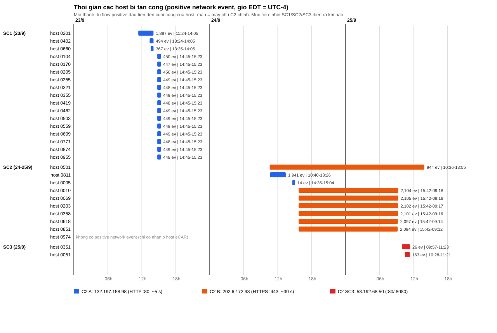

# STEP 11 — Mô tả chi tiết dataset DARPA OpTC (host + network, scenario, host nào thuộc scenario nào)

> Mục đích: một tài liệu duy nhất để hiểu **dữ liệu gồm những gì, sinh ra thế nào, có mấy scenario, ngày nào, bao nhiêu host, host nào thuộc scenario nào**.
> Nguồn: bài báo *A New Hope for DARPA OpTC* (bản PDF trong `D:\UIT\KLTN\Papers`), bài *Analyzing the Usefulness of the DARPA OpTC Dataset* (Anjum et al.), README của dataset gốc, slide CSET 2025 của bài báo, và các artifact đã có của nhóm (inventory raw, manifest host, joined network). **Chưa cần đọc lại ổ E:**; số liệu nào chỉ có thể kiểm bằng ổ E: được nêu ở §10.
> Script tái lập: `01_code/pipeline/11_dataset_profile.py`, `11_make_timeline_svg.py`. Bảng chi tiết (CSV): cùng thư mục này.

---

## 0. Tóm tắt một trang

| Mục | Nội dung |
|---|---|
| Dataset | **DARPA OpTC** (Operationally Transparent Cyber): mạng doanh nghiệp giả lập, 1000 máy Windows 10 + 1 Domain Controller (`DC1`), có cả log **host** (eCAR) lẫn log **mạng** (Bro/Zeek). |
| Thời gian | **16 → 25/9/2019** (10 ngày lịch). Benign: 16–22/9. Có tấn công: **23, 24, 25/9** (mỗi ngày một kịch bản APT). |
| Phần của nhóm | 8,865 file raw, **951.4 GB** nén, trên ổ E:. Gồm 625 host có log host, 4,695 file host-ngày, 3,954 file Bro, 156 file eCAR-Bro. |
| Dữ liệu mạng dùng cho DL | Bro `conn` ghép với eCAR-Bro bằng `bro_uid`: **92,045,755 flow** của **743 host**, trong đó **620 host** dùng để train (85.6M flow), **24,721 flow positive**. |
| Scenario | **SC1** (23/9, 17 host), **SC2** (24–25/9, 10 host), **SC3** (25/9, 2 host) = **29 host** bị tấn công. |
| Điểm quan trọng nhất | **98% positive window (530/541) là beacon C2** (mã độc gọi về máy chủ điều khiển đều đặn); phần còn lại chỉ 11 window (5 của SC2, 6 của SC3). Benign gần như chỉ là `firefox.exe` (99.8%). |

```text
 Testbed OpTC (1000 Win10 + DC1)                       Bro NIDS (sensor mạng)
   │ sensor trên từng host                                  │ chỉ thấy traffic host <-> Internet (giả lập)
   ▼                                                        ▼
 eCAR host (JSON, nhiều loại event)                    Bro/Zeek logs: conn, ssl, http, dns, files, x509 ...
   │  FLOW events có bro_uid  ───────────────────────────►  (khóa nối: uid)
   ▼
 eCAR-Bro (chỉ FLOW, mỗi dòng có bro_uid + app + host)
```

---

## 1. Dataset gốc là gì và được sinh ra như thế nào

### 1.1 Nguồn gốc (từ README của dataset, bài Anjum và bài *A New Hope*)
- OpTC là kết quả một dự án thí điểm **chuyển giao công nghệ** do Boston Fusion Corp. tài trợ (dự án CASES): kiểm tra xem công nghệ của chương trình **DARPA Transparent Computing (TC)** có mở rộng lên cỡ doanh nghiệp mà không mất hiệu năng phát hiện hay không.
- Các bên: **Five Directions** (thu telemetry endpoint), **BAE Systems** (phân tích), **Provatek** (đóng vai **Red Team** và điều phối bài test).
- Testbed: **1000 máy Windows 10** (tên `SysClient0001` … `SysClient0975…`, domain `systemia.com`) và **1 Active Directory Domain Controller** (`DC1`). Mạng nối ra Internet giả lập (router); toàn bộ IP và domain trong dữ liệu là **giả**.
- Thu thập: mỗi máy có một **sensor** ghi event thành JSON, gửi vào hàng đợi Kafka, ETL gom và đổi sang định dạng **eCAR** (Extended Cyber Analytics Repository, mô hình Actor–Action–Object dựa trên MITRE CAR).
- Quy mô công bố: khoảng **1 TB** JSON nén; theo Anjum: **17,433,324,390 event**, 11 loại object, 32 cặp (object, action). README nói ban đầu 1000 host nhưng chỉ lưu dữ liệu của khoảng **500 host** vì giới hạn lưu trữ (bài *A New Hope* thấy thực tế tùy ngày có hơn 500 host).
- **Benign (lưu lượng bình thường)**: do script chạy trên từng máy mô phỏng người dùng (duyệt web, soạn tài liệu…). **Không có tài liệu mô tả** cách sinh; chỉ thấy dấu vết script trên log (ví dụ `schtasks /delete /tn "KickoffAutoLoginRandom"`, tiến trình Python27). Hệ quả cho nhóm: lưu lượng mạng benign gần như toàn `firefox.exe` (xem §4.4).
- **Tấn công**: 3 kịch bản APT độc lập, mỗi ngày một kịch bản, do Red Team thực hiện. Mô tả chính thức duy nhất là file PDF `OpTCRedTeamGroundTruth.pdf` (liệt kê máy bị chiếm, pid của agent, máy chủ C2, một số mốc giờ); **không có nhãn chính thức** cho event.

### 1.2 Mốc thời gian và múi giờ
| Ngày (2019) | Giai đoạn | Ghi chú |
|---|---|---|
| 16/9 → 22/9 | **Benign** | 7 ngày lịch có file host-begnin (bài báo ghi "9 ngày, 6 ngày đầu benign", lệch 1 ngày so với số file thực tế của nhóm; không ảnh hưởng kết quả). |
| **23/9** | **Scenario 1** (ngày 1) | PowerShell Empire "chuẩn" |
| **24/9 → 25/9 sáng** | **Scenario 2** (ngày 2) | Agent chạy suốt đêm 24→25/9 |
| **25/9** | **Scenario 3** (ngày 3) | Cập nhật phần mềm độc hại (Notepad++) |

**Múi giờ:** eCAR ghi giờ địa phương `-04:00` (**EDT = UTC − 4**). Cột `ts` của Bro là epoch (UTC). Mọi giờ của scenario trong tài liệu này quy về **EDT**, giống cách Red Team ghi trong PDF. Lưu ý: khi nhóm đặt "ngày" theo UTC thì một kịch bản có thể rơi vào 2 ngày UTC khác nhau.

---

## 2. Dữ liệu thô trên ổ E: (cái nhóm đang có)

Inventory STEP 00 (`compressed_inventory.csv`) cho 5 thư mục:

| Thư mục (E:\) | Số file | Dung lượng nén | Là gì |
|---|---:|---:|---|
| `host-begnin` *(typo thật của thư mục)* | 3,195 | 621.5 GB | eCAR **host** của giai đoạn benign (16–22/9) |
| `host-malicious` | 1,500 | 291.6 GB | eCAR **host** của giai đoạn tấn công (23–25/9): 500 host × 3 ngày |
| `bro` | 3,954 | 31.6 GB | Log mạng Bro/Zeek (`*.log.gz`, theo giờ) |
| `ecar-bro` | 156 | 6.5 GB | eCAR chỉ gồm **FLOW**, có `bro_uid` để nối với Bro |
| `a_new_hope_for_darpa_optc` | 60 | 0.2 GB | **Nhãn host** (ground truth) của bài báo *A New Hope*: 1 file/host bị tấn công + 2 file tổng |
| **Tổng** | **8,865** | **951.4 GB** | |

Ví dụ đường dẫn: `host-malicious\2019-09-23\AIA-201-225\AIA-201-225.ecar-2019-09-23-sysclient0201.json.gz` (khối `AIA-a-b` = nhóm 25 host `a..b`).

Cách nhóm đọc dữ liệu: **không** giải nén toàn bộ ra đĩa; đọc trực tiếp `.gz`, tạo artifact nhỏ gọn ở `D:\UIT\KLTN` (và nay là `D:\UIT\KLTNv2`).

---

## 3. Dữ liệu HOST (eCAR)

### 3.1 Một event eCAR trông như thế nào
Mỗi dòng là một JSON: **ai (Actor/process) làm gì (Action) lên cái gì (Object)**.

```json
{ "timestamp": "2019-09-23T00:00:04.556-04:00",
  "hostname": "SysClient0201.systemia.com",
  "action": "CREATE",  "object": "FILE",
  "actorID": "104cecd4-…",  "objectID": "d90d63da-…",  "id": "dc0bb295-…",
  "pid": 1200, "ppid": 560, "tid": 2284,
  "principal": "NT AUTHORITY\\SYSTEM",
  "properties": { "file_path": "\\Device\\HarddiskVolume1\\ProgramData\\lwa\\.winlogbeat.yml.new",
                  "image_path": "\\Device\\HarddiskVolume1\\lwabeat\\lwabeat.exe", "acuity_level": "3" },
  "label": 0 }
```
- `actorID` = process thực hiện; `objectID` = đối tượng bị tác động; `pid/ppid` = process cha–con; `principal` = tài khoản; `properties` thay đổi theo loại object (đường dẫn file, command line, registry key…).
- Trong file giai đoạn tấn công có thêm cột **`label` (0/1)** (nhãn host của bài báo *A New Hope*).

### 3.2 Loại event (object / action)
Mẫu từ STEP 01B (20,000 record đầu của 8 file, chỉ mang tính minh họa): `FLOW` 71.7%, `FILE` 12.7%, `PROCESS` 7.3%, `MODULE` 5.0%, `THREAD` 2.9%, `REGISTRY` 0.3%, còn lại `TASK`, `SHELL`, `USER_SESSION`, `SERVICE`. Action thường gặp: `START` (flow), `MESSAGE`, `OPEN`, `LOAD`, `MODIFY`, `READ`, `WRITE`, `CREATE`, `TERMINATE`, `REMOTE_CREATE`. Cả 3 file host bị tấn công được quét đầy đủ (0201 ngày 23/9: 4,376,026 record; 0501 ngày 24/9: 4,383,849; 0051 ngày 25/9: 2,524,447).

`FLOW` trong eCAR host là event mạng nhìn từ máy; phần mạng chi tiết nằm ở nhánh **Network** (§4), nên nhánh Host của đề tài **không** dùng FLOW làm feature.

### 3.3 Có bao nhiêu host, ngày nào có host nào
Manifest STEP 02: **4,695 file host-ngày, 625 host** (`sysclient0001` … `sysclient0975`). Số host có log mỗi ngày:

| Ngày | 16 | 17 | 18 | 19 | 20 | 21 | 22 | 23 | 24 | 25 |
|---|---:|---:|---:|---:|---:|---:|---:|---:|---:|---:|
| Số host | 350 | 350 | **595** | 475 | 475 | 475 | 475 | **500** | **500** | **500** |
| Nguồn | benign | benign | benign | benign | benign | benign | benign | malicious | malicious | malicious |

625 host chia làm **5 nhóm theo những ngày có log**:

| Nhóm | Số host | Có log những ngày | Khối `AIA-…` / dải ID |
|---|---:|---|---|
| A | 225 | 16 → 25 (xuyên suốt) | 51–75, 101–125, 151–175, 201–225, 251–275, 301–325, 351–375, 401–425, 451–475 |
| B | 250 | 18 → 25 | 501–525, 551–575, …, 951–975 (10 khối) |
| C | 120 | chỉ 16 → 18 (chỉ benign) | 276–300, 326–350, 376–400, 426–450, 476–500 |
| D | 25 | chỉ 23 → 25 (chỉ giai đoạn tấn công) | 1–25 |
| E | 5 | chỉ 16 → 17 | `sysclient0341/0346/0389/0395/0440` |

Kiểm tra: 18/9 = A + B + C = 225 + 250 + 120 = 595; 23–25/9 = A + B + D = 500. Ngoài ra có 123 host có log mạng nhưng **không có log host** (xem §4.5).

### 3.4 Lỗi đã biết của eCAR (bài báo *A New Hope*)
Do hệ thống log nhận event **không đúng thứ tự thời gian**, khoảng **40% process** và **4.22% event** có `actorID/pid` sai (event của process đã kết thúc vẫn được gán vào process mới dùng lại cùng `pid`). Tác giả sửa 3 lượt (còn 1.6% event lỗi) và công bố bản "corrected". Hai tác động cho nhóm: (1) nhãn nên bám theo **pid + cây process**, (2) `app_family` suy từ eCAR-Bro có thể sai ở một phần event.

---

## 4. Dữ liệu MẠNG (Bro/Zeek + eCAR-Bro)

### 4.1 Bro/Zeek
- 3,954 file `*.log.gz`, chia theo **ngày và giờ** (ví dụ `conn.14_00_00-15_00_00.log.gz`), cho **15 ngày** (5/9, 12→25/9; các ngày 5/9 và 12–15/9 nằm ngoài giai đoạn eCAR).
- Các loại log (số file / dung lượng nén): `conn` 313 / 14.3 GB (**bảng kết nối nền tảng**), `ssl` 291 / 8.6 GB, `http` 289 / 4.9 GB, `files` 293 / 3.5 GB, `x509` 291 / 0.13 GB, `dns` 313, `smtp` 222, `weird` 316… Hiếm: `rdp` (chỉ 25/9, 2 file), `ssh` (24/9, 1 file), `smb_*`/`ntlm`/`dce_rpc` (20/9).
- **`conn.log`** mỗi dòng là một kết nối: `ts, uid, id.orig_h:port (nguồn), id.resp_h:port (đích), proto, service, duration, orig_bytes, resp_bytes, conn_state, orig_pkts, resp_pkts, history, label …`. Các log khác (`http`, `ssl`, `dns`…) chứa `uid` để bổ sung chi tiết tầng ứng dụng cho đúng kết nối đó. Nhóm chỉ dùng `conn` để mỗi kết nối chỉ tính một lần.
- Bro trong dữ liệu có cột **`label`** (0/1): theo ghi chú nhóm, `conn.log` có **29,311** `uid` độc hại.
- **Giới hạn quan trọng:** Bro chỉ ghi kết nối giữa hệ thống và **Internet giả lập**, **không** ghi traffic nội bộ giữa các máy. Kiểm tra trên dữ liệu: trong 92M flow chỉ có đúng **1** flow tới IP nội bộ (RDP `sysclient0051` → `142.20.56.52:3389`). Vì vậy **lateral movement (di chuyển ngang) gần như không thấy ở nhánh Network.**

### 4.2 eCAR-Bro
- 156 file `ecarbro.json.gz` (6.5 GB, **92,097,521 record**), nhóm theo thư mục: `benign/17-18Sep19`, `18-19Sep19`, `19Sep19`, `20-23Sep19`, `short/17-18Sep19`, và `evaluation/{23Sep-Night, 23Sep-night, 23Sep19-red, 24Sep19, 25Sept}`.
- Chỉ có event `object=FLOW`, `action=INFO`. Mỗi record: `timestamp, hostname, pid, principal`, và `properties`: `bro_uid`, `src_ip/src_port`, `dest_ip/dest_port`, `direction`, `l4protocol`, **`image_path`** (process tạo ra flow, ví dụ `firefox.exe`).
- Vai trò: **cầu nối host ↔ network** qua `properties.bro_uid == Bro conn.uid`; cho biết **host nào, process nào** đã tạo ra kết nối.
- Lưu ý dữ liệu: thư mục `23Sep-Night` và `23Sep-night` (khác hoa/thường) **trùng nhau** (mỗi cái 10 file, 0.18 MB/file); thư mục `25Sept` rất nhỏ (0.12 MB/file) nên ngày 25/9 gần như **không có lưu lượng benign** (xem §4.4).

### 4.3 Bước ghép (STEP 04B)
`eCAR-Bro.bro_uid == Bro conn.uid` ⇒ **92,045,755 flow** (tỉ lệ ghép **99.972%** trên số `uid` duy nhất của eCAR-Bro; 26,347 `uid` trùng đã khử; 0 xung đột hostname). Nhãn lấy từ cột `label` của Bro `conn`.

| Tập | Số flow | Positive |
|---|---:|---:|
| TRAIN (split host gốc) | 61,751,292 | 18,056 |
| VAL | 13,164,701 | 3,465 |
| TEST | 10,710,192 | 3,200 |
| `unmatched_split` (host không có log host) | 6,419,570 | 0 |
| **Tổng** | **92,045,755** | **24,721** |

### 4.4 Lưu lượng mạng trông như thế nào
- **99.8% flow là `firefox.exe`** (91.84M / 92.05M). Process khác: `cmd.exe` 33k, `conhost.exe` 33k, `powershell.exe` 24.5k, `ping.exe` 22k…
- Giao thức: gần như toàn TCP (UDP chỉ 101 flow); dịch vụ `ssl` 93.1%, `http` 6.5%; trạng thái `SF` 99.0%.
- Chỉ **72 IP đích** khác nhau trong cả dataset (Internet giả lập); phần lớn là cổng 443, ví dụ `165.101.35.5:443` chiếm 28M flow.
- Vì benign gần như chỉ là trình duyệt, một process lạ gọi ra Internet (đặc biệt `powershell.exe`) **rất dễ nổi bật**: toàn bộ 24,503 event `powershell.exe` đều là positive.
- Số flow theo ngày (**giờ EDT**, 743 host):

| Ngày EDT | Flow | Host | Positive | Ghi chú |
|---|---:|---:|---:|---|
| 17/9 | 14.5M | 460 | 0 | |
| 18/9 | 12.7M | 432 | 0 | |
| 19/9 | 17.8M | 474 | 0 | |
| **20/9** | **0.22M** | 60 | 0 | **hụt dữ liệu** |
| 21/9 | 13.3M | 467 | 0 | |
| 22/9 | 14.7M | 460 | 0 | |
| **23/9** | 14.6M | 496 | **9,030** | **SC1** |
| **24/9** | 4.3M | 473 | 3,373 | SC2 bắt đầu; lưu lượng benign giảm mạnh |
| **25/9** | **17,890** | 500 | 12,318 | **gần như không có benign**, 69% flow là positive |

### 4.5 Host trong dữ liệu mạng so với host trong log host
- **620 host** có cả log host lẫn log mạng (đây là tập dùng để train/đánh giá DL, sau gọi là "supervised").
- **5 host** nhóm E (`0341, 0346, 0389, 0395, 0440`) có log host nhưng **không có dòng mạng nào**.
- **123 host** có log mạng nhưng **không có log host** (ID `26–50, 76–100, 126–150, 176–200, 226–250`; 6,419,570 flow), bị gán `unmatched_split` và không dùng train.
- Tổng số host xuất hiện trong dữ liệu: 625 + 123 = 748. Phần còn lại của "1000 host" nominal không có dữ liệu.

---

## 5. Nhãn (ground truth): ai gán, theo cách nào

- **Không có nhãn chính thức** từ OpTC. Chỉ có PDF Red Team (máy bị chiếm, pid agent, C2, một số mốc giờ).
- Bài *A New Hope* (Majorczyk, Pilastre, Dijoud, CSET/ACSAC 2025) tự gán nhãn cả hai cấp:
  - **Nhãn mạng (Bro):** lọc kết nối theo **IP máy bị chiếm + IP/tên miền C2**, theo từng ngày (**trừ SC2** vì agent liên lạc C2 suốt đêm), rồi **kiểm tay** từng `uid`. Tìm thêm các máy kết nối C2 mà PDF không liệt kê: **4 máy ở SC1, 1 máy ở SC2, 1 máy ở SC3** (mẫu kết nối giống hệt); eCAR của 6 máy này **không có** nên chỉ gán nhãn mạng. C2 dùng tên miền phổ thông (`news.com`, `sports.com`) nên không thể lọc theo domain.
  - **Nhãn host (eCAR):** theo **pid của agent độc hại**, dựng **cây process**, gán positive cho mọi event của process độc hại và **mọi process con**.
  - Bước cuối: dùng eCAR-Bro để **đồng bộ** hai cấp (flow của process độc hại là positive; process tạo flow positive thì cũng positive).
- Số liệu nhãn host của bài báo (bản corrected): SC1 **17** máy / 752 actorID / 124,453 event; SC2 **10** máy / 151 / 205,617; SC3 **2** máy / 118 / 30,855. File ground truth của nhóm cho tổng event host gần khớp: SC1 124,217; SC2 205,617; SC3 30,733.
- **Vùng xám** (bài báo §4.3): `notepad++.exe` bị gán positive vì chứa file thực thi độc hại; phiên RDP của Red Team bị gán không nhất quán giữa các nhóm nghiên cứu. Nhóm Nikulshin & Talhi gán 313,018 event, bài này 360,925 (rất giống nhau).
- Hệ quả cho nhánh Network: nhãn flow là **"flow của máy bị chiếm tới C2 trong khung giờ tấn công"**, nên positive gần như chỉ là **beacon tới 3 máy chủ C2** (xem §6).

---

## 6. Ba scenario

### 6.1 Bảng tổng hợp

| | **SC1** | **SC2** | **SC3** |
|---|---|---|---|
| Ngày (EDT) | **23/9**, 11:24 → 15:23 | **24/9** 10:36 → **25/9** ~13:55 (beacon qua đêm 24→25/9) | **25/9**, 09:57 → 11:23 |
| Tên (Anjum) | PowerShell Empire "chuẩn" (staging) | PowerShell Empire tùy biến; lấy dữ liệu qua Netcat và RDP | Cập nhật phần mềm độc hại (Notepad++) |
| Số host bị tấn công | **17** | **10** | **2** |
| Máy chủ C2 (dữ liệu) | `132.197.158.98:80` (HTTP, gọi mỗi **~5 s**, ~169 flow/15 phút) | `202.6.172.98:443` (HTTPS, mỗi **~30 s**, ~30 flow/15 phút); một số host đầu dùng `132.197.158.98` | `53.192.68.50:8080` và `:80` (nhịp **không đều**) |
| Event nhãn host (eCAR) | 124,217 | 205,617 | 30,733 |
| Flow positive (mạng) | **9,030** | **15,502** (9 host) | **189** |
| Positive window 15 phút | 61 | 474 | 6 |
| Tính chất flow positive | beacon đều, cùng template trên mọi host | beacon đều, cùng template trên 7 host, ~17.6 giờ | chuỗi kết nối bị từ chối (`REJ`) và vài HTTP, **giống noise benign** |

(Window = (host, 15 phút); tổng 541 window, 530 là beacon A hoặc B, 11 không phải beacon.)

### 6.2 Dòng thời gian của 29 host (giờ EDT)



(File: `scenario_timeline_edt.svg`. Mỗi thanh = khoảng từ flow positive đầu đến cuối của host; màu = C2 chính.)

### 6.3 SC1 — 23/9 (kịch bản "PowerShell Empire chuẩn")
Theo log Red Team (slide của bài báo) và khớp với dữ liệu mạng:
1. **~11:23 EDT:** Red Team vào console `sysclient0201`, mở `news.com:8000` tải stager `runme.bat` (script PowerShell Empire); **11:24:54** agent đầu tiên check-in. Dữ liệu mạng: flow positive đầu tiên của `0201` lúc **11:24**.
2. Nâng quyền bỏ qua UAC, chạy **mimikatz** lấy mật khẩu, thử inject vào LSASS (lỗi), tạo persistence bằng registry, chụp màn hình, quét ARP mạng `/22`.
3. **Pivot (nhảy sang máy khác) bằng WMI:** `0201` → **`0402`** (13:24) → **`0660`** (13:35), trên 0660 chạy script lấy thông tin Domain Controller, rồi tới **`DC1`** (mimikatz, lsadump lấy hash).
4. Từ DC1 pivot tới **14 máy trạm** (**14:45 → 15:23**), mỗi máy xuất hiện ~449 flow positive trong 3 window. Sau đó Red Team tắt toàn bộ agent.
- C2: server `news.com:80` (IP `132.197.158.98`), delay **5 giây**, profile URL `/admin/get.php, /news.php, /login/process.php`, User-Agent giả IE11.
- Agent ghi trong PDF: `0201` (VL8B5T3U, LUAVR71T), `0402` (NEK5H8GX), `0660` (DS29HY41).
- 17 host SC1 trong dữ liệu = **3 máy chính** (`0201`, `0402`, `0660`) + **14 máy trạm**.

### 6.4 SC2 — 24 → 25/9 (kịch bản tùy biến, chạy qua đêm)
Dữ liệu cho thấy (phần "ai làm gì" chi tiết nằm ở PDF Red Team mà nhóm chưa có; mục này là **quan sát từ dữ liệu**):
1. **24/9 ~10:36–10:40 EDT:** `0501` và `0811` bắt đầu liên lạc `132.197.158.98:80` (cùng C2 và nhịp 5 giây của SC1; `0811` 1,941 flow trong ~2.8 giờ).
2. **24/9 14:36–15:04:** `0005` có ít flow lạ tới `132.197.158.98` ở các cổng **445, 8080, 9999, 81, 8000** (14 flow).
3. **24/9 15:42 → 25/9 ~09:15 EDT:** **6 host** (`0010, 0069, 0203, 0358, 0618, 0851`) **gọi `202.6.172.98:443` đều đặn mỗi ~30 giây suốt ~17.6 giờ**, mỗi host ~2,100 flow trong 72 window, **cùng kích thước gói** (gửi ~667 byte, nhận ~2,277 byte). Đây là **beacon qua đêm**. `0501` cũng gọi `202.6.172.98:443` (808 flow) và kéo dài tới **25/9 13:55**.
4. `0974` có nhãn host (5,724 event ngày 24/9) nhưng **không có flow positive nào** ở mạng.
- Bài báo xác nhận: ở `0501` "agent chạy suốt đêm 24/9 và liên lạc C2 cả đêm", nên với SC2 họ không lọc theo ngày. Bài Anjum mô tả ngày 2 gồm lấy dữ liệu bằng Netcat và RDP.

### 6.5 SC3 — 25/9 (cập nhật phần mềm độc hại)
- Máy chủ C2: `53.192.68.50` (cổng 80 để tải về, cổng 8080 để liên lạc). `sysclient0351` bắt đầu **09:57 EDT**, `sysclient0051` **10:28 → 11:21**; kết thúc ~**11:23**.
- Theo bài báo: `notepad++.exe` chứa file thực thi độc hại tải **meterpreter** về (kỹ thuật "malicious update"); có RDP và process injection.
- Dữ liệu mạng **rất mỏng**: `0051` 163 flow positive (159 flow `REJ` tới `:8080`, 3 flow HTTP tới `:80`, 1 phiên RDP nội bộ), `0351` 26 flow (REJ, HTTP và một phiên dài ~2.6 giờ của `f.exe`). Trên host nhãn lại nhiều (11,355 và 19,378 event). **Đây là chỗ cần ngữ cảnh host** để phân biệt với noise.

### 6.6 Bảng 29 host × scenario

(`gt` = event có nhãn ở log host; `net+` = flow positive ở mạng; `win` = positive window 15 phút; giờ EDT; nhóm A/B/D xem §3.3.)

**SC1 — 17 host, 23/9**

| Host | Nhóm | gt | net+ | win | Thời gian (EDT) | Vai trò |
|---|:-:|---:|---:|---:|---|---|
| sysclient0201 | A | 36,045 | 1,887 | 12 | 11:24 → 14:05 | **máy bị chiếm đầu tiên** |
| sysclient0402 | A | 16,801 | 494 | 4 | 13:24 → 14:05 | pivot (WMI) |
| sysclient0660 | B | 9,319 | 367 | 3 | 13:35 → 14:05 | pivot, đường tới DC1 |
| 0104, 0170, 0205, 0255, 0321, 0355, 0419, 0462 | A | ~4,4xx mỗi host | ~448–450 | 3 | 14:45 → 15:23 | 14 máy trạm (qua DC1) |
| 0503, 0559, 0609, 0771, 0874, 0955 | B | ~4,4xx mỗi host | ~448–449 | 3 | 14:45 → 15:23 | 14 máy trạm (qua DC1) |

**SC2 — 10 host, 24–25/9**

| Host | Nhóm | gt | net+ | win | Thời gian (EDT) | Ghi chú |
|---|:-:|---:|---:|---:|---|---|
| sysclient0501 | B | 60,025 | 944 | 29 | 24/9 10:36 → 25/9 13:55 | agent chạy suốt đêm |
| sysclient0811 | B | 18,033 | 1,941 | 12 | 24/9 10:40 → 13:26 | C2 `132.197.158.98:80` |
| sysclient0005 | D | 5,172 | 14 | 3 | 24/9 14:36 → 15:04 | cổng lạ 445/8080/9999 |
| sysclient0010 | D | 19,506 | 2,104 | 72 | 24/9 15:42 → 25/9 09:18 | beacon `202.6.172.98:443` |
| sysclient0069 | A | 19,486 | 2,105 | 72 | 15:42 → 09:18 | beacon |
| sysclient0203 | A | 19,486 | 2,102 | 72 | 15:42 → 09:17 | beacon |
| sysclient0358 | A | 19,444 | 2,101 | 72 | 15:42 → 09:16 | beacon |
| sysclient0618 | B | 19,327 | 2,097 | 71 | 15:42 → 09:14 | beacon |
| sysclient0851 | B | 19,414 | 2,094 | 71 | 15:42 → 09:12 | beacon |
| sysclient0974 | B | 5,724 | 0 | 0 | (không có flow positive) | chỉ có nhãn host |

**SC3 — 2 host, 25/9**

| Host | Nhóm | gt | net+ | win | Thời gian (EDT) | Ghi chú |
|---|:-:|---:|---:|---:|---|---|
| sysclient0351 | A | 19,378 | 26 | 2 | 09:57 → 11:23 | process lạ `ckfgw.exe`, `f.exe`, REJ + HTTP |
| sysclient0051 | A | 11,355 | 163 | 4 | 10:28 → 11:21 | `biguwcmnsucig.exe`; 159 flow REJ tới `:8080` |

Bảng đầy đủ: `scenario_hosts_29.csv`; 625 host: `hosts_625.csv`.

---

## 7. Quá trình nhóm sinh ra dataset DL từ dữ liệu thô

```text
E:\ raw (951 GB)
  │ STEP 00  inventory 8,865 file, kiểm magic gzip
  │ STEP 01  profile schema + giá trị host (eCAR)
  │ STEP 02  ground truth (29 host positive) + split theo hostname  -> 625 host
  │ STEP 04A profile mạng: quét 156 eCAR-Bro (92.1M record) + 3,954 Bro (1.012 tỉ record)
  │ STEP 04B JOIN exact: eCAR-Bro.bro_uid == Bro conn.uid  -> 92.05M flow (parquet)
  │ STEP 04C preprocessing chỉ fit trên TRAIN (từ điển category, mean/std)
  │ STEP 04D dựng sample: (hostname, cửa sổ 15 phút, chunk<=512 event)
  │ STEP 05  train BiLSTM / Mixed-Type (Kaggle)  -> metric gần 1.0
  │ STEP 08  LOSO (giữ lại 1 scenario)  | STEP 09 audit leakage | STEP 10 split ngẫu nhiên + bỏ app_family
  ▼
 Dataset cho DL  (host split gốc: 228,984 sample; 566 sample positive)
```
Mỗi sample là **một chuỗi tối đa 512 flow** của một host trong 15 phút; nhãn sample = 1 nếu có ít nhất 1 flow positive. Feature: `app_family, proto, service, conn_state, resp_port_class` (categorical), `duration, bytes, pkts` (numeric, `log1p` rồi z-score), `delta_t` (khoảng cách thời gian giữa 2 flow), `has_missed_bytes`.

---

## 8. Hai loại nhãn: host-level và network-level khác nhau rất xa
Nhãn host đếm **event của process độc hại** (hàng chục nghìn event mỗi host), còn nhãn mạng chỉ đếm **kết nối tới C2** (vài trăm đến vài nghìn flow). Ví dụ SC3: `0351` có 19,378 event nhãn host nhưng chỉ **26** flow positive; SC1 mỗi máy trạm ~4,400 event host so với ~449 flow mạng. Vì vậy nhánh Network thấy một phần rất nhỏ của chiến dịch, và **không thấy** hành vi nội bộ.

---

## 9. Những đặc điểm dataset ảnh hưởng đến kết quả DL
1. **Positive ≈ beacon.** 530/541 positive window là beacon C2 gọi đều đặn (SC1 mỗi ~5 giây, SC2 mỗi ~30 giây), cùng template trên nhiều host; chỉ 11 window không phải beacon.
2. **Benign gần như chỉ có `firefox.exe`** (99.8%), còn `powershell.exe` luôn là positive ⇒ `app_family` là "đường tắt" (shortcut).
3. **Ngày 25/9 gần như không có benign** (17,890 flow, 69% positive) và **20/9 hụt dữ liệu**; ngày 24/9 cũng giảm mạnh. Tỉ lệ positive theo ngày vì thế rất lệch.
4. **Scenario ≈ ngày** (SC1 = 23/9, SC2 = 24–25/9, SC3 = 25/9), nên "scenario lạ" cũng là "ngày lạ".
5. **Chỉ 29 host positive** (SC1 17, SC2 10, SC3 2); SC3 chỉ có 2 host và 6 window.
6. **Nhãn bám theo ngữ cảnh máy bị chiếm**, nên cùng một flow (cùng process, cùng IP) có thể positive trên máy này và benign trên máy khác (ví dụ `53.192.68.50:80`: 5,563 flow benign trên 499 host so với 188 positive trên 2 host).
7. **Mất một phần positive ở bước ghép:** Bro có 29,311 `uid` độc hại nhưng chỉ còn 24,721 flow positive sau ghép (một phần do 6 máy kết nối C2 không có eCAR, bài báo §4.1).
8. **123 host chỉ có log mạng, 5 host chỉ có log host:** tập host của nhánh Host và nhánh Network **không trùng nhau hoàn toàn** (khi fusion cần xử lý).
9. **Múi giờ:** eCAR là EDT, Bro là UTC; "ngày" của file eCAR-Bro cắt khoảng 03:00 EDT (07:00 UTC), nên ngày tính theo UTC và EDT khác nhau.

---

## 10. Có cần gắn ổ E: không?

**Chưa cần** cho những gì trong tài liệu này. Gắn ổ E: chỉ cần nếu muốn kiểm các điều sau (cần quét lại file lớn, ước tính vài giờ mỗi việc):
- Đếm **số event host theo từng host-ngày** và theo loại (object/action) trên cả 4,695 file (hiện chỉ có mẫu và 3 file đầy đủ).
- Xác minh **nhãn `label` trong Bro** đúng bằng bản của bài báo (so với file ground truth) và đếm đủ 29,311 `uid` độc hại theo scenario, kể cả **6 máy chỉ có nhãn mạng** (không có trong joined hiện tại).
- Đọc `http.log`/`ssl.log` quanh các flow SC3 để biết URL/SNI thật (hiện chỉ có `conn`).
- Tìm mô tả Red Team của SC2 và SC3 (PDF `OpTCRedTeamGroundTruth.pdf` **không có** trong 8,865 file inventory; nếu bạn có bản PDF thì đưa tôi để bổ sung §6.4–6.5).

---

## 11. Thuật ngữ

| Thuật ngữ | Nghĩa |
|---|---|
| **eCAR** | Định dạng log host (Actor–Action–Object): process nào làm gì lên file/process/registry… |
| **Bro / Zeek** | Hệ thống giám sát mạng; ghi mỗi kết nối vào `conn.log`, chi tiết ứng dụng vào `http/ssl/dns…` |
| **eCAR-Bro** | eCAR chỉ chứa event FLOW, có `bro_uid` để nối với Bro |
| **uid** | Mã định danh duy nhất của một kết nối Bro |
| **C2 (Command & Control)** | Máy chủ của kẻ tấn công mà mã độc liên lạc để nhận lệnh |
| **Beacon** | Mã độc gọi về C2 **đều đặn** (vd. mỗi 30 giây) để hỏi có lệnh mới không |
| **Pivot / lateral movement** | Từ máy đã chiếm, nhảy sang máy khác trong mạng |
| **PowerShell Empire / mimikatz / meterpreter** | Framework điều khiển / công cụ lấy mật khẩu / payload điều khiển của Metasploit |
| **WMI, RDP** | Gọi lệnh từ xa trên Windows / điều khiển màn hình từ xa |
| **REJ** | Trạng thái Bro: kết nối bị từ chối (SYN bị trả lời bằng RST) |
| **Window / chunk** | Cửa sổ 15 phút của một host / đoạn tối đa 512 flow trong cửa sổ đó |
| **EDT** | Giờ miền Đông Mỹ = UTC − 4 (múi giờ của eCAR) |

---

## 12. File và nguồn

- Bảng CSV (cùng thư mục): `raw_inventory_by_source.csv`, `bro_by_log_type.csv`, `bro_files_by_date.csv`, `ecarbro_by_group.csv`, `host_groups.csv`, `host_files_by_day.csv`, `hosts_625.csv`, `scenario_hosts_29.csv`, `network_by_day_edt.csv`, `network_hosts_without_ecar_host_files.csv`, `summary.json`, `scenario_timeline_edt.svg`.
- Artifact của nhóm: `D:\UIT\KLTN\KLTN_bootstrap_step01\artifacts\step00_inventory\`, `D:\UIT\KLTN\artifacts\step02_label_split_v1_1\`, `02_artifacts/02_network_joined_v1/`, `02_artifacts/10g_unseen_beacon_v1/beacon_profile/`.
- Tài liệu: *A New Hope for DARPA OpTC* (Majorczyk, Pilastre, Dijoud; CSET 2025; HAL hal-05474126v2); Anjum, Iqbal, Hamelin, *Analyzing the Usefulness of the DARPA OpTC Dataset in Cyber Threat Detection Research*, SACMAT 2021; README [FiveDirections/OpTC-data](https://github.com/FiveDirections/OpTC-data); slide [CSET 2025](https://cset25.isi.edu/slides/cset2025-slides-optc.pdf).
