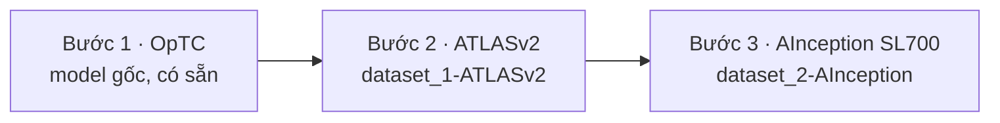
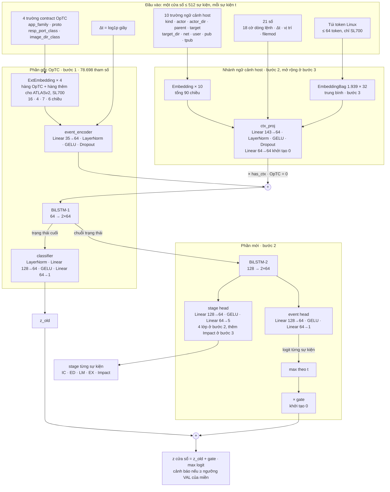
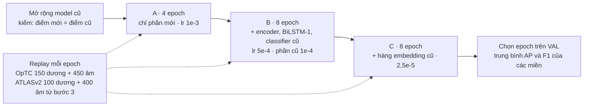
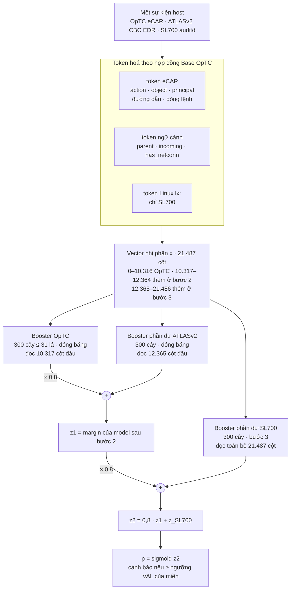
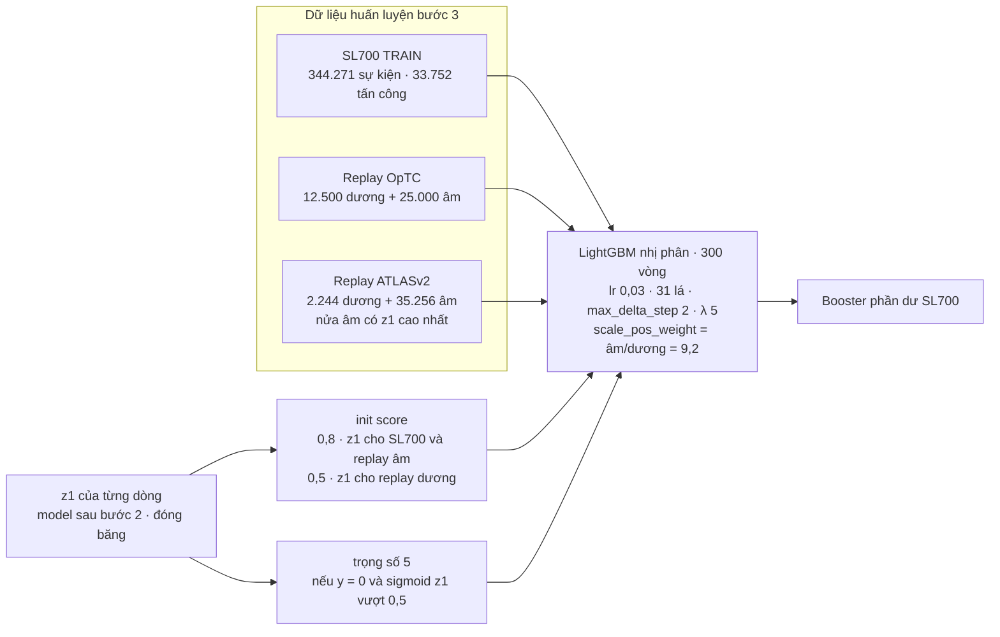

# IL — Incremental Learning OpTC → ATLASv2 → AInception SL700

Tài liệu tổng quan của thư mục `IL/`, mô tả **phiên bản cuối** (14/11/2026). Lịch sử các phiên bản trước và mọi số liệu chi tiết nằm trong các báo cáo ở mục 9.

## 1. Tóm tắt

- **Mục tiêu:** một mô hình phát hiện tấn công học lần lượt ba miền telemetry host mà không quên miền cũ. Hai miền đầu là Windows, miền thứ ba là Linux.
- **Hai nhánh làm song song:**
  - **DL:** BiLSTM chấm theo cửa sổ sự kiện, có thêm stage tấn công theo từng sự kiện.
  - **ML:** LightGBM chấm từng sự kiện, học tiếp bằng boosting phần dư.



Kết quả trên TEST. Mỗi ô ghi F1 của miền đó sau bước tương ứng; "—" là miền chưa học tới.

| Nhánh | Sau bước | OpTC | ATLASv2 | SL700 |
|---|---|---:|---:|---:|
| DL (cửa sổ, 3 seed) | 1 | 0,988 | — | — |
| | 2 | 0,994 | 0,990 ± 0,014 | — |
| | 3 | 0,994 | 0,970 ± 0,012 | **0,978 ± 0,004** |
| ML (sự kiện) | 1 | 0,996 | — | — |
| | 2 | 0,991 | 0,959 | — |
| | 3 | 0,994 | 0,953 | **0,995** (theo cửa sổ 0,883) |

- **Quên:** sau cả ba bước, không miền cũ nào mất quá 0,02 F1. Thứ chống quên là replay; bỏ replay thì ATLASv2 của nhánh ML tụt từ 0,959 xuống 0,741.
- **Chuyển giao:** train từ đầu trên miền mới đạt F1 ngang IL ở cả hai nhánh. Giá trị của IL nằm ở chỗ **một mô hình duy nhất giữ được cả ba miền**, không phải ở F1 trên miền mới.
- Các số SL700 ở trên **không dùng địa chỉ IP**. Có thêm phạm vi địa chỉ (mục 4.4.4) thì DL đạt 0,999 và ML theo cửa sổ đạt 0,966; nhóm đặc trưng này được báo cáo riêng.

## 2. Cấu trúc thư mục

```
IL/
├── README.md                     # tài liệu này
├── DL_IL_architecture.png        # kiến trúc bên trong mô hình DL
├── ML_IL_architecture.png        # kiến trúc bên trong mô hình ML
├── draw_il_architecture.py       # vẽ lại hai ảnh trên (matplotlib)
├── HANDOFF_20261113.md           # nhật ký bàn giao giữa các phiên
├── dataset_1-ATLASv2/            # bước 2
│   ├── code/preprocess/          # adapter CBC EDR, LabelRefiner (REAPr), split
│   ├── code/DL/bilstm_v9/        # parse sự kiện + dựng cửa sổ, nhãn v9b
│   ├── code/DL/optc_il/          # mô hình DL IL (il_model.py, train_il.py, contract.py)
│   ├── code/DL/pretrained_optc_model/   # BiLSTM OpTC gốc (bước 1)
│   ├── code/ML/preprocess/       # shard host-ML (build_host_shards_v9.py), replay OpTC
│   ├── code/ML/pretrained_optc_model/   # LightGBM OpTC gốc (bước 1)
│   ├── code/ML/output/v9b_20261112/     # LightGBM IL bước 2 (model, kết quả)
│   └── analyst/                  # báo cáo
└── dataset_2-AInception/         # bước 3
    ├── code/adapters.py, relabel*.py, relabel_v3_linux.py   # auditd → sự kiện, nhãn v3
    ├── code/DL/                  # cửa sổ SL700, train IL bước 3
    ├── code/ML/                  # ma trận host-ML SL700, LightGBM IL bước 3
    ├── code/rootcause/           # tokenizer Linux (linux_ctx.py), token theo sự kiện
    ├── output/                   # relabel_v3, sl700_windows_v3, il_step3v3_*, ml_il_step3_*
    └── analyst/                  # báo cáo
```

Dữ liệu gốc nằm ở `/mnt/SSD_Data/optc/DATASET/` và chỉ được đọc.

## 3. Ba miền dữ liệu

| | OpTC (bước 1) | ATLASv2 (bước 2) | AInception SL700 (bước 3) |
|---|---|---|---|
| OS | Windows | Windows | Linux (Debian) |
| Telemetry | eCAR (+ Bro conn cho DL) | Carbon Black EDR | auditd thô |
| Tấn công | APT 3 ngày, nhiều máy | 10 kịch bản S1–S4, M1–M6 | 6 run AttackMate: ZoneMinder RCE → meterpreter → linpeas → leo quyền → persistence → ssh → Impact |
| Nhãn | ground truth của OpTC | REAPr, tinh chỉnh v9b | dựng lại từ attack log + cây tiến trình (relabel_v3) |
| Chia | DL: ngẫu nhiên theo cửa sổ (~70/15/15 mỗi ngày); ML: theo sự kiện | theo kịch bản + ngày benign | theo run: train a_a, a_b, b_a, e_a · val a_c · test f_a |
| Mẫu DL (cửa sổ) | 228.984 (401 / 83 / 82 dương) | 4.864 / 1.960 / 2.366 (103 / 57 / 33 dương) | 5.582 / 1.614 / 1.681 (734 / 161 / 170 dương) |
| Mẫu ML (sự kiện) | 6,25 tr / 833 nghìn / 1,25 tr | 69.564 / 82.477 / 79.220 | 344.271 / 104.616 / 105.606 |

## 4. Tiền xử lý

### 4.1 Nguyên tắc chung (mọi miền, cả DL và ML)

1. **Sự kiện chuẩn:** raw được đưa về một bản ghi chung (thời gian, máy, loại sự kiện, tiến trình, tiến trình cha, ảnh, dòng lệnh, đích, user, mạng) và chỉ giữ trường quan sát được. IP cụ thể, tên máy, GUID và thời điểm tấn công không bao giờ là đặc trưng.
2. **Nhãn theo tiến trình:**
   - nhãn được dựng lại từ ground truth hoặc attack log cộng cây tiến trình;
   - mỗi sự kiện mang nhãn tấn công/benign và một stage;
   - nhãn cửa sổ (DL) là OR của các sự kiện mang nhãn trong cửa sổ.
3. **Split cố định trước khi train:** từ ATLASv2 trở đi, chia theo kịch bản hoặc run để TEST là tấn công chưa thấy. Hai model OpTC gốc được chia ngẫu nhiên, theo cửa sổ (DL) hoặc theo sự kiện (ML).
4. **Ngữ cảnh nhân quả:** mọi ngữ cảnh (cha, ông bà, incoming, phiên đăng nhập, has_netconn) chỉ dùng bằng chứng **trước** thời điểm của sự kiện.
5. **Từ vựng mở rộng đơn điệu:** id của miền cũ đóng băng; token mới chỉ lấy từ TRAIN của miền mới và được nối tiếp sau id cũ.
6. **Đánh giá trung thực:**
   - epoch, số vòng, ngưỡng và siêu tham số chọn trên VAL;
   - TEST chỉ chấm một lần;
   - miền cũ được chấm bằng ngưỡng đóng băng từ bước trước.
7. **DL:** cửa sổ 180 s, bước 30 s, theo máy.
   - Một cửa sổ cần ít nhất 2 sự kiện mang nhãn và được chia khúc tối đa 512 sự kiện.
   - Sự kiện file chỉ làm đầu vào.
   - Mỗi sự kiện có 4 trường contract OpTC + Δt (phần gốc) và các trường ngữ cảnh host (nhánh mới).
8. **ML:** mỗi hàng là một sự kiện host.
   - Flow mạng không phải là hàng; nó chỉ góp vào ngữ cảnh `has_netconn`.
   - Đặc trưng là vector nhị phân token theo hợp đồng Base OpTC.

### 4.2 OpTC — bước 1 (model gốc, không train lại)

| | DL | ML |
|---|---|---|
| Model | BiLSTM subsetB (`dataset_1-ATLASv2/code/DL/pretrained_optc_model`, trùng md5 với `DL/05_models/v2_subsetB`) | LightGBM 300 cây (`dataset_1-ATLASv2/code/ML/pretrained_optc_model/model-slot-0.txt`) |
| Mẫu | cửa sổ 15 phút theo máy, khúc tối đa 512 flow mạng (Bro conn ⨝ eCAR FLOW) | một sự kiện host eCAR (không flow) |
| Đặc trưng | `app_family`, `proto`, `resp_port_class`, `image_dir_class` + Δt | token eCAR (`ML/code/preprocess/ecar_tokenizer.py`) + ngữ cảnh actor/parent/incoming (`process_context_tracker.py`); 10.317 cột nhị phân |
| Ngưỡng | F1 lớn nhất trên VAL OpTC | 0,87427 (VAL OpTC) |
| TEST | F1 0,988 | F1 0,9963 |

Từ vựng OpTC (DL: `preprocess_spec.json`; ML: `vocab.json`, sha256 `2e4a6239…`) được giữ nguyên ở mọi bước sau.

### 4.3 ATLASv2 — `dataset_1-ATLASv2`

**Phần chung**
1. **Raw:** JSONL CBC EDR của 10 kịch bản và 4 ngày benign, chỉ đọc.
2. **Nhãn v9b** (`code/preprocess/label_refiner.py`, áp ở `bilstm_v9/build_dataset.py` và `ML/preprocess/build_host_shards_v9.py`):
   - hạt giống là tiến trình và endpoint REAPr;
   - bỏ endpoint từng xuất hiện ở ngày benign (ví dụ captive portal của Firefox 34.107.221.82:80);
   - mốc bắt đầu tấn công của mỗi kịch bản = min(mốc cấu hình, kết nối đầu tiên tới máy tấn công 10.193.66.115);
   - stage theo REAPr: IC, ED, LM, EX.

**DL** (`code/DL/bilstm_v9/`, `code/DL/optc_il/contract.py`)
1. `parse_events.py`: đọc mỗi file một lần, giữ procstart, netconn, crossproc và filemod; filemod chỉ giữ với các đuôi exe/dll/script/archive/office/html/pdf.
2. `build_dataset.py`:
   - procstart, netconn, crossproc mang nhãn; filemod chỉ làm đầu vào;
   - cửa sổ 180 s / 30 s;
   - split: train S1–S3, M1, M2, M4 + ngày benign 1–2; val M3, M5 + ngày 3; test S4, M6 + ngày 4.
3. Token mỗi sự kiện:
   - **contract OpTC:** tên ảnh, tcp/udp, lớp cổng phía responder, lớp thư mục; quy tắc chép nguyên văn từ pipeline OpTC;
   - **10 trường ngữ cảnh:** loại sự kiện, actor/thư mục, cha, đích/thư mục, net, user, publisher của actor và đích;
   - **21 số:** 9 cờ dòng lệnh cho actor + 9 cho đích, Δt, vị trí trong cửa sổ, cờ filemod;
   - trường `ip_scope` bị bỏ khỏi model (shortcut).
4. Từ điển ngữ cảnh lấy từ TRAIN, min count 2.

**ML** (`code/ML/preprocess/build_host_shards.py` qua `build_host_shards_v9.py`)
1. Adapter CBC → sự kiện chuẩn → bản ghi eCAR (`process/start`, `file/write|create|delete`, `registry/modify`, `module/load`, `process/open`).
2. Token:
   - `tokenize_record` của Base OpTC;
   - cộng token "domain shift": đuôi file, chuyển thư mục giữa các tiến trình, `has_netconn` (30 s/300 s, chỉ quá khứ), incoming `process_open`, dòng dõi cha một bước.
3. Từ vựng: 10.317 cột OpTC + 2.048 cột mới = **12.365**.
4. Ngày benign lấy 1/10; mẫu âm của train giới hạn 30:1; chia 60/20/20 theo kịch bản.

### 4.4 AInception SL700 — `dataset_2-AInception`

#### 4.4.1 Phần chung

1. **Tải chọn lọc** (`code/remote_zip.py`, `fetch_host_logs.sh`):
   - đọc zip Zenodo bằng HTTP Range, chỉ lấy auditd, log AttackMate và facts của 6 run (khoảng 20–60 MB/run thay vì 3,5 GB);
   - kết quả ở `DATASET/AInception/extracted/`.
2. **Sự kiện chuẩn** (`code/adapters.py`):
   - gom các bản ghi auditd cùng `msg=audit(ts:serial)` (SYSCALL + EXECVE + PROCTITLE + PATH + SOCKADDR);
   - phân loại theo syscall:
     - `execve` → procstart;
     - `connect`/`accept` → netconn;
     - open/creat/unlink/rename… → filemod/fileread;
     - `set*id` → privchange;
     - `ptrace`/`kill` → crossproc;
   - bản ghi `USER_*`/`CRED_*` → auth (tài khoản, địa chỉ, op PAM);
   - giữ pid, ppid, uid, auid, ses (phiên đăng nhập audit), exe, dòng lệnh.
3. **Nhãn v3** (`code/relabel_v3_linux.py`, dựa trên `relabel_v2.run_sl700`), quét theo thời gian và lan nhãn trực tuyến xuống tiến trình con:

   | Luật | Tiến trình được đánh dấu tấn công |
   |---|---|
   | Hạt giống C2 | tiến trình kết nối tới máy tấn công 192.42.1.174, hoặc bind cổng tunnel C2 trong attack log |
   | Phiên tấn công | mọi sự kiện của phiên đăng nhập (audit `ses`) xác thực từ máy tấn công, và phiên ssh localhost mở ngay sau một ssh tấn công |
   | Lệnh tiêm | tiến trình cha của stager C2, khởi chạy ≤ 10 s trước stager (`sh -c '<payload> \| python3 -'`) |
   | Payload | tiến trình fork không exec ("cha ẩn"), cùng uid với stager, pid ngay sau (≤ 64), con đầu tiên ≤ 30 s sau kết nối C2 |
   | Burst | cha ẩn có con đầu tiên ≤ 5 s sau hoạt động của một tiến trình tấn công cùng uid (subshell linpeas) |
   | Lệnh msf | cha ẩn có con đầu tiên ≤ 20 s sau một lệnh msf **có tactic MITRE** |
   | Chặn trùng giờ | không áp hai luật trên khi pid kề trước là một shell benign vừa được một cha nhìn thấy được khởi chạy (≤ 2 s); ví dụ job `phpsessionclean` |

   Stage theo tiến trình:
   - Impact: nằm trong cửa sổ hành động Impact;
   - IC: hạt giống trong 30 s đầu và con của chúng trong 60 s;
   - còn lại là ED.

   Mỗi run có khoảng 8.400–8.700 sự kiện tấn công.
4. **Split theo run:** train a_a, a_b, b_a, e_a; val a_c (biến thể persistence chưa thấy); test f_a (biến thể leo quyền chưa thấy).

#### 4.4.2 DL (`code/DL/build_sl700_windows_v3.py` → `build_sl700_windows.py`)

1. **Cùng công thức cửa sổ với ATLASv2:**
   - loại mang nhãn: procstart, netconn, crossproc, **auth**, **privchange**;
   - filemod chỉ làm đầu vào.
2. **Procstart lấy theo cha, như CBC:** actor là exe của tiến trình cha, đích là ảnh mới.
3. **User lấy từ uid:** 0 → SYSTEM, 1–999 → SERVICE, ≥ 1000 → DOMAIN_USER. Với `accept`, cổng phía responder để MISSING.
4. **Túi token Linux theo từng sự kiện** (`code/rootcause/linux_ctx.py` + `build_sl700_events_v2.py` → `output/rootcause_20261113/events_v3`):
   - thiết kế theo Base OpTC (`ecar_tokenizer` + `process_context_tracker`), chỉ dùng bằng chứng trước t;
   - từ điển lấy từ sự kiện TRAIN (min count 2; 1.939 hàng embedding kể cả pad và `<UNK>`), tối đa 64 token mỗi sự kiện.

| Nhóm | Token Linux |
|---|---|
| Sự kiện (`g_ev`) | syscall, exe + nhóm thư mục Linux (cred_store, ssh_keys, sudoers, pam, cron, systemd, tmp, web_root…), lớp uid/auid, leo quyền (uid ≠ auid); dòng lệnh: argv0, chế độ `sh -c`/inline/stdin/script, switch, vai trò tham số (đường dẫn, url, ip, blob), toán tử shell, anchor python/perl; bản ghi auth: kiểu, op PAM, lớp tài khoản; nhóm đường dẫn file |
| Cha (`g_par`) | actor, cha, ông bà: exe, nhóm thư mục, uid, tuổi, chế độ dòng lệnh, hành động gần đây; dòng dõi cha → con; cha chưa từng thấy (fork không exec) |
| Phiên — "incoming" (`g_ses`) | phiên đăng nhập của sự kiện: ai mở (sshd/cron/sudo/systemd), lớp tài khoản, tuổi phiên, đã sudo chưa, số lệnh |
| Phạm vi địa chỉ (`g_scope`) | private/external/loopback của nguồn đăng nhập và kết nối; **chỉ dùng trong báo cáo riêng** vì gần với luật gán nhãn |

#### 4.4.3 ML (`code/ML/sl700_ecar.py`, `build_sl700_host_ml.py`)

1. **Hàng:** procstart, filemod, fileread, auth, privchange trên mọi máy; netconn chỉ góp vào `has_netconn`.
2. **Bản ghi eCAR cho tokenizer Base OpTC:**
   - procstart → `process/start` (ảnh, ảnh cha, dòng lệnh);
   - file → `file/write|create|delete|read`;
   - auth → `user_session/login|logout|command`;
   - `set*id` → `process/modify`;
   - tài khoản: uid 0 → `nt_system`, 1–999 → `nt_service`, ≥ 1000 → `domain_user`.
3. **Token:**
   - eCAR, cộng token ngữ cảnh kiểu bước ATLASv2 (dòng dõi cha, `has_netconn`, đuôi file);
   - cộng token Linux tiền tố `lx:` (giống túi DL).
   - Khoảng 39 % token rơi vào từ vựng cũ, nên model cũ vẫn chấm điểm có nghĩa.
4. **Từ vựng:** 12.365 cột cũ + 9.128 cột từ TRAIN = **21.493** (7.118 eCAR, 2.004 Linux, 6 phạm vi địa chỉ). Cấu hình chính bỏ 6 cột phạm vi, còn **21.487** cột.
5. Âm/dương của train là 9,2:1, chưa vượt 30:1 nên không cần lấy mẫu lại.

#### 4.4.4 Vì sao phạm vi địa chỉ được tách riêng

- Sau leo quyền, kẻ tấn công ssh bằng root và chạy lệnh qua kênh exec, giống hệt phiên ssh root thường lệ của admin. Thông tin phân biệt mạnh nhất là phiên đó mở từ đâu.
- Tuy vậy, nhãn phiên được gieo từ chính IP kẻ tấn công. Vì thế mọi số chính không dùng nhóm này; số có nhóm này được ghi riêng.

## 5. Mô hình DL — BiLSTM IL (`dataset_1-ATLASv2/code/DL/optc_il/il_model.py` + nhánh túi token trong `dataset_2-AInception/code/DL/train_il_step3_v2.py`)

### 5.1 Kiến trúc bên trong (sau bước 3)



Ảnh chi tiết: [`DL_IL_architecture.png`](DL_IL_architecture.png).

### 5.2 Thành phần và tham số (sau bước 3, tổng 282.521)

| Thành phần | Có từ | Tham số | Ghi chú |
|---|---|---:|---|
| Embedding 4 trường OpTC (hàng cũ) + encoder + BiLSTM-1 + classifier | bước 1 | 78.698 | đầu ra `z_old` là điểm của model OpTC |
| Hàng embedding thêm cho token ATLASv2/SL700 | bước 2, 3 | 1.740 | khởi tạo bằng hàng `<UNK>` |
| Embedding 10 trường ngữ cảnh + `ctx_proj` | bước 2 (mở rộng ở 3) | 23.804 | lớp cuối khởi tạo 0, nhân `has_ctx` |
| Túi token Linux (EmbeddingBag) | bước 3 | 62.048 | cột mới của `ctx_proj` khởi tạo 0 |
| BiLSTM-2 + event head + stage head + gate | bước 2 | 116.231 | stage head 4 → 5 lớp ở bước 3 |

### 5.3 Cơ chế IL ở mỗi bước



1. **Mở rộng mà không đổi hành vi.**
   - Token mới được nối vào từ vựng (contract + ngữ cảnh).
   - Phần mới khởi tạo sao cho điểm cửa sổ **trùng** model trước: lớp chiếu cuối = 0, gate = 0, lớp stage mới có trọng số 0 và bias thấp.
   - Đã kiểm bằng số: sai khác tối đa 0 trên OpTC và SL700, 1,7e-5 trên ATLASv2.
2. **Mở băng dần (A → B → C)** như sơ đồ, với AdamW (weight decay 1e-4), batch 64.
3. **Replay dữ liệu thật** của các miền cũ trộn vào mỗi epoch.
4. **Loss:**
   - BCE cửa sổ, trọng số dương = √(âm/dương) theo từng miền;
   - + 0,5 × BCE từng sự kiện;
   - + 0,5 × CE stage cho sự kiện tấn công, trọng số lớp tỉ lệ nghịch với √tần suất.
5. **Chọn mô hình:**
   - epoch tốt nhất theo trung bình (AP + F1 lớn nhất)/2 trên VAL của mọi miền đã học;
   - ngưỡng chọn trên VAL riêng từng miền; OpTC giữ ngưỡng gốc.
6. **Bước 2** khởi tạo từ BiLSTM OpTC. **Bước 3** khởi tạo từ model bước 2 cùng seed, thêm túi token Linux và lớp stage Impact.

### 5.4 Kết quả (TEST, 3 seed)

| | Bước 2 (ATLASv2) | Bước 3 (SL700) |
|---|---|---|
| Miền mới F1 (AP) | 0,990 ± 0,014 (1,000) | 0,978 ± 0,004 (0,998) |
| Stage presence trên miền mới | 0,837 | 0,758 (IC, ED, Impact) |
| ATLASv2 sau bước | — | 0,970 ± 0,012, stage 0,910 |
| OpTC sau bước | 0,988 → 0,994 | 0,994 |
| Train từ đầu, cùng kiến trúc | 0,985 | 1,000 (1 seed, có phạm vi địa chỉ), nhưng ATLASv2 0,03 và OpTC 0,00 |
| Có phạm vi địa chỉ | — | 0,999 ± 0,001 |

## 6. Mô hình ML — LightGBM boosting phần dư

### 6.1 Kiến trúc bên trong (suy luận, sau bước 3)



Ảnh chi tiết: [`ML_IL_architecture.png`](ML_IL_architecture.png).

### 6.2 Cơ chế IL ở mỗi bước



1. **Cộng dồn margin.** Mỗi bước thêm một booster học **phần dư** trên margin của model trước, nhân 0,8:
   - bước 2: `z1 = 0,8 · z_OpTC + z_ATLASv2`;
   - bước 3: `z2 = 0,8 · z1 + z_SL700`.
   Booster cũ đóng băng và chỉ đọc các cột thuộc từ vựng của nó, nên cột mới không ảnh hưởng tới chúng.
2. **Replay dữ liệu thật:**
   - bước 2: buffer OpTC 75.000 dòng (25.000 tấn công + 35.000 âm khó + 15.000 âm đa dạng);
   - bước 3: OpTC 37.500 + ATLASv2 37.500 dòng.
3. **Init score cho replay dương** dùng hệ số α_rep nhỏ hơn để booster mới không "bỏ đói" gradient của mẫu tấn công cũ:
   - bước 2 dùng α_rep = 0,25;
   - bước 3 chọn α_rep = **0,5** trên VAL của cả ba miền (`eval_old_val.py`; điểm trung bình VAL 0,973–0,974, so với 0,970–0,971 của 0,25 và 0,969 của 0,8).
4. **Hard negative:** mẫu âm mà model trước nghi (sigmoid(margin) > 0,5) có trọng số 5.
5. **Tham số giống nhau ở mọi bước:** 300 vòng, lr 0,03, 31 lá, `max_delta_step` 2, `reg_lambda` 5, deterministic.
6. **Ngưỡng:**
   - miền mới: F1 lớn nhất trên VAL;
   - miền cũ: ngưỡng đóng băng (OpTC 0,87427; ATLASv2 0,94073).
   - Model sau bước 2 dựng lại tái hiện **đúng tuyệt đối** confusion đã công bố.

### 6.3 Kết quả (TEST; LightGBM tất định, 3 seed replay cho std ≈ 0)

| | Bước 2 (ATLASv2) | Bước 3 (SL700) |
|---|---|---|
| Miền mới F1 (AP) | 0,959 (0,980) | 0,995 (0,999); theo cửa sổ 0,883 |
| ATLASv2 sau bước | — | 0,959 → 0,953 |
| OpTC sau bước | 0,9963 → 0,9905 | 0,991 → 0,994 |
| Train từ đầu, cùng đặc trưng | 0,954 | 0,995 |
| Không replay | — | ATLASv2 tụt còn 0,741 |
| Model cũ chạy thẳng trên miền mới | 0,30 | 0,799 (theo cửa sổ 0,540) |
| Có phạm vi địa chỉ | — | 0,997; theo cửa sổ 0,966 |

## 7. So sánh hai nhánh và giới hạn

| | DL | ML |
|---|---|---|
| Đơn vị chấm | cửa sổ 180 s (+ stage từng sự kiện) | từng sự kiện |
| Dùng flow mạng | có (contract OpTC từ flow) | không (chỉ `has_netconn`) |
| Cách giữ kiến thức cũ | đóng băng dần + replay + khởi tạo tương đương | booster cũ đóng băng + phần dư + replay |
| SL700 theo cửa sổ (không IP) | 0,978 | 0,883 |

Giới hạn còn lại:
1. **Không có chuyển giao xuôi:** train từ đầu ngang IL trên miền mới.
2. **Khái quát sang biến thể chưa thấy còn yếu.** Giữ run e_a (persistence cron) làm TEST thì DL đạt 0,74–0,83 (LightGBM chẩn đoán theo cửa sổ đạt 0,81–0,91). Nhánh ML IL chưa được đo trên fold này.
3. **Phiên ssh của kẻ tấn công** chỉ tách rõ khi có phạm vi địa chỉ, vốn gần với luật gán nhãn.
4. **TEST SL700 chỉ là một run.** Nhãn SL700 là heuristic theo cây tiến trình, không có ground truth từng tiến trình.
5. **Replay lưu dữ liệu thật** của các miền cũ.

## 8. Chạy lại (luôn ghi ra thư mục mới; không ghi đè output đã công bố)

```bash
# Bước 2 — ATLASv2 (dataset_1-ATLASv2)
cd /mnt/SSD_Data/optc/IL/dataset_1-ATLASv2/code/DL
python3 bilstm_v9/parse_events.py --out output/<mới>                       # sự kiện CBC EDR
python3 bilstm_v9/build_dataset.py --work output/<mới> --out-name dataset_v9b_stage_optc.pkl
bash optc_il/run_matrix.sh output/optc_il_<mới>                            # DL IL (freeze_replay là cấu hình chính)
cd /mnt/SSD_Data/optc
python3 IL/dataset_1-ATLASv2/code/ML/preprocess/build_host_shards_v9.py --output-dir <mới>   # shard host-ML v9b
# huấn luyện ML bước 2: IL/dataset_1-ATLASv2/code/ML/output/v9b_20261112/run_both.sh (lgbm_atlasv2_script.py)

# Bước 3 — AInception SL700 (dataset_2-AInception)
cd /mnt/SSD_Data/optc/IL/dataset_2-AInception/code
for r in a_a a_b b_a e_a a_c f_a; do python3 relabel_v3_linux.py $r; done   # nhãn v3
python3 DL/build_sl700_windows_v3.py                                        # cửa sổ DL
python3 rootcause/build_sl700_events_v2.py --relabel ../output/relabel_v3 \
    --ref ../output/sl700_windows_v3/dataset.pkl --out ../output/rootcause_20261113/events_v3   # túi token Linux
bash DL/run_matrix_v3.sh                                                    # DL IL: cấu hình chính bag_freeze_replay2
python3 ML/build_sl700_host_ml.py                                           # ma trận host-ML
bash ML/run_ml_matrix.sh                                                    # ML IL: cấu hình chính incA05_ecar_lx
```

## 9. Báo cáo chi tiết

| Bước | Báo cáo |
|---|---|
| Nhãn ATLASv2 v9b, BiLSTM ATLASv2, LightGBM IL bước 2 | [`dataset_1-ATLASv2/analyst/dl_bilstm_v9_20261112.md`](dataset_1-ATLASv2/analyst/dl_bilstm_v9_20261112.md) |
| DL IL bước 2 | [`dataset_1-ATLASv2/analyst/dl_optc_il_20261112.md`](dataset_1-ATLASv2/analyst/dl_optc_il_20261112.md) |
| Nguyên nhân F1 SL700, nhãn v3, token Linux, DL bước 3 | [`dataset_2-AInception/analyst/rootcause_sl700_20261113.md`](dataset_2-AInception/analyst/rootcause_sl700_20261113.md) |
| ML IL bước 3 | [`dataset_2-AInception/analyst/ml_il_step3_sl700_20261113.md`](dataset_2-AInception/analyst/ml_il_step3_sl700_20261113.md) |
| README từng dataset | [`dataset_1-ATLASv2/README.md`](dataset_1-ATLASv2/README.md), [`dataset_2-AInception/README.md`](dataset_2-AInception/README.md) |
