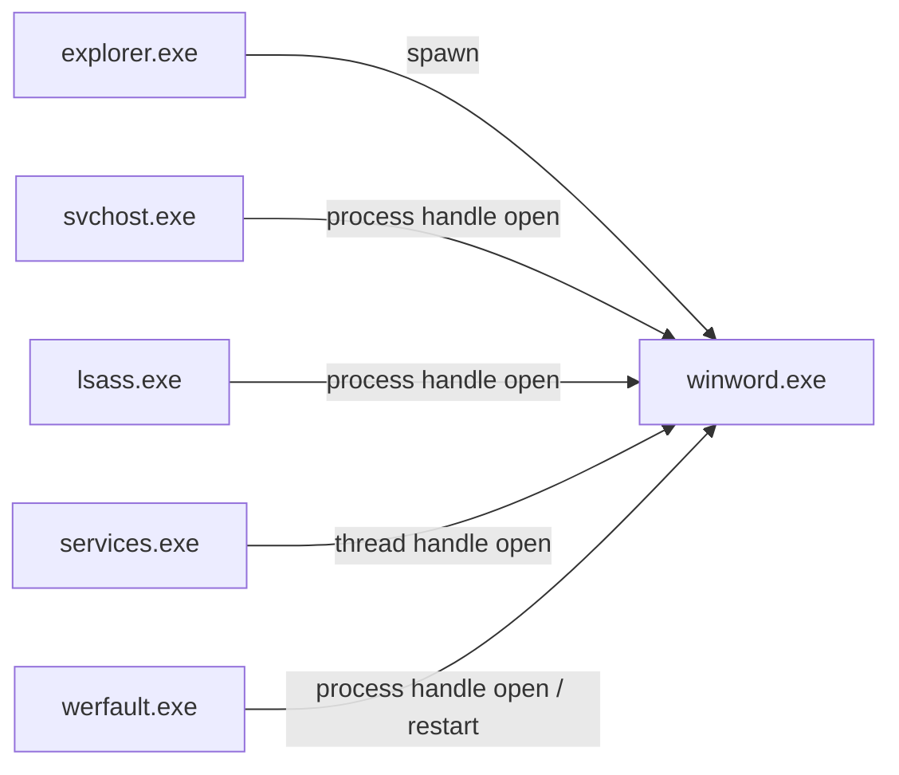
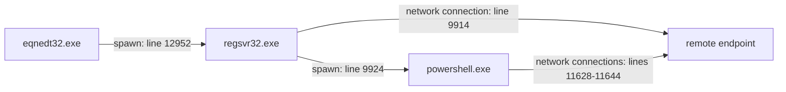

# Provenance traceback and context-enriched DL — 11 November 2026

This extends the [low-F1 investigation](dl_root_cause_20261111.md) by joining
individual model errors to source events and bounded provenance neighbourhoods,
then testing observable context in the BiLSTM. No labels, attack GUID lists,
REAPr seeds, reputation scores, attack times or scenario IDs are model features.

## What the graph reveals about actual errors

The reference is the original v5 checkpoint with its validation-selected threshold
0.8936129212: TP=16, FP=5, FN=22. All 27 FP/FN windows now have source-linked, machine-readable bounded graph
exports under
`code/DL/output/provenance_context_20261111/traceback_v5/`.
For FN windows the exported focal graph covers the events supplying positive
supervision and their earlier neighbours; FP exports retain every current event.
Every window also has aggregate observable token counts. Each edge names its
raw source file/line and timestamp. Supervision is joined
only in the audit artifact, after feature construction.

### False positive: S4 Office activity is collapsed into an executable token

`win-32-h1_s4_w0034_c00` has an attack score of **0.972835** but no refined-positive
event. Its 31 current events include 19 cross-process interactions, eight process
starts and four connections. Fifteen interactions have Word as their target,
including service handle opens, crash-handler interactions and process starts.
The original representation substitutes the target basename for a process or
cross-process event and lacks explicit operation/source role. Thus a service
opening Word and a genuinely relevant Word action can produce similar inputs.

The observed graph includes these distinct relations (process instances remain
separate in the exported JSON; names are shortened here for readability):



A fixed-weight intervention removing the 18 events whose original application
category is `winword.exe`, with inter-event gaps recomputed, reduces its score
to **0.022579**. Removing the other frequent application groups does not have
that effect. This is strong evidence of model sensitivity to Word-associated
events and loss of source/operation semantics. Event removal changes the input
distribution, so it is not a proof of real-world causation or of benign intent.

For `win-32-h2_benign_w2673_c00`, the analogous audit investigates a browser-driven
false alarm amidst browser/media-service activity. Exact sensitivities for all
baseline errors are in `occlusion/v5_event_drop_sensitivity.csv`.

### Genuine execution-chain evidence is present in some false negatives

For `win-32-h1_m6_w0025_c00`, the original score is only **0.183344**. Source-line
relationships include:



Source is `edr-h1-m6.jsonl`. Line numbers are not chronological; raw files must
be sorted by device timestamp before context replay. The regsvr32 launch is
observed before the PowerShell event, so a parent feature is available without
reading future evidence. The graph supports investigating this execution chain;
it does not make every service opening PowerShell an attack.

For `win-32-h1_s4_w0037_c00`, the observed chain includes `svchost.exe -> mshta.exe
-> powershell.exe`, with endpoint connections and system handle opens. The old
score is **0.294673**. This is an observable opportunity for source/target and
lineage information, unlike simply teaching a stage label from a process GUID.

### Thirteen false negatives depend only on questionable connectivity labels

In **13 of the 22 baseline FN windows**, every positive event is a Firefox
connection to 34.107.221.82 with a captive-portal domain. Six are h1 windows
`w0046`–`w0051`; seven are h2 windows `w0028`–`w0033` and `w0038`.
The local graph shows ordinary browser lineage and service handle interactions,
not an independently verified offensive event in those windows.

Other windows mix these connections with actual execution or internal portal
evidence. In particular, h1 `w0026`/`w0027` must not be dismissed as pure browsing.
The earlier broad statement about all Initial-Compromise windows should be read
with this distinction: a last-event stage may come from a questionable browser
label while the same window still contains other attack evidence.

Do not optimize the model merely to recover these 13 labels. Better label review
and better feature extraction are separate requirements. This audit cohort is
not used in vocabulary construction, training loss, threshold selection or
checkpoint selection.

## How the ML idea was adapted

The reference implementation is
`ML/code/preprocess/process_context_tracker.py`, its incoming-context tests,
and `ML/code/kaggle/docs/PARENT_CONTEXT_RUNBOOK.md`. Useful properties preserved:

- Extract context before observing the equal-timestamp batch. Historical
  evidence must satisfy `evidence.timestamp < query.timestamp`.
- Snapshot parent/incoming source metadata from the earlier interaction.
- Scope joins by host and file/session; never fall back to PID.
- Keep incoming kinds separate, cap each kind at eight records, and use a
  24-hour TTL. Cap process/target state at 10,000 and image-writer state at 20,000.
- Do not propagate compromise labels along graph edges.

The adaptation uses CBC process GUIDs, not eCAR UUID syntax. It reads only
whitelisted observable fields and emits finite semantic tokens. Full GUIDs and
paths are available for joins and audit traces, never as model columns.
Missing/expired parent evidence is marked unobserved; that is not a claim that
the process has no parent. Discovery records describe observed relationships;
their age is time since observation, not a certified birth time.

There are **235 TRAIN-fitted extra columns**:

| Group | Columns | Examples |
| --- | ---: | --- |
| Current event structure | 129 | source family/role, event and relation type, target role, source-to-target transition, bounded command switches, endpoint scope/direction |
| Parent context | 53 | observed parent family/role, age bucket, parent-to-current family transition, earlier parent command structure |
| Typed incoming context | 44 | source family/role and age scoped to process-open, process-duplicate, thread-open or other observed relation |
| File-writer context | 9 | a spawned image's recent writer family and write-to-start age, within five minutes |

The extra context vocabulary encodes no exact endpoint IP/domain, special malicious filename, raw command operand,
absolute date/time, label vocabulary or reputation field is encoded. Observable
program families and shell switches describe behavior and are not verdicts.
Original base application categories, including observed executable basenames,
remain unchanged.

CBC direction and relation semantics were checked against the
[official endpoint schema](https://developer.carbonblack.com/reference/carbon-black-cloud/data-forwarder/schema/latest/endpoint.event/).
`ACTION_OPEN_THREAD_HANDLE` is preserved as thread-open; it is not remote-thread
creation. Target-view cross-process records are normalized, and unknown
directions do not update incoming state. The audited corpus contains no fitted
remote-thread-create token, so the experiment does not claim injection evidence
of that specific type. An inaccurate equivalence in the older field comparison
document has been corrected.

The label-blind state machine includes file-write observations omitted from the
old sequence input, but adds evidence only when it happened earlier. It does not
add later writes or future descendants. A completed BiLSTM window remains a
window-end decision, not a causal per-event online detector.

## Paper code inspected and what it supports

- `paper-general/code/NDSS/theseus-main/models/esage_encoder.py`: concatenates
  source-node and edge attributes in its learned message, then combines self
  and aggregated neighbour features. This motivates retaining relation identity
  and source role instead of flattening every interaction to a target name.
- `paper-general/code/NDSS/theseus-main/scripts/create_csv_files_atlasv2.py`:
  reconstructs parent-to-child process edges but explicitly skips cross-process
  records. It cannot simply be copied to implement typed incoming CBC context.
- `paper-general/code/kairos/DARPA/CADETS_E3/model.py`: uses relation messages
  and relative time in temporal graph attention. It reinforces the importance of
  timestamped edge semantics; its anomaly task and training protocol differ.

The implemented model is a **BiLSTM with graph-enriched event features**, not a
replication of Theseus/Kairos and not a GNN. The provenance graph supplies bounded
observations; a learned projection and sequence model decide how to use them.

## Controlled experiment

Every original sample ID, label, stage, split and original tensor was checked for
exact equality after enrichment. TRAIN event membership alone fits the vocabulary;
validation/test only transform. The original benchmark's ten overlapping benign
source events across splits remain an inherited limitation, not a new clean-split
claim. No evaluation-label correction is mixed into these comparisons.

Three arms start from the identical v5 checkpoint, for seeds 42 and 43:

1. `none`: original input, same additional training schedule.
2. `event`: only richer current-event structure.
3. `graph`: current-event structure plus parent, incoming and image-writer context.

The optional projection starts at exactly zero. A regression test verifies
identical initial logits, and verifies nonzero gradients reach the projection.
All arms consider epoch 0 and train for ten further epochs with the same batches,
optimizer policy and stage supervision. Natural binary BCE is combined with
balanced conditional-stage cross-entropy; there is no positive-only binary loss
and no synthetic replay. Validation alone selects both threshold (FPR <=2%) and
checkpoint using equal weights on binary F1 and operational attack macro F1.

All six trials completed. Test labels and sample counts are unchanged.

| Input arm | Seed | Selected epoch | Validation F1 | Test F1 | Test AP | TP / FP / FN |
| --- | ---: | ---: | ---: | ---: | ---: | --- |
| Original | 42 | 2 | 72.00% | 51.61% | 0.5379 | 16 / 8 / 22 |
| Event structure | 42 | 2 | 72.00% | 53.33% | 0.5379 | 16 / 6 / 22 |
| Graph context | 42 | 2 | 74.63% | **54.24%** | **0.5492** | 16 / 5 / 22 |
| Original | 43 | 1 | 73.85% | 55.17% | 0.5255 | 16 / 4 / 22 |
| Event structure | 43 | 1 | 72.73% | 53.33% | 0.5299 | 16 / 6 / 22 |
| Graph context | 43 | 5 | 74.63% | **56.60%** | **0.5650** | 15 / 0 / 23 |

Mean test F1 across the two seeds changes from **53.39% to 55.42%** with graph
context. It resolves three and four false alarms respectively without creating
new ones relative to each matched original-input run. Seed 43 also loses one
true positive. The unchanged existing v5 checkpoint already scores 54.24% after
recalibration, so this is a modest result, not a large new-model breakthrough.
Do not choose seed 43 for deployment because its test FP count happens to be zero.

[Paired comparison figure](../code/DL/output/provenance_context_20261111/comparison.png)
shows individual seeds rather than misleading confidence intervals from n=2.
`experiment_table.csv`, `experiment_summary.json` and `error_changes.csv` retain
exact results and paired prediction changes.

### What the learned model actually does with context

For the S4 Office false alarm, graph seed 43 scores **0.631329** against its
validation threshold **0.776695**, correctly suppressing that alert. Holding its
weights and original events fixed:

| Feature intervention | Attack probability |
| --- | ---: |
| All observable features | 0.631329 |
| Remove current event structure | 0.933694 |
| Remove parent context | 0.731683 |
| Remove typed incoming context | 0.608286 |

The current-event structure contributes strongly to suppressing this false
alarm; parent context also lowers its score. Incoming context has the opposite
local effect in this seed. In seed 42 both parent and incoming removal raise the
Office score, but the full score is still above that model's threshold. Thus it
would be false to claim every graph feature helps every case or that graph
context robustly fixes this particular example across seeds. All group
interventions are exported under `occlusion/`; they are input-sensitivity
measurements, not real-world causal proofs.

### What remains broken: genuine early-stage detection

None of the six selected models recovers stage-1/2/3 windows as binary positives.
The observed M6 execution-chain window stays below the binary threshold:
original v5 probability 0.183344; graph seeds 42/43 probabilities 0.056267 and
0.047256. This feature extension **has not solved early attack detection**.

Ignoring the binary gate is also insufficient. Conditional-head correctness,
computed only as a diagnostic on the true attack windows, is:

| True stage | Support | v5 conditional correct | Graph seed 42 | Graph seed 43 |
| --- | ---: | ---: | ---: | ---: |
| Initial Compromise | 8 | 6 | 6 | 6 |
| Execution / Discovery | 4 | **0** | **0** | **0** |
| Lateral Movement | 8 | 3 | 3 | 4 |
| Exfiltration | 18 | 18 | 18 | 18 |

These are not operational F1 scores: the diagnostic omits benign false alarms
and deliberately bypasses the gate. The historical claim of near-perfect
Execution/Discovery discrimination is not supported by this checkpoint. Binary
confidence and stage discrimination are both problems, while 13 of the 22
baseline FN windows have questionable browser-only positive evidence.

The experiment therefore supports retaining this extension as an optional
observable-context branch and a useful traceback tool. It does not justify
promoting it as a completed stage detector. Prioritize the following next:

1. Review the source-linked labels and mark unresolved connectivity evidence
   unknown rather than training the model to recognize a convenient verdict.
2. Define action-level or multi-label stage supervision. A mixed host window's
   last positive process-stage is not a reliable target for all earlier actions.
3. Compare process-centered causal sequences or explicit edge-aware learned
   neighbourhood aggregation against these same ablations. This version uses
   one observed parent hop, bounded incoming snapshots and a file-path writer
   join; it is not full two-hop message passing or persistent per-process memory.
4. Reassess binary/stage supervision after label adjudication. Natural BCE and a
   stage-only balanced auxiliary loss remain conservative on rare early windows;
   extra context alone does not guarantee that the binary head will use their
   evidence. Avoid repeatedly lowering thresholds to fit mislabeled browsing.
5. Use a frozen fresh evaluation protocol and more independent campaigns/seeds
   before making generalization or source-retention claims.

Interpret these results as exploratory evidence on a previously inspected
benchmark, not proof of transfer to fresh campaigns or of genuine OpTC retention.
Sixteen local regression/integration tests and seven original ML incoming-context
tests pass. The original ML implementations and baseline artifacts are unchanged.

## Reproduction

```bash
python3 IL/dataset_1-ATLASv2/code/DL/preprocess/build_provenance_context.py
python3 IL/dataset_1-ATLASv2/code/DL/model/train_provenance_context.py
python3 IL/dataset_1-ATLASv2/code/DL/audit/trace_provenance_errors.py
python3 IL/dataset_1-ATLASv2/code/DL/audit/occlude_provenance_context.py
python3 -m unittest discover -s IL/dataset_1-ATLASv2/code/DL/test
python3 -m unittest ML.code.test.test_incoming_context
```

Published datasets and run directories refuse overwrite. Builds publish atomically
and retain source hashes, code hashes, vocabulary frequencies and frozen manifest
identity. An interrupted `.building` directory is not a resumable checkpoint.
These local extensions are not embedded in the historical Kaggle notebooks.
