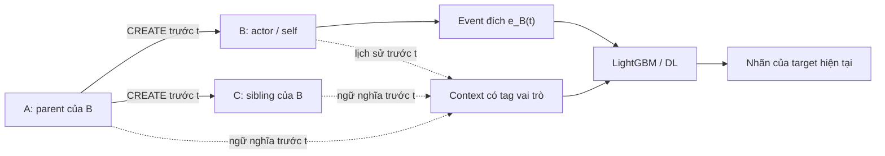

# Context block cha–con trên corrected DARPA OpTC

Ngày đối chiếu: 26/10/2026. Theo `Temp/task/1.md`; người dùng đã chọn **giữ đầu ra hiện tại, bổ sung block context**. Đây là báo cáo kiểm chứng và thiết kế trước triển khai. Chưa chạy lại preprocessing hay huấn luyện.

**Kết luận đề xuất.** Dùng provenance làm chỉ mục truy xuất process và lịch sử trước thời điểm dự đoán. Biểu diễn context có vai trò cha/con/anh-em rồi đưa vào LightGBM hoặc mạng DL hiện tại. Nhánh thử nghiệm này không cần GraphSAGE hay một bộ phân loại graph riêng. Bắt đầu bằng actor + parent; tiếp theo thử block gia đình tối đa 8 process, bán kính tối đa 2 cạnh CREATE. Giữ nguyên nhãn của event/flow/sample đích, không tạo nhãn chung cho block. Đây là cấu hình khởi đầu cần kiểm chứng trên validation, không phải số node tối ưu được bài báo xác nhận.

**1. Tác giả thực sự gán nhãn thế nào?**

Tài liệu được cung cấp là bài báo của Frédéric Majorczyk, Barbara Pilastre và Fanny Dijoud, bản HAL `hal-05474126v2`, không phải một luận văn riêng. Bản PDF local có trang bìa HAL; phần labeling nằm ở **trang PDF 7, §§4.1–4.3**, giới hạn correction ở **trang PDF 6, §3.3**. [PDF local](../../DATASET/DARPA-OPTC/a_new_hope_for_darpa_optc/A%20New%20Hope%20for%20DARPA%20OpTC.pdf). Trang dự án xác nhận việc phát hành correction, nhãn host/network và mã nguồn: [correctedoptc.inria.fr](https://correctedoptc.inria.fr/). DOI bài báo: [10.1109/ACSACW69556.2025.00064](https://doi.org/10.1109/ACSACW69556.2025.00064).

Luồng gán nhãn được mô tả trong bài:

1. Dùng tài liệu Red Team: máy bị xâm nhập, PID agent, thời gian, hạ tầng C2 và hành động tấn công. Có kiểm tra thủ công process cha, agent thiếu PID và phiên RDP.
2. Xác định process liên quan tấn công, theo dõi CREATE/TERMINATE, mở rộng xuống process con. Giả định nghiên cứu là con của process độc hại cũng độc hại.
3. Gán các event của những process được xác định vào tập malicious. Vì vậy nhãn không chỉ phản ánh nội dung riêng của từng event: thao tác có vẻ bình thường vẫn có thể thuộc hoạt động tấn công.
4. Đối chiếu nhãn host và network qua eCAR-Bro. Nhãn mạng còn dựa vào IP/domain, thời gian và kiểm tra các kết nối; không chỉ sao chép nhãn event host.

Điểm cần phân biệt giữa mô tả và mã phát hành:

| Lớp bằng chứng | Điều đã kiểm tra | Hệ quả thiết kế |
| --- | --- | --- |
| Bài báo §4.1 | Mô tả nhãn ở mức process/actor và mở rộng xuống con | Context lineage có cơ sở; nội dung event độc lập có thể thiếu thông tin |
| `host_darpapy.py:22` | Mã thực thi tra hostname + PID + khoảng thời gian; nhận biết con qua PROCESS/CREATE và `ppid`; thêm PID con vào danh sách | Không được giản lược bộ nhãn phát hành thành một phép tra UUID actor tĩnh |
| `host_darpapy.py:36` | Với mốc cuối `Infinity`, self-TERMINATE (`actorID == objectID`) có thể đóng khoảng thời gian | Đây là quy trình dựng ground truth offline; không đưa thông tin kết thúc tương lai vào feature |
| Các `complete_gt_corrected_host_darpapy_sc*.sh` | Chạy lại đến khi CSV ổn định; `MARGINS=90` giây | Không có giới hạn label propagation ở 1–2 hop. 90 giây là biên thời gian gán nhãn, không phải cửa sổ context nên dùng |
| Script local `script/label_optc_host_logs.py` | Thêm `label=1` khi **event id** nằm trong corrected ground-truth export; các ID còn lại là 0 | Giữ nguyên nhãn phát hành hiện có; không tự gán lại toàn bộ sự kiện cùng actor hoặc cả block |

Nguồn mã: [host_darpapy.py](../../DATASET/DARPA-OPTC/a_new_hope_for_darpa_optc/labelling/host/host_darpapy.py:22), [vòng lặp SC1](../../DATASET/DARPA-OPTC/a_new_hope_for_darpa_optc/labelling/host/complete_gt_corrected_host_darpapy_sc1.sh:14), [script áp nhãn local](../../DATASET/DARPA-OPTC/a_new_hope_for_darpa_optc/script/label_optc_host_logs.py:64). Không chạy các script này trong lần phân tích này.

Đếm trực tiếp `ground_truth_corrected_all_evts.json.gz`: **360.567 dòng, 360.567 event ID duy nhất, 1.009 cặp hostname–actorID**. Bài báo §4.2 nêu **360.925 event và 1.103 actorID** trong phần so sánh nhãn. Không thay số đo local bằng số trong bài, và cũng không coi chênh lệch là bằng chứng dataset hỏng: chưa đối soát từng phiên bản/export; cặp hostname–actor cũng khác đơn vị đếm actorID thuần. Audit này chưa xác minh lại nhãn của toàn bộ raw corpus.

Tác giả thừa nhận vùng xám: nếu coi toàn bộ hậu duệ `winlogon.exe` trong phiên RDP độc hại là malicious, nhiều chương trình khởi động phiên vốn bình thường cũng bị kéo vào. Chạy executable tấn công chỉ để in help cũng có thể bị gán malicious. Vì vậy, context có thể giúp mô hình học quy ước nhãn, nhưng tăng F1 chưa chứng minh nhận ra mọi hành vi nguy hiểm thực tế.

Corrected không đồng nghĩa không còn lỗi. §3.3 nêu process System/PID 4 và lỗi timestamp chưa được sửa đầy đủ; ví dụ hoạt động có thể xuất hiện trước CREATE. Truy xuất phải có trạng thái thiếu/mâu thuẫn, không tìm cạnh tương lai để vá.

**2. Pipeline hiện tại cung cấp được gì?**

Kết quả trong [thư mục middle-threshold sweep](../code/output/provenace_graph/kaggle_output/lgbm_exact_time_middle_threshold_sweep_results/summary.md) được đối chiếu bằng `test_metrics.json`:

| Đại lượng TEST | Giá trị |
| --- | ---: |
| Số event | 1.249.689 |
| TP / FP / FN / TN | 39.880 / 626 / 430 / 1.208.753 |
| Precision / Recall / F1 | 0,984545 / 0,989333 / **0,986933** |
| FPR | 0,000517621 |
| Ngưỡng GraphSAGE middle sau sweep validation | 0,7590387248 |
| Số event gọi GraphSAGE | 380.652 |

F1 được tính lại từ confusion counts và tổng TEST khớp manifest Host seed02. `summary.md` tự ghi rõ đây là kết quả exploratory vì TEST đã được xem ở lượt trước. Không coi các lượt cải tiến tiếp theo trên TEST này là xác nhận mù mới.

Tại thời điểm audit ban đầu, notebook đổi tên [lgbm.ipynb](../code/kaggle/notebooks/lgbm.ipynb) còn dùng middle gate `GRAPH=0.95`, nên chưa tái lập bản sweep. **Cập nhật theo yêu cầu tiếp theo ngày 26/10/2026:** notebook đã chuyển sang policy frozen sau sweep với middle threshold `0.7590387248013881`, có kiểm tra reference confusion counts và giữ 0,95 chỉ làm comparator legacy. Xem [báo cáo follow-up](parent_child_object_context_followup_2026-10-26.md) về thay đổi, tests và giới hạn xác minh. Baseline vẫn là artifact sweep được chỉ định; chưa chạy lại full inference.

Trong [graph.py](../code/provenace_graph/preprocess/graph.py:120), PROCESS/CREATE tạo cạnh `(hostname, actorID) → (hostname, objectID)`. `image_path`/`command_line` của CREATE mô tả **child**; `parent_image_path` mô tả **parent**. Không dùng PID đơn lẻ, filename hostname hay PROCESS/OPEN để suy ra cha–con.

Index [exact_time_graph](../code/output/provenace_graph/exact_time_graph/manifest.json) hiện có:

| Thành phần | Số lượng/phạm vi |
| --- | ---: |
| `parent` | 605.007 cạnh/cặp parent–child lưu first-seen |
| `fact` | 1.518.706 fact rút gọn lưu first-seen |
| `target` | 8.331.257 event đích |
| SQLite | 1.811.619.840 byte |
| Nguồn theo manifest | 106 file; 447.632.215 dòng đã đọc |

Đã truy vấn số dòng bảng ở chế độ read-only và khớp manifest. Hash toàn bộ SQLite chưa tính lại; identity hash trong kết quả và manifest khớp. Manifest ghi lượt dựng trước mất khoảng 5,35 giờ; đây là lịch sử lần chạy đó, không phải dự báo thời gian cho thiết kế mới.

Index giữ các nhóm role/path/launch/network hữu hạn và thời điểm đầu tiên thấy chúng. Nó **không lưu toàn bộ command line, chuỗi event gần nhất, số lần hoạt động trong 5 phút, hay vòng đời TERMINATE đầy đủ**. Do đó không thể dùng `fact.t` như một lịch sử đầy đủ. Bảng parent có khóa `(host,child,parent)`, thuận cho tìm cha; truy vấn con/sibling cần chỉ mục đảo ở artifact mới để tránh quét lại cả host theo từng event.

[EgoGraphs hiện tại](../code/provenace_graph/model/ego.py:41) lấy actor–parent–grandparent và neighborhood Host, tối đa 64 node. Nó chưa dựng block A/B/C với sibling của target theo yêu cầu mới. Ta có thể tái sử dụng bằng chứng CREATE, nhưng cần extractor context khác; không cần giữ phần suy luận GraphSAGE.

**3. Định nghĩa block, số hop và thời gian**

Với event `e_B(t)` do B thực hiện, nếu đã quan sát A tạo B và C trước `t`:

A là cha; B và C đều là con của A, nhưng **C là sibling đối với target B**. Gắn `family_role=child` cho B/C nếu biểu diễn theo anchor A, đồng thời giữ `target_role=self/sibling`. Với sparse features, dùng trực tiếp namespace theo target để tránh mơ hồ. Không union mọi token rồi xóa thông tin process sở hữu chúng.

Nếu C được tạo sau `t`, block tại `t` chỉ có A/B. Nếu chính target là CREATE A→B, thông tin B trong payload target là hợp lệ, nhưng cạnh này chưa là bằng chứng lịch sử `<t`; không được đưa hoạt động tương lai của B/C vào context.

Đề xuất các cấu hình độc lập để ablation:

| Cấu hình | Process được lấy | Số node tối đa | Mục đích |
| --- | --- | ---: | --- |
| B0 | Event gốc | Không context | Mốc LightGBM/DL cùng pipeline |
| B1 | Actor + parent | 2 | Đo giá trị riêng của cha với chi phí thấp |
| B2 | Actor + parent + grandparent | 3 | Đo thêm tổ tiên hop 2 |
| B3 | Actor + parent + tối đa 4 sibling + tối đa 2 child của actor | 8 | Thực hiện block A/B/C và hành vi gia đình |

B3 có bán kính tối đa 2 cạnh tính từ actor: sibling nằm ở đường B←A→C. Đây không phải toàn bộ cây và không bao gồm grandparent mặc định. Nếu cần kết hợp B2+B3 thì đó là biến thể riêng tối đa 9 node; chỉ thêm khi validation chứng minh lợi ích. B1/B2 phải được đo trước để biết sibling/child có thực sự hữu ích hay chỉ tăng nhiễu.

Với B3, chọn sibling/child theo CREATE gần nhất nhưng vẫn `<t`, tie-break theo source/line ổn định, không theo nhãn hoặc điểm mô hình. Ưu tiên giữ actor/parent; không có parent thì đặt missing, không thay bằng một process cùng PID. Không đi qua nhiều parent mâu thuẫn, cycle, quan hệ sai hostname hoặc chuỗi tổ tiên ngược thời gian. Không mở rộng qua cạnh cùng Host vì sẽ gom gần như mọi process trong máy.

Ngữ nghĩa mỗi process gồm hai phần:

- **Thông tin khởi chạy đã quan sát:** process family, path role, command family, switches/operands đã chuẩn hóa. Có thể giữ từ lúc CREATE đến `t` dù process chạy lâu; không giới hạn tất cả metadata vào 5 phút.
- **Lịch sử hành vi gần:** cấu hình khởi đầu lấy tối đa 8 event gần nhất của mỗi process trong `[t−5 phút,t)`, giữ action/object, ngữ nghĩa đường dẫn/command/endpoint và độ trễ đã chia bucket. So sánh cửa sổ 1/5/15 phút trên validation nếu B1 có lợi ích.

Khống chế thêm tối đa 64 semantic token duy nhất/process sau chuẩn hóa, tức tối đa 512 token context trước khi gộp theo vai trò ở B3; tối đa 64 historical event được chọn. Đây là ngân sách dự kiến, chưa có benchmark CPU/RAM. Không đưa UUID, PID, IP/hostname định danh, source_id, nhãn, scenario, cửa sổ tấn công hoặc trạng thái split vào feature.

Tách sự kiện thật sự do process thực hiện khỏi payload mô tả đối tượng. Ví dụ CREATE child không biến command của child thành command của parent; vẫn có thể biểu diễn quan hệ `parent_spawns_child::<family>`. Từ điển context chỉ fit trên context của các target TRAIN, sau khi cắt thời gian; VAL/TEST chỉ transform. Với schema semantic hữu hạn cố định thì không cần fit từ điển cho các trường đó.

Không có bằng chứng để nói “2 hop sẽ đủ detect thành công”. Tổ tiên gây tấn công có thể xa hơn, process bị injection có thể không có dấu hiệu ở parent, CREATE có thể thiếu. Ground truth mở rộng đến hội tụ cũng không có nghĩa detector nên đọc toàn bộ cây. Chọn bán kính nhỏ nhất đạt lợi ích validation trong ngân sách tài nguyên.

**4. Đưa context vào ML và DL mà giữ nguyên đầu ra**

**Host ML:** giữ `x_event` 9.048 cột đang có, xây sparse sidecar `x_context` cùng `(source_id,source_line)`; input mới là `[x_event ; x_context]`. Các namespace ví dụ: `ctx::parent::launch::encoded`, `ctx::sibling::command_family::powershell`, `ctx::child::path_role::temp`. Các relation/count/age bucket có tên cố định, có cờ missing/truncated/conflict. Không dùng `parent_is_malicious` hay nhãn kế thừa làm input. Cần **train LightGBM mới** vì schema đầu vào thay đổi; trọng số hiện tại không tự sử dụng được cột mới. Nhãn event gốc giữ nguyên, kể cả CREATE có quy tắc gán nhãn đặc thù.

**Network DL:** thêm vector context của process tạo flow vào từng flow trước BiLSTM/Mixed-Type encoder. Giữ grouping/split và đầu ra sample hiện tại. Cụ thể mã [s4_shards.py](../../DL/01_code/s4_shards.py:128) cắt cửa sổ 15 phút thành chunk tối đa 512 flow; nhãn sample là OR của nhãn **flow trong chunk**, không phải một nhãn process/block mới. Không so F1 chunk của DL trực tiếp với F1 event của ML.

Để nối process cần `Bro uid → eCAR-Bro event → corrected host process`, kiểm tra hostname, thời gian, UUID và provenance của correction. [s1_join.py](../../DL/01_code/s1_join.py:105) có actor_id ở bảng ghép, nhưng `id` và timestamp eCAR dùng để chọn bản ghi rồi bị bỏ khỏi output cuối. Ngoài ra DL rút hostname về `sysclientNNNN`, còn graph dùng dạng có domain. Cần chuẩn hóa có kiểm chứng; không nối PID/PPID đơn lẻ hoặc mặc định UUID eCAR-Bro chưa sửa luôn khớp corrected eCAR. Nếu có event-ID bridge thì dùng để đối soát actor đã sửa; nếu không xác minh được thì context missing, không đoán.

Chỉ mục ML hiện bao phủ nguồn của cohort 106 file; bảng DL mô tả 620 host sau lọc. Cần đo coverage trên các flow thực tế trước khi quyết định mở rộng index. Không tự suy ra có context đầy đủ cho 620 host từ chữ “full graph” của baseline ML. Dữ liệu parquet/shards DL lớn không có trong bản workspace này theo README, nên chưa đo join coverage và chi phí mở rộng.

Mỗi flow có cutoff riêng; không dùng context ở cuối cửa sổ để bổ sung ngược cho flow đầu cửa sổ. Bro `conn.ts` là thời điểm bắt đầu, trong khi duration/byte totals chỉ đầy đủ sau đó. Cần ghi rõ thời điểm quyết định/khả dụng của flow khi triển khai; nếu dùng cutoff tại start thì đó là giới hạn bảo thủ cho context, không tự biến pipeline hiện tại thành detector tức thời. Audit event-time `<t` cũng chưa chứng minh khả dụng theo ingestion-time khi log đến trễ.

**5. Có phải chạy lại preprocessing từ đầu không?**

**Không cần dựng lại toàn bộ Host baseline; cần preprocessing bổ sung và train lại model dùng context.** Phạm vi dự kiến:

| Artifact/bước | Tái sử dụng | Phần cần làm mới |
| --- | --- | --- |
| Raw corrected và nhãn | Giữ nguyên | Không relabel/correct lại |
| Host index, split seed02 | Giữ nguyên cho so sánh đầu tiên | Không chia seed01 hoặc thay cohort |
| Vocabulary 9.048 cột, 358 shard Host | Giữ nguyên | Chỉ append/ghép sidecar context bằng row identity |
| `exact_time_graph/graph.sqlite` | Đọc CREATE/first-seen facts có sẵn | Chỉ mục đảo và metadata bổ sung đặt ở output mới; không sửa SQLite/checkpoint cũ |
| Thử nghiệm context chỉ dùng fact rút gọn | Có thể dùng index hiện tại | Dựng sidecar; không cần scan raw toàn corpus |
| Block semantic có command và lịch sử event | Raw là nguồn bổ sung | Cần lượt đọc raw mới hoặc một cache lịch sử đã có và xác minh được; index hiện tại không chứa đủ |
| DL S1/S2 | Giữ flow cohort và split nếu còn bảng gốc | Sidecar uid/process; có thể phải đọc lại eCAR-Bro lấy event ID/time bị bỏ. Bro không cần join lại nếu uid mapping và bảng gốc đủ |
| DL S3–S6 | Tái sử dụng quy tắc cũ | Fit context trên TRAIN, dựng tensor/shard mới, validate/package lại |
| LightGBM và DL weights | Giữ làm baseline | Train checkpoint mới trên Kaggle |

Nếu cần mở rộng context ngoài 106 file cho DL hoặc lịch sử sớm hơn, đó là tăng phạm vi **context index**, không phải mặc nhiên thay target/split. Nếu không có parquet S1 và các row mappings thì DL phải phục hồi/chạy lại phần đầu; chưa thể khẳng định chỉ S3 trở đi là đủ.

Output đề xuất cho triển khai: `ML/code/output/parent_child_context_v1/`, tách biệt với baseline. Chưa tạo hay chạy pipeline đó. Phân tích lần này chỉ ghi tài liệu và audit evidence ở `ML/code/output/parent_child_context_review_20261026/`. Cần chốt phạm vi scan, nguồn DL và ngân sách sau pilot trước lượt dựng lớn; đây là thông báo trước theo mục 3 của task.

**6. Kiểm chứng trước khi chọn cấu hình cuối**

Giữ seed02 và cùng TRAIN sampling/model budget để so representation. Nhãn của context luôn bị bỏ. Raw context trước `t` có thể thuộc partition khác theo thiết kế streaming/transductive hiện tại; phải khai báo điều này, không gọi là process-disjoint. [Ontology audit](../code/output/provenace_graph/exact_time_graph/ontology_audit.json) hiện ghi 41.625 process xuất hiện cả ba partition. Một đánh giá held-out process-tree/time/host riêng sẽ cần split, vocabulary và checkpoint riêng; không thay baseline đã duyệt.

Trình tự nên thực hiện:

1. Pilot TRAIN đo tỷ lệ có parent, sibling, child; ambiguity/cycle; CREATE và metadata thực sự trước cutoff; tỷ lệ token missing/truncated; coverage nối DL nếu có nguồn. Dựng các ví dụ A/B/C kiểm tra bằng source/line.
2. Đo B0/B1/B2/B3 cùng điều kiện; thử history chỉ sau khi xác nhận metadata cha có ích. Chọn theo validation F1/PR, FP/FN, FPR, độ trễ p50/p95, throughput, peak RAM, bytes/row và số truy vấn/event. Không chỉ đếm tham số model.
3. Kiểm thử synthetic: C sinh sau target không xuất hiện; cạnh bằng timestamp không thành history; đổi nhãn context không đổi feature; PID tái dùng không nối sai; CREATE command thuộc đúng child; thiếu/mâu thuẫn cho missing; cap và thứ tự chọn ổn định; row/label/split sidecar khớp baseline.
4. Freeze cấu hình/threshold rồi mới chấm TEST. So cả Host-only và cascade 0,986933, báo số FP/FN sửa được và phát sinh. Do TEST đã được xem, kết quả này vẫn exploratory; dùng đánh giá độc lập nếu muốn khẳng định generalization.

Không dùng true ancestor labels, dự đoán được fit trên toàn TRAIN để giả làm feature ngoài mẫu, hay chọn sibling/history dựa trên lỗi TEST. Không chuyển yêu cầu mới thành một GNN detector khác. Nếu block không cải thiện F1 nhưng giảm chi phí so cascade, phải báo đúng trade-off đã đo; chưa có số liệu để hứa cải thiện cả hai.

**Bằng chứng tái lập của lần phân tích này:** [evidence.json](../code/output/parent_child_context_review_20261026/evidence.json), [read_only_audit.py](../code/output/parent_child_context_review_20261026/read_only_audit.py). Audit chỉ đọc ground-truth export, schema/counts SQLite và metrics đã có; ghi hash các nguồn nhỏ, đối chiếu TEST totals/F1; không scan raw corpus hay fit model.
