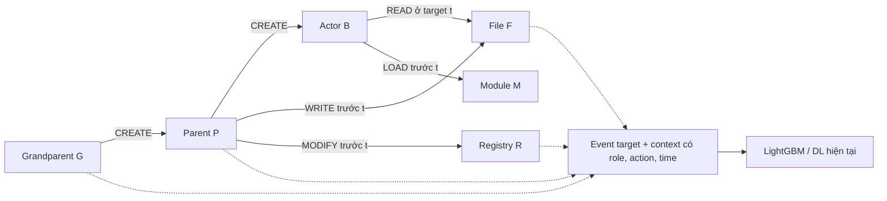

# Notebook sau sweep và thiết kế context Process–Object

Đối chiếu ngày 26/10/2026 theo bốn câu hỏi tiếp theo của người dùng. Giữ quyết định: **Host ML dự đoán event; DL giữ sample/chunk hiện tại; provenance truy xuất context, không làm detector graph mới**. Báo cáo này cập nhật đề xuất sibling trong [báo cáo trước](parent_child_block_context_review_2026-10-26.md): sibling không phải thành phần mặc định của pilot đầu tiên.

**1. Đã cập nhật notebook nào, và mức xác minh?**

[lgbm.ipynb](../code/kaggle/notebooks/lgbm.ipynb) hiện là bản **tái lập policy đã freeze sau sweep validation**, không chạy lại quá trình chọn threshold. Không có huấn luyện lại. Các ngưỡng lấy nguyên độ chính xác từ `frozen_policy.json` trong `lgbm_exact_time_middle_threshold_sweep_results`:

| Nhánh quyết định | Điều kiện ML | Threshold graph |
| --- | --- | ---: |
| Low có collision TRAIN | ML < 0,30 | 0,9973355952927457 |
| Middle, cả collision và noncollision | 0,30 ≤ ML < 0,96 | **0,7590387248013881** |
| High có collision TRAIN | ML ≥ 0,96 | 0,008663969833834228 |
| Low/high không collision | Ngoài middle | Giữ direct decision theo biên ML |

So sánh graph score dùng `>=`. Giá trị 0,95 còn trong mã chỉ để tính comparator legacy và kiểm tra cache validation cũ; nó không phải threshold của quyết định middle mới. Collision là membership trong tập vector Host có cả hai nhãn ở TRAIN; không dùng nhãn của target tại inference.

Notebook kiểm tra hash/identity model, graph, vocabulary và manifest với artifact gốc; tính lại metrics từ các shard và dự đoán. Expected counts chỉ dùng để **phát hiện sai lệch**, không dùng làm prediction hay thay kết quả đo:

| Split | TP | FP | FN | TN |
| --- | ---: | ---: | ---: | ---: |
| Validation selected | 26.579 | 417 | 294 | 805.835 |
| TEST selected | 39.880 | 626 | 430 | 1.208.753 |

TEST F1 tương ứng **0,9869332805385073**. Notebook dừng nếu validation không tái lập đúng trước khi mở TEST; kiểm tra TEST sau khi tính xong. Kết quả vẫn mang giới hạn exploratory vì TEST đã được xem ở các lượt trước.

Đã bỏ runtime collision experiment không được gọi, bộ chọn low/high policy cũ, per-vector representation audit không cần cho việc tái lập, CLI và scorer/cache thay thế không dùng. Gộp runtime còn lại vào một module nhúng `frozen_lgbm_runtime.py`. Sửa guard cũ vốn cấm thay đổi middle/noncollision; sửa transition export để giữ đúng cờ collision của từng event; publish các file error/transition từ `.tmp` và ZIP bằng rename. Giữ hash checks, TRAIN registry, CPU/GPU scoring, checkpoints, resume, full error exports và confusion matrix màu Blues.

Output mới: `/kaggle/working/lgbm_post_sweep_reproduction_v1/`; ZIP: `lgbm_post_sweep_reproduction_results.zip`. `RESUME_FROM=None` mặc định. `USE_CUDA=False` mặc định để khớp backend NumPy của artifact gốc; có thể bật CUDA nhưng chênh lệch floating-point sát threshold vẫn phải vượt kiểm tra confusion chính xác. Có thể chỉ định output cũ để lấy TRAIN registry và validation scores sau kiểm tra identity. TEST decisions cũ không được dùng lại nếu policy khác; same-output rerun tiếp tục checkpoints của policy mới.

Đã chạy **10 regression tests**, gồm biên ML/graph threshold, middle noncollision, missing score, đối chiếu policy/identity và replay toàn bộ **1.056 lỗi TEST + 2.821 prediction transitions** đã lưu. Một integration test dùng model/data giả nhỏ chạy đường compute → metrics/error export → ZIP → resume và từ chối cache policy cũ. [Mã test](../code/test/test_lgbm_post_sweep_notebook.py).

Chưa chạy lại full inference trên Kaggle và chưa kiểm tra GPU trong môi trường hiện tại. Replay các dòng đã xuất không thay thế chấm lại toàn bộ 1.249.689 TEST event. Bản sửa dùng đúng policy đã đạt điểm đó; không tuyên bố một lượt inference mới đã hoàn tất.

**2. Event không phải PROCESS được xử lý thế nào?**

`object=FILE` nghĩa là **đối tượng của thao tác là file**, không phải event không có process. Một ví dụ:

```text
e = (hostname=H, actorID=B, action=READ, object=FILE,
     objectID=F, timestamp=t, properties.file_path=...)

G --CREATE--> P --CREATE--> B --READ tại t--> F
```

Ta lấy context của **B và tổ tiên của B**. Parent của event này là cách nói tắt cho parent của actor B; file F không có “process cha” theo nghĩa process creation. Tương tự REGISTRY, MODULE, FLOW: xác định actor, giữ action và semantics của target object. Nếu không xác định được actor/hostname/timestamp, giữ event với missing-context mask; không loại khỏi đánh giá hay đoán actor từ tên file.

Pipeline hiện tại vẫn dự đoán FILE/REGISTRY bằng LightGBM vì tokenizer đã có các feature của event và object. Hạn chế nằm ở GraphSAGE Process/Host: input graph không mang đầy đủ action/object/path của target; hai event khác nhau của cùng actor ở cùng snapshot có thể nhận graph context giống nhau. Do đó cần tách hai nhu cầu:

| Nhu cầu | Cần node FILE/REGISTRY toàn cục? | Cách tối thiểu |
| --- | --- | --- |
| Biết actor B được P khởi chạy thế nào | Không | CREATE lineage + metadata đúng process |
| Biết P vừa ghi file Temp, sửa Run key, tải module | Không bắt buộc | Lịch sử event/object có kiểu gắn vào P |
| Biết process Q nào đã ghi **đúng file F** trước khi B đọc/load nó | Có thể cần index đối tượng và cạnh truy cập theo thời gian | Truy xuất quan hệ qua object F, phân biệt writer với parent |
| Theo dõi chuỗi qua nhiều file/process/host | Cần graph quan hệ rộng hơn | Ngoài pilot nhẹ ban đầu; chi phí và ambiguity tăng |

**Thiết kế khuyến nghị: process backbone + lịch sử object theo thời gian, có index cho truy xuất object khi cần.**



Các cạnh trong hình mô tả **ai thao tác lên đối tượng**, không mặc định hướng truyền dữ liệu. Nếu cần truy vết ảnh hưởng: WRITE biểu diễn Process→File; READ/LOAD biểu diễn File/Module→Process theo semantics của thao tác. Phải lưu action và role riêng, không tự coi mọi OPEN là execution hay PROCESS/OPEN là CREATE/injection. Không đồng nhất `actorID→objectID` với chiều information-flow cho mọi event.

Triển khai có thể là bảng `process`, `create_edge`, `event_history`, `object_access` với chỉ mục thời gian; không phải giữ hàng trăm triệu Event node trong RAM. Event là bản ghi/cạnh đa quan hệ `(actor,action,object,time,source,line)`; thêm Event node chỉ khi có yêu cầu mô hình cụ thể, chưa cần ở đây. Host giữ làm namespace/ownership; không mở rộng tất cả process cùng Host hoặc Host–Host cho nhiệm vụ lineage này.

Object key ưu tiên `(canonical_hostname, object_type, corrected_objectID)`. Giữ raw UUID chỉ để join/audit; path đã normalize là feature, không thay cho identity. Nếu thiếu UUID, không gộp mọi `Temp/*.exe` vào một object thật. Với shared file, truy cập sau t bị loại; bản ghi WRITE trước t chỉ là ứng viên writer, không chứng minh bytes cụ thể được READ nếu log không có offset/version. Giữ version/lifecycle khi có và đánh dấu ambiguous khi có nhiều writer. Không duyệt vô hạn qua DLL, registry root hoặc file phổ biến dùng chung.

**3. Chọn parent hay grandparent theo tiêu chí nào?**

Trước hết đây là quan hệ xác định từ log, không phải lựa chọn process “có vẻ độc hại nhất”.

| Kiểm tra | Quy tắc đề xuất |
| --- | --- |
| Parent của B | Một cạnh PROCESS/CREATE P→B, đúng hostname/UUID, đã xảy ra trước target t |
| Grandparent của B | Tiếp tục cạnh CREATE G→P; việc P được tạo không được muộn hơn lúc P tạo B |
| Mâu thuẫn | Nhiều parent, cycle, UUID/time không đáng tin: missing/conflict; không chọn tùy ý |
| Metadata | Mỗi field có evidence timestamp riêng `<t`; không lấy snapshot cuối ngày |
| Parent đã thoát | Vẫn giữ launch/lineage đã biết; parent không cần còn chạy ở t. Không đọc TERMINATE tương lai để quyết định context |
| Parent thiếu | Không đoán grandparent từ PID/PPID hoặc tên executable. Cần cả chain có bằng chứng |
| Timestamp trùng | Không suy thứ tự chỉ bằng dòng ở các file khác nhau; cạnh tại chính target t không dùng như history |

**Cấu hình đầu tiên: luôn lấy parent hợp lệ, tối đa một slot.** Sau đó so `parent` với `parent + grandparent` trên validation cùng budget. Nếu hop 2 có lợi ích đủ so với CPU/RAM/FPR, dùng hai slot cố định cho mọi event đủ evidence. Không chọn hop bằng nhãn TEST hay nhãn tổ tiên.

Grandparent đặc biệt có khả năng bổ sung khi parent là launcher trung gian: `winword.exe → cmd.exe → powershell.exe`. Đây là ví dụ giải thích tín hiệu, không phải luật tự gán malicious. Ngược lại, `services.exe`, `explorer.exe`, `winlogon.exe` có nhiều con có thể không giúp phân biệt task. Giữ metadata của parent thật, nhưng không mở rộng toàn bộ cây dưới chúng. Không mặc định loại mọi process hệ thống vì attack cũng có thể lạm dụng chúng.

Chưa có số liệu validation để nói hop 2 tốt hơn hop 1. Giới hạn hợp lý ban đầu là **actor + parent (+ grandparent) = tối đa 3 process**, cộng lịch sử event/object bị chặn số lượng. Parent history gần có thể hữu ích hơn việc thêm nhiều tổ tiên chỉ có tên executable; cần ablation hai yếu tố riêng.

**4. Sibling có bắt buộc không? KAIROS/FLASH/TAPAS nói gì?**

**Không bắt buộc.** Cùng cha không chứng minh cùng task hoặc có dependency. A có thể là service manager/browser/session launcher tạo nhiều con độc lập. Lấy tất cả sibling vừa tốn chi phí vừa đưa hành vi không liên quan vào target. Đề xuất “tối đa 4 sibling” ở báo cáo trước là cấu hình thử, không có cơ sở để coi là mặc định tốt nhất; sau đối chiếu tài liệu, pilot nên **không có sibling**.

Nếu GVHD định nghĩa block cụ thể là A+B+C, thì với target thuộc B, C đúng là một sibling cần được biểu diễn trong **biến thể family đó**. Điều này không chứng minh mọi event B luôn cần C để detect. Giữ biến thể family trong ablation để kiểm chứng yêu cầu gom block, thay vì âm thầm coi parent-only là đã kiểm chứng đầy đủ A/B/C.

| Công trình đã kiểm tra | Bằng chứng cụ thể | Phần phù hợp với mục tiêu hiện tại |
| --- | --- | --- |
| **FLASH**, PDF §4.2–4.3, trang 5–6 | Process/file/flow/module; semantic sentences từ attributes và sự kiện 1-hop; Word2Vec; contextual GNN; selective traversal, bỏ trùng và chuẩn hóa execution/user-specific attributes | Học cách chọn semantic fields, giữ action/object và hạn chế trùng. Không cần bê toàn bộ Word2Vec–GNN–classifier vào pipeline |
| **KAIROS**, PDF §4.1–4.2 | Graph subject/object và sự kiện theo thời gian; temporal state của hai đầu cạnh; reconstruct event type | Học cách giữ object context có timestamp và score trước update. Không có quy tắc bắt buộc gom sibling |
| **TAPAS**, PDF §4.3–4.5, trang 7–10 | Process-only backbone; event và File/Netflow attributes được đưa vào process history representation; phân đoạn task dựa trên process structure | Phù hợp nhất với câu hỏi “không có node FILE thì làm sao”: vẫn giữ semantics FILE trong history của process, giảm graph dimension |
| **EagleEye**, PDF §V.B/V.D, trang 5–6 | Graph hành vi process + event; security features theo file/registry; command embedding dùng command line current process và parent | Phù hợp trực tiếp với parent context và DL hiện tại. Có thể dùng tokenizer có sẵn thay sentence Transformer trong pilot nhẹ |
| **ORTHRUS**, PDF §4.4, trang 7 | Phân tích dependency có thời gian để tránh attribution quá rộng | Cần phân biệt parent với writer của object; không suy mọi node liên quan đều malicious |
| **RAPiDLe**, bản local trong `paper-token/`, abstract trang 2 | Streaming anomaly-path detector với learned baseline/tag propagation | Gợi ý về cache/streaming; không phải bằng chứng cần sibling hoặc giải pháp trực tiếp cho feature augmentation. Bản local ghi “for review”; không lấy con số hiệu quả của nó làm cam kết |

Các nguồn chính thức: [FLASH](https://ieeexplore.ieee.org/document/10646725/), [KAIROS](https://www.vanbastelaer.com/publication/kairos/), [TAPAS](https://www.usenix.org/system/files/usenixsecurity25-zhang-bo-tapas.pdf), [EagleEye](https://arxiv.org/abs/2408.09217). Đây là tham khảo thiết kế, không phải tái lập hoặc chuyển nguyên accuracy của các công trình sang corrected OpTC.

Điểm đã kiểm tra trong **mã nguồn local**, không chỉ dựa trên abstract:

- [FLASH OpTC.ipynb](../../paper-general/code/Flash-IDS/OpTC.ipynb), cell index 7/8/10: lọc PROCESS/FILE/FLOW/MODULE, tạo câu từ `parent_image_path`, `image_path`, `command_line`, `file_path`, `module_path` hoặc endpoints; xây actor/object nodes. Filter này không bao phủ REGISTRY/SHELL như Host tokenizer của ta, nên không sao chép nguyên.
- FLASH cell 18 dùng `NeighborLoader(... num_neighbors=[-1,-1])`: hai layer neighborhood sau filtering, **không phải hai đời cha và không phải cap node cố định**. Cell 25 `helper` nới metric theo 2-hop neighbors của ground truth/TP. Không dùng cách chấm nới lỏng đó cho event-level F1 của ta.
- [KAIROS config](../../paper-general/code/kairos/DARPA/CADETS_E3/config.py:108) đặt `neighbor_size=20`; [test.py](../../paper-general/code/kairos/DARPA/CADETS_E3/test.py:65) lấy neighborhood, score rồi update memory/insert cạnh của batch ở dòng 85–87. `ground-truth state` trong comment train là tương tác quan sát, không có nghĩa đưa malicious labels vào feature. Neighbor 20 là cấu hình của thí nghiệm CADETS đó, không chứng minh tối ưu cho OpTC.
- [TAPAS PDF](../../paper-general/TAPAS%20-%20An%20Efficient%20Online%20APT%20Detection%20with%20Task-guided%20Process%20Provenance%20Graph%20Segmentation%20and%20Analysis.pdf) không đơn giản gom mọi con chung cha. Nó còn cắt task tại branching process và giữ boundary node ở upstream/downstream task. Prose nói “more than one child”, pseudocode có điều kiện `children > 2` và cập nhật child count; không lấy một số fanout từ bài để áp cứng sang OpTC khi chưa tái lập thuật toán.

Nếu sau pilot muốn thêm sibling C của B, yêu cầu cả: parent A đã xác minh, C tồn tại trước t, có hoạt động gần t và **evidence liên quan**, chẳng hạn C ghi đúng object mà B đọc/load, hoặc task/session grouping đáng tin. Chỉ “cùng hostname”, “cùng tên exe” hay “cùng normalized path category” không đủ. Dùng slot `sibling` riêng, tối đa 1–2 ứng viên ở ablation đầu tiên; writer không cùng cha phải là `object_writer`, không gọi nhầm là sibling. Cửa sổ thời gian và cap là cấu hình validation, chưa được đo tối ưu.

**5. Chọn field nào của parent để bổ sung?**

Không copy nguyên raw event cha. Dùng field đã biết trước t, giữ quyền sở hữu và namespace `ctx::parent::*`; grandparent dùng namespace riêng.

| Ưu tiên | Field nguồn | Feature/context đề xuất | Cách lấy đúng |
| --- | --- | --- | --- |
| P0 | `properties.image_path` của P; `parent_image_path` tại CREATE P→B | Executable family/basename có kiểm soát; shell/script/office/browser/service; path role system/program_files/user/temp/UNC | `parent_image_path` ở CREATE P→B nói về P. Các event khác phải kiểm tra field mô tả actor hay object |
| P0 | `properties.command_line` lúc **P được tạo**, hoặc command của P được quy thuộc rõ | Command family; launcher; switch; switch–operand type; encoded/hidden/download/script indicators | Tìm CREATE G→P để lấy launch command của P. Command line ở CREATE P→B là của **B**, không phải P |
| P0 | Cạnh CREATE và target event | `parent_family → actor_family`; `parent_family → target_action/object`; launch-path relation | Giữ action/object của event đích từ feature hiện có; không biến FILE thành PROCESS |
| P0 | `timestamp` của CREATE/metadata/history | Bucket tuổi process; thời gian từ P tạo B đến target; recency của evidence | Dùng delta, không dùng ngày/giờ tấn công hay timestamp tuyệt đối |
| P0 | Chất lượng lookup | parent_missing, metadata_missing, ambiguous, truncated, observed_termination | Missing không tự là malicious; có audit source/line bên ngoài model |
| P1 | Các event thật sự do P thực hiện: `action`, `object` | Binary/count bucket theo action–object; recent CREATE/FILE/REGISTRY/MODULE/SHELL activity | Chỉ history `<t`; cap last-K/TTL; event hiện tại và hoạt động sau t bị loại |
| P1 | `file_path/new_path`, `module_path`, `key/registry_key/registry_path` của history P | File extension/path role; module role; registry root/persistence/security categories | Giữ typed semantics; không đưa arbitrary raw path, key data, memory address vào vocab |
| P1 | SHELL command/payload của P nếu có | Command/API/parameter role qua parser không thực thi | Tách launch command với lệnh chạy sau đó; không chạy hay tự giải mã payload |
| P2 | `principal` trên event có actor P; user field khi semantics được xác minh | Built-in/domain/service account class; same/different principal với target | Không copy username/SID; không lấy account của B gán cho P. Đo ablation vì account class có thể là testbed shortcut |
| P2 | FLOW trước t của P, nếu phạm vi cho phép | Direction, service/port class, private/public scope, recency/count | Không nối raw IP hay host identity thành feature; dùng extractor FLOW riêng vì Host tokenizer hiện loại FLOW |

`image_path` và `command_line` phải có evidence provenance riêng; “lấy dòng CREATE gần nhất” mà không xét actor/object rất dễ gán nhầm command của con cho cha. Nếu không có command của P thì đặt missing, không dùng command của B làm fallback. Có thể lấy metadata parent từ sự kiện không nằm trong cohort target, miễn trước t và không dùng labels.

Ví dụ biểu diễn, chỉ minh họa schema chứ không phải một trace đo được:

```text
target::action=read
target::object=file
target::file_path_role=user_document
ctx::parent::process_family=script
ctx::parent::command_family=powershell
ctx::parent::switch=encodedcommand
ctx::parent::recent_action_object=FILE_WRITE
ctx::parent::recent_file_path_role=temp
ctx::parent::to_actor_family=script->shell
ctx::grandparent::process_family=office
```

Cho ML: sparse role-scoped tokens/columns ghép với x_event. Cho DL: encode từng slot/process role rồi ghép vào vector flow trước sequence encoder; giữ các trường numeric/mask có ý nghĩa. Không flatten ID, label, campaign/scenario hoặc predicted malicious ancestor vào input. Chỉ fit từ điển/normalizer trên TRAIN theo split và causal policy đã chốt. Bounded context không cần LLM/Word2Vec/GNN để bắt đầu; Toolscaler không phải phương pháp chọn neighborhood provenance.

**6. Phương án triển khai nên chốt tiếp theo**

Khuyến nghị ba bước ablation: **event-only → event + parent launch/semantics → thêm parent history hoặc grandparent**, mỗi lần thay một yếu tố. Sibling/object-writer là thử nghiệm sau nếu validation cho thấy lỗi còn thiếu quan hệ đó. Không khởi đầu bằng một graph toàn object hoặc toàn cây family.

Giữ index/split/vocabulary/shards baseline. Cần artifact mới cho process metadata/history và sidecar context; muốn command/history đầy đủ thì phải đọc bổ sung raw log, do SQLite hiện chỉ giữ first-seen finite facts. Nếu thêm object-mediated context thì cần index object access có thời gian, không sửa graph/checkpoint cũ. Với DL vẫn cần audit UUID bridge/coverage như báo cáo trước.

**Chưa dựng graph mới, chưa scan raw để preprocess, chưa train model context.** Thay đổi thực thi lần này chỉ là notebook tái lập policy sau sweep và regression tests. Đề xuất graph/field ở trên là thiết kế có dẫn chứng, cần đo coverage, latency/RAM và validation trước khi tuyên bố cải thiện detection.
