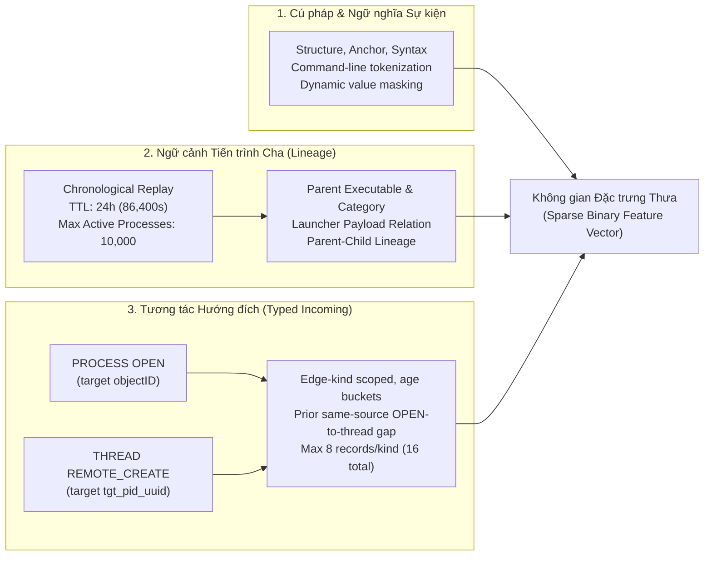

# Host ML: Parent & Incoming Context Experiment (`host_ml_parent_incoming_seed02`)

Tài liệu này mô tả phân hệ **Host ML** phát hiện APT trên dữ liệu eCAR host telemetry (DARPA OpTC).

> [!IMPORTANT]
> **Thí nghiệm hiện hành (Active SOTA Experiment):**
> Lần chạy chính thức và đạt hiệu năng cao nhất hiện tại là **`host_ml_parent_incoming_seed02`** (kế thừa phân vùng đóng băng `split` seed 02 gốc, tích hợp thêm **Parent Process Context** và **Typed Incoming Interaction Context**).
> 
> Mô hình **LightGBM** trên cấu hình mở rộng ngữ cảnh này đã nâng hiệu năng phát hiện APT từ F1 0.9533 (baseline) lên **F1 = 0.9963** trên toàn bộ 1,249,689 sự kiện của tập TEST độc lập.

---

## 1. Cấu trúc Thư mục Thí nghiệm

Dữ liệu và kết quả huấn luyện của thí nghiệm được lưu trữ tại `code/output/host_ml_parent_incoming_seed02/`:

| Thư mục / Tệp tin | Vai trò & Nội dung |
|---|---|
| `experiment_identity.json` | Hash SHA256 phân vùng split (`f771b56...`), hash mã nguồn tracker và cấu hình TTL |
| `completion.json` | Biên bản xác thực hoàn tất quá trình tiền xử lý, kiểm tra nhãn và đóng gói archive |
| `vocab.json`, `vocab_metadata.json` | Từ điển đặc trưng fit **chỉ trên tập TRAIN** (tích hợp token ngữ cảnh cha và tương tác vào) |
| `model_input/` | Manifest, assets, helper scripts và các compressed binary shards (.npz) |
| `kaggle_upload/host-input.tar` | Gói lưu trữ đầu vào hoàn chỉnh tải lên Kaggle để huấn luyện |
| `kaggle_output/lgbm_kaggle_results/` | Kết quả huấn luyện LightGBM được phê duyệt từ Kaggle (model checkpoint, metrics, test state) |
| `logs/` | Nhật ký chi tiết của từng giai đoạn scan dữ liệu |

---

## 2. Thiết kế Mở rộng Ngữ cảnh (Parent & Typed Incoming Context)

Thay vì chỉ trích xuất các đặc trưng tĩnh từ một sự kiện eCAR đơn lẻ, mô hình được mở rộng 2 tầng ngữ cảnh hành vi theo thời gian thông qua `process_context_tracker.py`:



### 2.1. Parent Process Context Tracker
- Tái hiện chuỗi sự kiện trên từng máy theo thứ tự thời gian tuyến tính (chronological replay).
- Quản lý trạng thái tiến trình với hàng đợi TTL 24 giờ (86,400 giây) và dung lượng tối đa 10,000 tiến trình active đồng thời.
- Trích xuất thông tin về nguồn gốc tiến trình cha (`parent_image_path`, quan hệ launcher → child) nhằm phát hiện các hành vi thực thi tiến trình bất thường (ví dụ: `svchost.exe` đẻ ra `powershell.exe`).

### 2.2. Typed Incoming Context (Checkpoint Schema 4)
Thu nạp các tương tác nguy hiểm có hướng tới tiến trình mục tiêu xảy ra **ngay trước thời điểm sự kiện** (strictly earlier than query timestamp):
1. **PROCESS OPEN (với target `objectID`):** Tiến trình bên ngoài mở handle can thiệp vào tiến trình mục tiêu (lưu snapshot ảnh tiến trình và quyền thực thi của bên mở).
2. **THREAD REMOTE_CREATE (với target `tgt_pid_uuid`):** Tạo luồng thực thi từ xa vào không gian bộ nhớ của tiến trình mục tiêu — dấu hiệu kinh điển của kỹ thuật **Process Injection / Code Injection** trong các chiến dịch APT.
3. **Ràng buộc an toàn nguyên nhân (Causal Safety):**
   - Cả hai đầu mút (source và target) phải là UUID hợp lệ trên cùng một máy chủ; không sử dụng PID tái sử dụng (PID reuse); không dùng nhãn tương lai hoặc nhãn của tổ tiên.
   - Mỗi tiến trình lưu tối đa 8 bản ghi cho mỗi loại tương tác (tổng cộng 16 bản ghi), TTL 24 giờ.
   - Tính toán độ trễ thời gian (age buckets) và khoảng cách thời gian giữa lần OPEN trước đó và thời điểm REMOTE_CREATE.

---

## 3. Phân vùng Dữ liệu & Huấn luyện (Frozen Split Seed 02)

Mô hình tái sử dụng chính xác phân vùng đóng băng **Stratified Random Split Seed 02** (tỷ lệ 75/10/15 phân tầng theo `file_nguồn × nhãn`):

| Phân vùng | Lành tính (Benign) | Tấn công (Malicious) | Tổng sự kiện |
|---|---:|---:|---:|
| **TRAIN** | 6,046,892 | 201,551 | 6,248,110 |
| **VALIDATION** | 806,252 | 26,873 | 833,125 |
| **TEST** | 1,209,379 | 40,310 | 1,249,689 |

- **Chống rò rỉ (No Leakage):** Từ điển đặc trưng `vocab.json` chỉ được xây dựng từ tập TRAIN (gồm cả Benign TRAIN và Malicious TRAIN).
- **Lấy mẫu khi huấn luyện:** Random negative undersampling trên tập Train (6,248,110 dòng, 201,551 positive), tham số `scale_pos_weight = 30.00`.
- **Ngưỡng quyết định (Threshold):** Lựa chọn ngưỡng tối ưu trên tập Validation ($T = 0.87427$), sau đó cố định áp dụng đánh giá một lần duy nhất trên tập Test.

---

## 4. Kết quả Thực nghiệm Mô hình LightGBM

Kết quả được ghi nhận từ lần chạy huấn luyện Kaggle được phê duyệt (`ML/code/output/host_ml_parent_incoming_seed02/kaggle_output/lgbm_kaggle_results/results/lgbm_metrics.json`):

### 4.1. Bảng chỉ số chi tiết

| Tập dữ liệu | Ngưỡng (Threshold) | Precision | Recall | F1-Score | FPR | PR-AUC (binned) | ROC-AUC (binned) |
|---|---:|---:|---:|---:|---:|---:|---:|
| **Validation** (833,125 mẫu) | 0.87427 | 0.9978 | 0.9956 | 0.9967 | 0.000074 | 0.9996 | 0.99997 |
| **Test** (1,249,689 mẫu) | 0.87427 | **0.9973** | **0.9954** | **0.9963** | **0.000090** | **0.9993** | **0.99997** |

### 4.2. Ma trận Nhầm lẫn (Confusion Matrix) trên tập TEST (1,249,689 sự kiện)

```text
                     Dự đoán Lành tính (0)    Dự đoán Tấn công (1)
Thực tế Lành tính (0)        1,209,270 (TN)                 109 (FP)
Thực tế Tấn công  (1)              187 (FN)              40,123 (TP)
```

- **True Positive (TP):** Bắt được **40,123 / 40,310** sự kiện độc hại (đạt Recall **99.54%**).
- **False Negative (FN):** Chỉ còn **187** sự kiện tấn công bị bỏ sót (giảm ngoạn mục từ 3,189 ở bản baseline cũ).
- **False Positive (FP):** Chỉ còn **109** sự kiện báo nhầm trên hơn 1.2 triệu sự kiện lành tính (FPR chỉ **0.0090%**).
- **Precision:** Đạt **99.73%**, hầu như triệt tiêu hoàn toàn báo động giả trong SOC.

---

## 5. So sánh Tiến hóa Hiệu năng Nhánh Host ML

Bảng đối chiếu bước tiến hiệu năng trên cùng tập TEST (1,249,689 sự kiện):

| Phiên bản mô hình | Ngưỡng ($T$) | Precision | Recall | F1-Score | FPR | PR-AUC | FN (Bỏ sót) | FP (Báo nhầm) |
|---|---:|---:|---:|---:|---:|---:|---:|---:|
| **Random Forest (Baseline seed02)** | 0.56634 | 0.9587 | 0.8677 | 0.9109 | 0.001244 | 0.9237 | 5,334 | 1,505 |
| **XGBoost (Baseline seed02)** | 0.87878 | 0.9793 | 0.9209 | 0.9492 | 0.000650 | 0.9523 | 3,189 | 786 |
| **LightGBM (Baseline seed02)** | 0.94016 | 0.9881 | 0.9209 | 0.9533 | 0.000369 | 0.9578 | 3,189 | 446 |
| **LightGBM + Parent & Incoming Context** | **0.87427** | **0.9973** | **0.9954** | **0.9963** | **0.000090** | **0.9993** | **187** | **109** |

> [!TIP]
> **Nhận định chuyên môn:**
> Việc bổ sung ngữ cảnh tiến trình cha và lịch sử tương tác xâm nhập (Process Open & Remote Thread Creation) đã giải quyết triệt để điểm yếu của các mô hình cây truyền thống khi chỉ nhìn vào lệnh cục bộ.
> - Số lượng sự kiện tấn công bị bỏ sót (FN) giảm hơn **94%** (từ 3,189 xuống còn 187).
> - Số lượng cảnh báo giả (FP) giảm hơn **75%** (từ 446 xuống còn 109).
> - Đường cong PR-AUC đạt **0.9993**, chứng minh mô hình phân tách hoàn hảo giữa hoạt động quản trị lành tính và hành vi APT tinh vi.

---

## 6. Hướng dẫn Tái hiện & Vận hành

### 6.1. Kiểm tra Dữ liệu Đầu vào (Local read-only check)
```bash
python3 code/preprocess/verify_model_input.py \
  --manifest code/output/host_ml_parent_incoming_seed02/model_input/manifest.json \
  --decode
```

### 6.2. Tạo lại Toàn bộ Dữ liệu Shards & Upload Archive
```bash
cd /mnt/SSD_Data/optc
python3 -u ML/code/preprocess/run_parent_context_seed02.py \
  --workers 6 \
  --output-dir /mnt/SSD_Data/optc/ML/code/output/host_ml_parent_incoming_seed02
```

### 6.3. Huấn luyện trên Kaggle
1. Upload gói `ML/code/output/host_ml_parent_incoming_seed02/kaggle_upload/host-input.tar` lên Kaggle Dataset.
2. Import notebook `ML/code/kaggle/notebooks/lgbm.ipynb`.
3. Chạy notebook để tự động huấn luyện, chọn ngưỡng trên Validation và đánh giá trên Test set.
4. Xem hướng dẫn chi tiết tại [Kaggle Parent Context Runbook](kaggle/docs/PARENT_CONTEXT_RUNBOOK.md).
