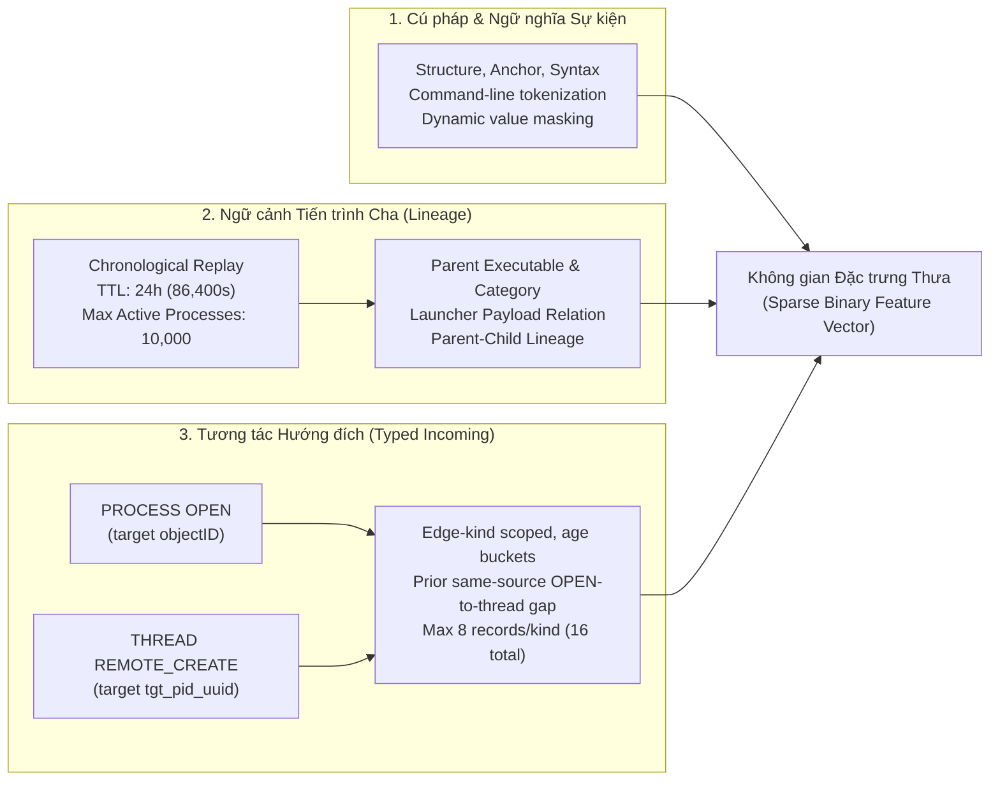

# Host ML: Parent & Incoming Context Experiment (`host_ml_parent_incoming_seed02`)

Tài liệu này mô tả chi tiết kiến trúc, cấu trúc tệp tin, kết quả thực nghiệm và hướng dẫn vận hành từng bước (step-by-step) của phân hệ **Host ML** phát hiện APT trên dữ liệu eCAR host telemetry (DARPA OpTC).

> [!IMPORTANT]
> **Thí nghiệm hiện hành (Active SOTA Experiment):**
> Lần chạy chính thức và đạt hiệu năng cao nhất hiện tại là **`host_ml_parent_incoming_seed02`** (kế thừa phân vùng đóng băng `split` seed 02 gốc, tích hợp thêm **Parent Process Context** và **Typed Incoming Interaction Context**).
> 
> Mô hình **LightGBM** trên cấu hình mở rộng ngữ cảnh này đã nâng hiệu năng phát hiện APT từ F1 0.9533 (baseline) lên **F1 = 0.9963** trên toàn bộ 1,249,689 sự kiện của tập TEST độc lập.

---

## 1. Cây thư mục và Giải thích Ý nghĩa Các Tệp tin (`ML/code/`)

Toàn bộ mã nguồn và dữ liệu của phân hệ Host ML đã được tinh gọn, loại bỏ các mô hình và kiểm thử cũ (Random Forest, XGBoost baseline không context, GraphSAGE offline). Dưới đây là sơ đồ cây và bảng mô tả chức năng của từng tệp tin trong repository:

```text
ML/code/
├── README.md                          # Tài liệu kỹ thuật tổng thể và hướng dẫn vận hành pipeline
├── preprocess/                        # Pipeline tiền xử lý dữ liệu và tạo shard đầu vào
│   ├── build_host_index.py            # CLI quét dữ liệu thô eCAR để tạo index nhãn sự kiện
│   ├── build_split.py                 # CLI tạo phân vùng ngẫu nhiên phân tầng 75/10/15
│   ├── build_split_contextual.py      # Sinh phân vùng contextual cohort (Option B, seed 02)
│   ├── build_vocab.py                 # Xây dựng từ điển đặc trưng ngữ nghĩa chỉ từ tập TRAIN
│   ├── build_model_input.py           # Sinh các binary shards nén (.npz) kết hợp context
│   ├── run_parent_context_seed02.py   # Script tự động hóa toàn trình (Vocab -> Shards -> Verify -> Package)
│   ├── process_context_tracker.py     # Lõi theo dõi ngữ cảnh: Tiến trình cha + Tương tác hướng đích
│   ├── ecar_tokenizer.py              # Bộ bóc tách token cú pháp & ngữ nghĩa từ sự kiện eCAR
│   ├── command_syntax.py              # Bộ phân tích cú pháp lexer/AST cho dòng lệnh command-line
│   ├── host_shards.py                 # Bộ giải mã (codec), lặp và đọc dữ liệu HostShardDataset
│   ├── shard_storage.py               # Quản lý phân bổ đĩa lưu trữ, ghi shard nguyên tử (atomic)
│   ├── shard_metrics.py               # Đo lường và kiểm tra chỉ số thống kê trong luồng shard
│   ├── stratified_pipeline.py         # Thư viện lõi cho indexing và phân tầng mẫu độc lập
│   ├── pipeline_contract.py           # Thiết lập ranh giới dữ liệu chỉ đọc và kiểm tra hash mã nguồn
│   ├── verify_model_input.py          # Script kiểm tra giải mã và xác thực tính toàn vẹn shard
│   └── build_matrix.py                # Helper phân tích metadata tệp phục vụ cho stratified_pipeline
├── kaggle/                            # Đóng gói và huấn luyện trên nền tảng Kaggle
│   ├── notebooks/
│   │   └── lgbm.ipynb                 # Notebook chính thức huấn luyện LightGBM trên Kaggle
│   ├── scripts/
│   │   ├── package_host_shards.py     # Đóng gói 358 shards + notebook thành archive host-input.tar
│   │   ├── refresh_parent_context_notebook.py  # Sinh lại notebook lgbm.ipynb với runtime nhúng sẵn
│   │   └── refresh_host_notebooks.py  # Cung cấp template cấu trúc notebook cơ sở
│   ├── docs/
│   │   └── PARENT_CONTEXT_RUNBOOK.md  # Sổ tay hướng dẫn chi tiết từng bước chạy trên Kaggle
│   ├── host_training_runtime.py       # Runtime huấn luyện, checkpoint và đánh giá nhúng vào notebook
│   ├── requirements-cpu.txt           # Danh mục thư viện Python tối thiểu cho môi trường CPU
│   └── requirements-gpu.txt           # Danh mục thư viện Python cho môi trường GPU
├── others/
│   └── model_input_volumes_parent_context.json # Cấu hình phân bổ hạn mức đĩa (SSD/HDD/System)
├── test/                              # Bộ kiểm thử hồi quy bảo vệ pipeline (11 modules, 104 tests)
│   ├── fixtures/                      # Dữ liệu mẫu giả lập phục vụ unit test
│   ├── test_build_split_contextual.py # Kiểm thử bộ sinh phân vùng đóng băng contextual split
│   ├── test_build_vocab.py            # Kiểm thử trích xuất từ điển đặc trưng và chống rò rỉ nhãn
│   ├── test_ecar_tokenizer.py         # Kiểm thử token hóa dòng lệnh và thuộc tính sự kiện eCAR
│   ├── test_host_shards.py            # Kiểm thử đọc/ghi shard, iterator và ma trận thưa
│   ├── test_incoming_context.py       # Kiểm thử trích xuất tương tác OPEN và THREAD REMOTE_CREATE
│   ├── test_package_host_shards.py    # Kiểm thử đóng gói kho lưu trữ tar upload
│   ├── test_parent_context_enrichment.py  # Bộ kiểm thử 12 quy tắc an toàn ngữ cảnh tiến trình cha
│   ├── test_parent_context_notebook.py    # Kiểm thử tính hợp lệ cú pháp notebook lgbm.ipynb
│   ├── test_parent_context_prune_schedule.py # Kiểm thử dọn dẹp bộ nhớ đệm TTL và giới hạn tiến trình
│   ├── test_pipeline_contract.py      # Kiểm thử ranh giới thư mục chỉ đọc và mã hóa hash
│   └── test_stratified_pipeline.py    # Kiểm thử tính toán phân tầng mẫu và phân bổ quota
└── output/                            # Kho lưu trữ kết quả thực nghiệm duy nhất
    ├── host_ml_parent_incoming_seed02/ # KẾT QUẢ CUỐI CÙNG SOTA (F1 = 0.9963)
    │   ├── experiment_identity.json   # Định danh cấu hình, tham số TTL và SHA-256 mã nguồn
    │   ├── completion.json            # Biên bản hoàn thành tiền xử lý dữ liệu và đóng gói
    │   ├── vocab.json                 # Từ điển đặc trưng (511 KB, 20,412 tokens nhị phân)
    │   ├── vocab_metadata.json        # Metadata thống kê tần suất xuất hiện token trên tập TRAIN
    │   ├── frozen_label_membership_verification.json # Biên bản đối chiếu nhãn đóng băng 100%
    │   ├── scope.json                 # Thống kê tổng số host, số file nguồn và số dòng xử lý
    │   ├── storage_config.json        # Cấu hình đường dẫn volume SSD lưu trữ shard
    │   ├── logs/                      # Toàn bộ nhật ký chạy từng giai đoạn quét dữ liệu
    │   ├── vocab_checkpoints/         # Checkpoint trung gian trong quá trình duyệt từ điển
    │   ├── model_input/               # 358 binary shards (.npz) kèm manifest và helper scripts
    │   ├── kaggle_upload/             # Chứa file host-input.tar để upload lên Kaggle
    │   └── kaggle_output/             # Kết quả huấn luyện chính thức tải về từ Kaggle
    │       └── lgbm_kaggle_results/
    │           ├── model/
    │           │   └── lightgbm_model.txt # Model weights LightGBM chính thức
    │           └── results/
    │               ├── lgbm_metrics.json  # Toàn bộ chỉ số chi tiết trên Validation và Test
    │               └── confusion_matrix.png
    └── host_ml_seed02/                # Phân vùng nền tảng kế thừa phục vụ tái lập
        ├── index/                     # Manifest và chỉ mục nhãn toàn bộ file eCAR
        └── split/                     # Manifest và mặt nạ phân vùng đóng băng seed 02
```

---

## 2. Thiết kế Mở rộng Ngữ cảnh (Parent & Typed Incoming Context)

Thay vì chỉ nhìn vào một sự kiện riêng lẻ, mô hình tích hợp **2 tầng ngữ cảnh hành vi theo thời gian** thông qua [process_context_tracker.py](file:///mnt/SSD_Data/optc/ML/code/preprocess/process_context_tracker.py):



### 2.1. Parent Process Context Tracker
- Tái hiện chuỗi sự kiện trên từng máy theo thứ tự thời gian tuyến tính (chronological replay).
- Quản lý trạng thái tiến trình với hàng đợi TTL 24 giờ (86,400 giây) và dung lượng tối đa 10,000 tiến trình active đồng thời.
- Trích xuất thông tin về nguồn gốc tiến trình cha (`parent_image_path`, quan hệ launcher → child) nhằm phát hiện các hành vi thực thi tiến trình bất thường (ví dụ: `svchost.exe` đẻ ra `powershell.exe`).

### 2.2. Typed Incoming Context (Checkpoint Schema 4)
Thu nạp các tương tác nguy hiểm có hướng tới tiến trình mục tiêu xảy ra **ngay trước thời điểm sự kiện** (strictly earlier than query timestamp):
1. **PROCESS OPEN (với target `objectID`):** Tiến trình bên ngoài mở handle can thiệp vào tiến trình mục tiêu (lưu snapshot ảnh tiến trình và quyền thực thi của bên mở).
2. **THREAD REMOTE_CREATE (với target `tgt_pid_uuid`):** Tạo luồng thực thi từ xa vào không gian bộ nhớ của tiến trình mục tiêu — dấu hiệu kinh điển của kỹ thuật **Process Injection / Code Injection** trong các chiến dịch APT.
3. **Ràng buộc an toàn nguyên nhân (Causal Safety):**
   - Cả hai đầu mút (source và target) phải là UUID hợp lệ trên cùng một máy chủ; không sử dụng PID tái sử dụng (PID reuse); không dùng nhãn tương lai hoặc nhãn của tổ tiên.
   - Mỗi tiến trình lưu tối đa 8 bản ghi cho mỗi loại tương tác (tổng cộng 16 bản ghi), TTL 24 giờ.
   - Tính toán khoảng cách thời gian (age buckets) và độ trễ từ lúc mở OPEN đến lúc REMOTE_CREATE.

---

## 3. Phân vùng Dữ liệu & Huấn luyện (Frozen Split Seed 02)

Mô hình tái sử dụng chính xác phân vùng đóng băng **Stratified Random Split Seed 02** (tỷ lệ 75/10/15 phân tầng theo `file_nguồn × nhãn`):

| Phân vùng | Lành tính (Benign) | Tấn công (Malicious) | Tổng sự kiện |
|---|---:|---:|---:|
| **TRAIN** | 6,046,892 | 201,551 | 6,248,110 |
| **VALIDATION** | 806,252 | 26,873 | 833,125 |
| **TEST** | 1,209,379 | 40,310 | 1,249,689 |

- **Chống rò rỉ tuyệt đối (No Leakage):** Từ điển đặc trưng `vocab.json` chỉ được xây dựng từ tập TRAIN (bao gồm cả Benign TRAIN và Malicious TRAIN). Tuyệt đối không đưa bất kỳ token mới nào từ tập Validation hoặc Test vào từ điển.
- **Lấy mẫu khi huấn luyện:** Random negative undersampling trên tập Train với tỷ lệ âm:dương là 30:1 (`scale_pos_weight = 30.00`).
- **Ngưỡng quyết định (Threshold):** Lựa chọn ngưỡng tối ưu trên tập Validation ($T = 0.87427$), sau đó cố định áp dụng đánh giá một lần duy nhất trên tập Test.

---

## 4. Kết quả Thực nghiệm Mô hình LightGBM

Kết quả được ghi nhận từ lần chạy huấn luyện Kaggle chính thức ([lgbm_metrics.json](file:///mnt/SSD_Data/optc/ML/code/output/host_ml_parent_incoming_seed02/kaggle_output/lgbm_kaggle_results/results/lgbm_metrics.json)):

### 4.1. Bảng chỉ số chi tiết

| Tập dữ liệu | Ngưỡng (Threshold) | Precision | Recall | F1-Score | FPR | PR-AUC (binned) | ROC-AUC (binned) |
|---|---:|---:|---:|---:|---:|---:|---:|
| **Validation** (833,125 mẫu) | 0.87427 | 0.9978 | 0.9956 | 0.9967 | 0.000074 | 0.9996 | 0.99997 |
| **Test** (1,249,689 mẫu) | 0.87427 | **0.9973** | **0.9954** | **0.9963** | **0.000090** | **0.9993** | **0.99997** |

### 4.2. Ma trận Nhầm lẫn (Confusion Matrix) trên tập TEST (1,249,689 sự kiện)

```text
                     Dự đoán Lành tính (0)    Dự đoán Tấn công (1)
Thực tế Lành tính (0)        1,209,270 (TN)                 109 (FP)
Thực tế Tấn công  (1)              187 (FN)              40,123 (TP)
```

- **True Positive (TP):** Bắt được **40,123 / 40,310** sự kiện độc hại (đạt Recall **99.54%**).
- **False Negative (FN):** Chỉ còn **187** sự kiện tấn công bị bỏ sót (giảm ngoạn mục từ 3,189 ở bản baseline cũ).
- **False Positive (FP):** Chỉ còn **109** sự kiện báo nhầm trên hơn 1.2 triệu sự kiện lành tính (FPR chỉ **0.0090%**).
- **Precision:** Đạt **99.73%**, triệt tiêu gần như hoàn toàn cảnh báo giả trong SOC.

---

## 5. So sánh Tiến hóa Hiệu năng Nhánh Host ML

Bảng đối chiếu bước tiến hiệu năng trên cùng tập TEST (1,249,689 sự kiện):

| Phiên bản mô hình | Ngưỡng ($T$) | Precision | Recall | F1-Score | FPR | PR-AUC | FN (Bỏ sót) | FP (Báo nhầm) |
|---|---:|---:|---:|---:|---:|---:|---:|---:|
| **Random Forest (Baseline seed02)** | 0.56634 | 0.9587 | 0.8677 | 0.9109 | 0.001244 | 0.9237 | 5,334 | 1,505 |
| **XGBoost (Baseline seed02)** | 0.87878 | 0.9793 | 0.9209 | 0.9492 | 0.000650 | 0.9523 | 3,189 | 786 |
| **LightGBM (Baseline seed02)** | 0.94016 | 0.9881 | 0.9209 | 0.9533 | 0.000369 | 0.9578 | 3,189 | 446 |
| **LightGBM + Parent & Incoming Context** | **0.87427** | **0.9973** | **0.9954** | **0.9963** | **0.000090** | **0.9993** | **187** | **109** |

---

## 6. Hướng dẫn Vận hành Step-by-Step (Dành cho người mới clone repo)

Mục này cung cấp hướng dẫn tường tận để bất kỳ ai khi clone repository về đều có thể kiểm tra tính đúng đắn, tái tạo lại toàn bộ dữ liệu, và huấn luyện mô hình.

> [!NOTE]
> Tất cả các câu lệnh bên dưới **đều được chạy từ thư mục gốc của repository**:
> ```bash
> cd /mnt/SSD_Data/optc
> ```

---

### Bước 0: Chuẩn bị Môi trường & Dependencies

Hệ thống yêu cầu **Python 3.12+**. Cài đặt các gói phụ thuộc tối thiểu:

```bash
pip install numpy scipy lightgbm psutil
```

Kiểm tra sự tồn tại của 2 thư mục dữ liệu gốc (được bảo vệ chỉ đọc):
- `host-begnin/` (thư mục cố ý viết đúng theo tên dataset trong repo)
- `host-malicious/`

---

### Bước 1: Chạy Kiểm thử Tự động Toàn diện (Sanity Test Suite)

Chạy bộ unit test gồm 11 module kiểm thử (104 bài test) để đảm bảo tokenizer, context tracker, shard reader và hợp đồng bảo mật hoạt động hoàn hảo:

```bash
python3 -m unittest discover -s ML/code/test -p "test_*.py"
```
**Kỳ vọng đầu ra:** `Ran 104 tests in ~9s — OK`.

---

### Bước 2: Kiểm tra Tính toàn vẹn của Dữ liệu Shards đã tạo sẵn

Nếu dữ liệu tại `ML/code/output/host_ml_parent_incoming_seed02/` đã có sẵn, bạn có thể kiểm tra giải mã 358 shard nhị phân trong vài giây:

```bash
python3 ML/code/preprocess/verify_model_input.py \
  --manifest ML/code/output/host_ml_parent_incoming_seed02/model_input/manifest.json \
  --decode
```
**Kỳ vọng đầu ra:** `[358/358] verified`, in ra thống kê 6,248,443 mẫu TRAIN, 833,125 mẫu VAL, 1,249,689 mẫu TEST khớp 100% với phân vùng đóng băng.

---

### Bước 3: Tái tạo lại Dữ liệu từ Đầu (Data Regeneration Pipeline)

#### Cách 3.1: Khuyên dùng — Tái tạo tự động bằng Script Orchestrator
Sử dụng phân vùng đóng băng seed 02 có sẵn trong `output/host_ml_seed02/` để sinh lại từ điển đặc trưng ngữ cảnh, toàn bộ 358 shard nhị phân và đóng gói file tar tải lên Kaggle:

```bash
python3 -u ML/code/preprocess/run_parent_context_seed02.py \
  --workers 6 \
  --output-dir ML/code/output/host_ml_parent_incoming_seed02
```
*Lưu ý: Quá trình này sẽ thực hiện lần lượt 4 giai đoạn:*
1. `vocabulary`: Quét tập TRAIN và trích xuất từ điển đặc trưng `vocab.json` (có hỗ trợ checkpoint).
2. `shards`: Sinh 358 tệp `.npz` nén với bộ theo dõi tiến trình cha và tương tác hướng đích.
3. `decode_verify`: Giải mã và đối chiếu nhãn từng dòng của từng shard với mask gốc.
4. `package`: Đóng gói thành `ML/code/output/host_ml_parent_incoming_seed02/kaggle_upload/host-input.tar`.

#### Cách 3.2: Tái tạo phân vùng (Split) từ file JSON log thô ban đầu (Nếu muốn làm lại từ số 0)
Nếu muốn tự sinh lại tệp `index` và `split` từ các file `.json.gz` thô của dataset:
1. **Tạo index nhãn:**
   ```bash
   python3 ML/code/preprocess/build_host_index.py \
     --benign-root host-begnin \
     --malicious-root host-malicious \
     --output-dir ML/code/output/host_ml_seed02/index \
     --workers 6
   ```
2. **Tạo mặt nạ phân vùng đóng băng (seed 02, 75/10/15):**
   ```bash
   python3 ML/code/preprocess/build_split_contextual.py \
     --index ML/code/output/host_ml_seed02/index/manifest.json \
     --output-dir ML/code/output/host_ml_seed02/split \
     --workers 6 \
     --seed 02
   ```
3. Sau khi có `index/` và `split/`, chạy tiếp lệnh ở **Cách 3.1**.

---

### Bước 4: Đóng gói Thủ công & Đồng bộ Notebook Kaggle (Tùy chọn)

Nếu bạn vừa tinh chỉnh logic trong [host_training_runtime.py](file:///mnt/SSD_Data/optc/ML/code/kaggle/host_training_runtime.py) và muốn nhúng lại mã nguồn mới nhất vào notebook Kaggle:

```bash
# 1. Cập nhật mã runtime vào notebook lgbm.ipynb
python3 ML/code/kaggle/scripts/refresh_parent_context_notebook.py

# 2. Đóng gói lại kho lưu trữ tar upload
python3 ML/code/kaggle/scripts/package_host_shards.py \
  --manifest ML/code/output/host_ml_parent_incoming_seed02/model_input/manifest.json \
  --output-dir ML/code/output/host_ml_parent_incoming_seed02/kaggle_upload \
  --notebook lgbm.ipynb
```
File đóng gói được xuất ra tại:
`ML/code/output/host_ml_parent_incoming_seed02/kaggle_upload/host-input.tar`

---

### Bước 5: Huấn luyện và Đánh giá trên Kaggle

1. **Tạo Dataset trên Kaggle:**
   - Vào Kaggle -> **Datasets** -> **New Dataset**.
   - Đặt tên dataset (ví dụ: `optc-host-parent-incoming-input`).
   - Tải tệp `ML/code/output/host_ml_parent_incoming_seed02/kaggle_upload/host-input.tar` lên và nhấn **Create**.
2. **Tạo Notebook trên Kaggle:**
   - Vào Kaggle -> **Code** -> **New Notebook**.
   - Chọn menu **File** -> **Import Notebook** -> Chọn tệp [lgbm.ipynb](file:///mnt/SSD_Data/optc/ML/code/kaggle/notebooks/lgbm.ipynb).
   - Ở bảng bên phải (Settings):
     - **Accelerator:** CPU (khuyên dùng 4 CPU, 30 GB RAM).
     - **Data:** Nhấn **Add Input**, chọn Dataset vừa tạo ở bước 1.
3. **Thực thi Huấn luyện:**
   - Nhấn **Run All**.
   - Notebook sẽ tự động:
     - Giải nén `host-input.tar` vào thư mục làm việc.
     - Lấy mẫu âm ngẫu nhiên 30:1 trên tập TRAIN.
     - Huấn luyện LightGBM trong khoảng 5-8 phút.
     - Quét tìm ngưỡng tối ưu $T$ trên 833,125 sự kiện của tập Validation.
     - Đánh giá một lần duy nhất với ngưỡng cố định trên toàn bộ 1,249,689 sự kiện của tập TEST.
     - Xuất các file kết quả vào `/kaggle/working/lgbm_kaggle_results`.
4. **Lưu trữ Kết quả về Local:**
   - Tải toàn bộ thư mục `lgbm_kaggle_results` từ Kaggle về máy và đặt vào:
     `ML/code/output/host_ml_parent_incoming_seed02/kaggle_output/lgbm_kaggle_results/`

---

### Bước 6: Kiểm tra Kết quả Mô hình SOTA tại Local

Xem trực tiếp các chỉ số đánh giá đã được kiểm chứng độc lập:

```bash
cat ML/code/output/host_ml_parent_incoming_seed02/kaggle_output/lgbm_kaggle_results/results/lgbm_metrics.json | jq .
```

Các chỉ số cốt lõi xác nhận mô hình hoàn tất:
- `test.f1_score`: **`0.9963`**
- `test.precision`: **`0.9973`**
- `test.recall`: **`0.9954`**
- `test.false_positive_rate`: **`0.000090`** (chỉ 109 sự kiện báo nhầm trên 1.2 triệu sự kiện lành tính)
- `test.pr_auc_binned`: **`0.9993`**
