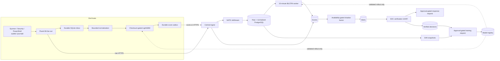

# KLTN: OpenStack end hosts, central detection framework and gated MLOps

Cập nhật: **03/11/2026**.

Thư mục này hiện chứa một framework chạy được theo kiến trúc đích
[`images/General_Architecture.png`](images/General_Architecture.png): thu thập raw
telemetry, chuẩn hóa, endpoint Host ML, Central Network DL, score relay, fusion,
SOC verification, model registry, drift trigger, incremental-learning request và
response request. Mọi khối phụ thuộc model đều **fail closed** khi chưa có bundle
hợp lệ.

> [!IMPORTANT]
> “Framework hoàn chỉnh” ở đây có nghĩa là các interface, durable state,
> orchestration và safety gate đã có mã nguồn. Nó **không** có nghĩa hệ thống APT
> detector đã được xác nhận hoạt động. Hai output run 12 hiện chỉ được đóng gói
> thành `candidate`, chưa có live parity fixture nên không thể activate. THEIA /
> Linux inference vẫn là `unsupported`; Ubuntu chỉ thu thập telemetry.

Không có VM hoặc tài nguyên OpenStack nào được tạo trong lần cập nhật mã nguồn
này. Terraform state hiện tại có `0` resource; luôn chạy `terraform plan` và đối
chiếu OpenStack thực tế trước khi quyết định `apply`.

## 1. Kiến trúc triển khai



Raw forwarding độc lập với model serving. Model lỗi, thiếu hoặc không tương thích
không được biến thành score `0`/benign và không được làm dừng raw archive.

## 2. Đối chiếu kiến trúc đích

| Khối | Mã nguồn hiện có | Trạng thái thực tế |
|---|---|---|
| Activities, sensors, logging | `ansible/roles/{windows_sensor,linux_sensor}` | Đã có cấu hình 7 luồng; cần VM để triển khai lại |
| Local durable storage | `serving/endpoint/agent.py` | SQLite WAL, dedup, giới hạn 50k/128 MiB |
| Host normalization/context | `serving/endpoint/endpoint_normalization.py` | Windows mapping bounded đã có; causal process-lifetime parity chưa được duyệt |
| Host ML | `serving/endpoint/agent.py` | LightGBM loader/scorer có checksum, width và domain gates; chưa active |
| Score forwarding | SQLite `score_outbox` → `/v1/scores` | Idempotent, retry bền vững, host credential ràng buộc host ID |
| Central receive/queue | `central/app/api.py`, `worker.py` | Raw NATS archive + score API tách biệt |
| Raw/processed storage | `central/app/common.py` | `events`, `normalized_events`, `scores`, evidence references |
| Normalization/correlation | `central/app/normalization.py` | Sysmon/Security/PowerShell/audit/journal common view; không suy diễn field thiếu |
| Network DL | `serving/central/{worker.py,bilstm.py}` | 15-minute bounded sequence + strict state-dict loader; chưa active |
| Context-aware fusion | `central/app/framework.py`, `framework_worker.py` | Shadow fallback có source mask; learned gating/cross-attention chưa có bundle |
| SOC dashboard | `GET /soc`, alert/review APIs | UI nhỏ phục vụ verification; không nhúng secret |
| Response/infra controller | `response_requests` + approval APIs | Chỉ tạo/duyệt request; không tự động đổi OpenStack network |
| MLOps/incremental learning | drift snapshots, training requests, registry APIs | Trigger và state machine đã có; notebook training vẫn là external approved runner |

Những mục “chưa active” là gate có chủ ý, không phải được coi như benign result.
KLTN chỉ có hai nhánh score: `host_ml` (LightGBM) và `network_dl`
(BiLSTM); không có nhánh Provenance/GraphSAGE trong runtime này.

## 3. Model run 12 và giới hạn domain

Nguồn được chọn:

- Host ML: `IL/dataset_1-ATLASv2/code/ML/output/kaggle_output/12`
  - LightGBM `model-slot-1.txt`, 12,337 features;
  - validation threshold `0.97917`;
  - output metrics báo TEST F1 `0.9375`, precision `1.0`, recall `0.8824` trên
    split ATLASv2 đã công bố. Đây không phải live OpenStack accuracy.
- Network DL: `IL/dataset_1-ATLASv2/code/DL/output/kaggle_output/12`
  - `incremental_best.pt`;
  - 4 categorical fields (`app_family`, `proto`, `resp_port_class`,
    `image_dir_class`) + `delta_t_log1p`;
  - threshold `0.245`.

Tạo candidate bundles, không sửa output huấn luyện:

```bash
python3 Openstack/KLTN/scripts/build_model_bundles.py
python3 Openstack/KLTN/scripts/verify_model_bundle.py \
  Openstack/KLTN/runtime/releases/host-ml-run12-candidate --branch host_ml
python3 Openstack/KLTN/scripts/verify_model_bundle.py \
  Openstack/KLTN/runtime/releases/network-dl-run12-candidate --branch network_dl
```

Output nằm trong `Openstack/KLTN/runtime/releases/` và bị gitignore:

```text
host-ml-run12-candidate/
network-dl-run12-candidate/
  manifest.json
  model/
  preprocess/
  evidence/
```

Manifest ghi SHA256 từng artifact, threshold, feature contract, domain và danh
sách blocker. Cả hai hiện có `activation.eligible=false`. Không sửa cờ này bằng
tay. Cần xuất golden fixture từ chính training runtime, chạy raw→feature→score
parity qua service, kiểm tra threshold boundary và xác nhận live domain trước khi
phát hành một bundle ID mới.

Sau khi một release mới thực sự vượt qua `--require-eligible`, rollout vẫn là
thao tác riêng, có chủ ý:

```bash
# Windows Host ML canary
Openstack/KLTN/runtime/venv/bin/ansible-playbook \
  Openstack/KLTN/ansible/deploy-host-model.yml \
  -e host_model_bundle=/absolute/path/to/eligible-host-release

# Central Network DL: stage first, inspect, then explicitly recreate worker
python3 Openstack/KLTN/scripts/stage_dl_bundle.py \
  /absolute/path/to/eligible-network-release
docker compose -f Openstack/KLTN/central/compose.yaml \
  --profile model-prep up -d --force-recreate dl-prep
```

### THEIA / Linux

Không dùng model Windows cho auditd/journald. Linux agent tiếp tục lưu inbox và
raw archive, nhưng không chấm điểm. Một release THEIA hợp lệ cần:

1. adapter audit serial grouping (`SYSCALL/EXECVE/CWD/PATH/PROCTITLE`);
2. causal PID-lifetime/parent tracking chống PID reuse;
3. vocabulary/sequence contract fit trên TRAIN Linux;
4. THEIA validation và parity fixtures;
5. bundle có domain `linux-audit` và artifact hashes độc lập.

## 4. Tái tạo framework mà không tạo VM

Chế độ này phù hợp để kiểm tra mã nguồn, schema và candidate artifacts:

```bash
cd /mnt/SSD_Data/optc

python3 -m unittest discover -s Openstack/KLTN/test -v
python3 -m py_compile \
  Openstack/KLTN/central/app/*.py \
  Openstack/KLTN/serving/endpoint/*.py \
  Openstack/KLTN/serving/central/*.py
python3 Openstack/KLTN/scripts/build_model_bundles.py

terraform -chdir=Openstack/KLTN/terraform fmt -check
```

Không chạy `terraform apply`. Nếu central runtime/secrets từ lần triển khai trước
còn hợp lệ, có thể rebuild/start control plane:

```bash
bash Openstack/KLTN/scripts/central_up.sh
docker compose -f Openstack/KLTN/central/compose.yaml \
  --profile framework ps
```

`central_up.sh` bật raw archive và `framework-worker`; nó không tạo Nova instance.

## 5. Tái tạo đầy đủ lab OpenStack (có tạo VM)

Chỉ thực hiện khi thực sự muốn tạo 2 Ubuntu + 1 Windows. Đọc
[`terraform/README.md`](terraform/README.md) trước.

### 5.1 Plan trước, không apply ngầm

```bash
source "$HOME/venvs/kolla-2026.1/bin/activate"
source /etc/kolla/admin-openrc.sh
openstack compute service set --enable openstack-aio nova-compute

terraform -chdir=Openstack/KLTN/terraform init
terraform -chdir=Openstack/KLTN/terraform validate
terraform -chdir=Openstack/KLTN/terraform plan -out=kltn.tfplan
```

Đọc toàn bộ plan. Chỉ sau khi xác nhận đúng 3 VM/network/subnet/router/security
group/floating IP mới chạy:

```bash
terraform -chdir=Openstack/KLTN/terraform apply kltn.tfplan
```

### 5.2 Central, inventory, sensors và model-gated runtimes

```bash
bash Openstack/KLTN/scripts/central_up.sh
Openstack/KLTN/runtime/venv/bin/python Openstack/KLTN/scripts/prepare_inventory.py
python3 Openstack/KLTN/scripts/fetch_assets.py

export ANSIBLE_CONFIG="$PWD/Openstack/KLTN/ansible/ansible.cfg"
Openstack/KLTN/runtime/venv/bin/ansible-playbook Openstack/KLTN/ansible/site.yml
bash Openstack/KLTN/scripts/prepare_serving.sh
```

`prepare_serving.sh` cài runtime và local fan-out nhưng giữ `mode=prepare`; nó
không copy/activate candidate bundles.

## 6. API và durable state

Central ingress duy nhất vẫn là `https://<central>:18443` qua Caddy.

| Interface | Auth | Chức năng |
|---|---|---|
| `POST /v1/events/{host}/{source}` | per-host token | Raw ingest → NATS |
| `POST /v1/scores` | per-host/admin | `score.v1`, host ownership, durable idempotency |
| `GET /v1/framework/status` | admin | Counts, services, registered bundles |
| `GET /v1/alerts` | admin | Risk/evidence queue |
| `POST /v1/alerts/{id}/reviews` | admin | SOC decision |
| `POST /v1/alerts/{id}/responses` | admin | Tạo request, chưa thực thi |
| `POST /v1/responses/{id}/approve` | admin | Phê duyệt riêng biệt |
| `GET /v1/training/requests` | admin | Drift/scheduled/enough-data requests |
| `POST /v1/training/requests/{id}/approve` | admin | Cho phép external runner nhận việc |
| `POST /v1/models` | admin | Đăng ký manifest metadata |
| `POST /v1/models/{id}/activate` | admin | Chỉ nhận bundle eligible + validated |
| `GET /soc` | token nhập trong trang | Lightweight SOC verification page |

`response approve` không tự chạy lệnh OpenStack. Tách phê duyệt khỏi executor giúp
tránh một shadow prediction hoặc tài khoản telemetry tự cô lập VM.

## 7. Verification

### Unit/contract tests

```bash
python3 -m unittest discover -s Openstack/KLTN/test -v
```

Tests hiện bao phủ event identity, inbox atomicity/capacity, score outbox,
score-contract ownership/null semantics, fusion source mask và central/endpoint
Sysmon adapter parity.

### Live smoke sau khi có VM

```bash
python3 Openstack/KLTN/scripts/status.py
python3 Openstack/KLTN/scripts/serving_status.py

Openstack/KLTN/runtime/venv/bin/ansible-playbook \
  Openstack/KLTN/ansible/smoke.yml \
  -e smoke_marker=kltn-framework-smoke-001

python3 Openstack/KLTN/scripts/check_ingest.py
python3 Openstack/KLTN/scripts/check_serving_telemetry.py \
  kltn-framework-smoke-001
```

Acceptance tối thiểu trước model activation:

- raw archive tiếp tục hoạt động khi agent/DL worker dừng;
- missing model trả trạng thái unavailable, không tạo fake benign score;
- bad hash/schema/domain bị từ chối;
- raw→feature→score fixture khớp offline trong tolerance đã công bố;
- duplicate score không tạo duplicate alert;
- source mask phân biệt branch thiếu;
- shadow alert không thể tự quarantine;
- drift chỉ tạo `pending_approval` training request;
- rollback giữ nguyên previous immutable bundle và raw evidence.

## 8. Vận hành và dừng

Xem thêm [`serving/OPERATIONS.md`](serving/OPERATIONS.md). Dừng framework mà giữ
PostgreSQL/NATS volumes:

```bash
docker compose -f Openstack/KLTN/central/compose.yaml \
  --profile framework --profile model-prep stop
```

Xóa VM/network chỉ khi có chủ ý:

```bash
terraform -chdir=Openstack/KLTN/terraform plan -destroy -out=destroy.tfplan
terraform -chdir=Openstack/KLTN/terraform apply destroy.tfplan
openstack compute service set --disable --disable-reason "KLTN lab idle" \
  openstack-aio nova-compute
```

Không xóa raw archive, PostgreSQL volume, inbox SQLite hoặc training outputs chỉ
để tạm dừng framework.
