# KLTN — Framework phát hiện APT trên OpenStack (triển khai IL3, 14/11/2026)

Triển khai lại theo `images/General_Architecture.png` với **2 model Incremental Learning cuối cùng**
(OpTC → ATLASv2 → AInception SL700, xem `IL/README.md`):

| Model | Chạy ở đâu | Đơn vị chấm | Bundle |
|---|---|---|---|
| Host ML — LightGBM residual (OpTC + ATLASv2 + SL700 ghép thành **1 booster** 900 cây, 21.487 feature) | **End host** (agent) | mỗi event | `runtime/releases/host-ml-il3-20261114` |
| Host DL — IL BiLSTM (base OpTC + nhánh host-context + BiLSTM-2 + event/stage head + bag token Linux) | **Central** (DL worker, CPU) | mỗi chunk cửa sổ 180 s / bước 30 s | `runtime/releases/host-dl-il3-20261114` |

Không có code/script tấn công nào trong repo (`red-team/` cố ý để trống).

## 1. Ánh xạ General Architecture → thành phần

```mermaid
flowchart LR
  subgraph EH[END HOSTS — OpenStack VMs]
    S1[auditd + 210 rule SL700<br/>Sysmon v2 model-aligned] --> FB[Fluent Bit<br/>buffer filesystem]
    FB -->|raw| AG[kltn-agent<br/>SQLite inbox]
    AG --> FX[kltn_features<br/>preprocess = lúc train]
    FX --> ML[fused LightGBM<br/>per-event score]
    ML -->|score.v1: event + score + top features<br/>summary.v1: OOV, histogram| OUT[outbox]
  end
  FB -->|raw logs TLS 18443| RX
  OUT -->|TLS 18443| RX
  subgraph C[CENTRAL — host lab, Docker kltn-il3]
    RX[Caddy → API<br/>Log Receive] --> Q[NATS JetStream] --> AR[archiver → events raw]
    AR --> NZ[normalizer<br/>auditd group / Sysmon→CBC] --> HE[(host_events)]
    HE --> DL[DL worker<br/>IL BiLSTM per-chunk]
    RX --> SC[(scores)]
    DL --> SC
    SC --> FU[framework: context-aware fusion<br/>incident, drift, IL trigger]
    FU --> SOC[/soc dashboard<br/>SOC verification/]
    SOC -->|approve| RS[response_controller<br/>OpenStack quarantine]
    FU -->|drift / schedule / enough labels| TR[(training_requests)]
    TR -->|approve| IL[il_service<br/>vocab extension + IL + replay]
    IL --> MF[MLflow 3.18<br/>registry + metrics]
    MF -->|activate + deploy_bundles.sh| AG
    MF --> DL
  end
```



| Khối trong kiến trúc | Thành phần |
|---|---|
| Monitoring / Logging (Ubuntu) | `ansible/roles/linux_sensor`: auditd với `files/kltn.rules` = **bfuzzy/auditd-attack @41d8a13**, đúng bộ rule đã sinh dữ liệu SL700 (không bật 4 rule `exit,never`, giống SL700), cộng `zz-kltn-sensor.rules`: bỏ `connect()` của chính Fluent Bit và agent (mục 9) |
| Monitoring / Logging (Windows) | `ansible/roles/windows_sensor`: Sysmon `files/sysmon.xml` v3 (EID 1/3/5/7/8/10/11/12-14/22/23/26; EID 3/12-14/22 bỏ `C:\KLTN\agent\` và `C:\KLTN\packages\fluent-bit\`), Security 4624/4634/4672/4688, PowerShell 4104 |
| Raw storage + Log Forwarding | Fluent Bit (buffer filesystem 256 MB) → `POST /v1/events/{host}/{source}` (TLS, token theo host) → NATS → bảng `events` (bất biến) |
| Log Processing & Feature Extraction | `serving/kltn_features` (endpoint + central): preprocess của lúc train được **vendor nguyên văn** (`scripts/vendor_features.py`, `_vendor/PROVENANCE.json`) |
| Detection Service (ML tree model on host) | `serving/endpoint/agent.py`: inbox → featurizer → fused LightGBM → **Result + Score + Selected logs** (event ≥ 0.5 hoặc vượt ngưỡng domain) + tóm tắt mỗi phút |
| Scheduled trigger sends batch logs | Fluent Bit flush 2 s + outbox của agent (retry 30 s) |
| Normalization & Correlation | `central/app/normalizer.py` → `host_events` (giữ `raw_refs` về bản ghi thô) |
| DL Inference (per-chunk score) | `serving/central/worker.py` (container `kltn-dl:il3`) |
| ML Result Relay (per-event score) | `POST /v1/scores` (host chỉ ghi được score của chính nó) |
| Context-Aware Fusion | `central/app/framework.py` + `framework_worker.py` (mục 4) |
| Dashboard (SOC verification) | `GET /soc` (`central/app/soc.html`): alert, nhãn theo event, response; nút **Model lifecycle**: drift, duyệt training request, registry + activate |
| Approved → Response Service → Infra Controller | `POST /v1/alerts/{id}/responses` → approve (chính sách `KLTN_APPROVAL_POLICY`: lab này `single_operator`, người yêu cầu tự duyệt được; `two_person` cho môi trường dùng chung) → `scripts/response_controller.py` (systemd) đổi port VM sang SG `kltn-quarantine` |
| Trigger (drift ‖ scheduled ‖ enough data) | `framework_worker.lifecycle_tick` → `training_requests` (chờ approve) |
| Incremental Learning Service | `scripts/il_service.py` + `scripts/il/{dataset,ml_step,dl_step}.py` (systemd, GPU) |
| Evaluation & Model Registry | **MLflow 3.18** (`kltn-host-ml`, `kltn-host-dl`; alias `candidate`/`champion`) + ledger `model_registry` |
| Deploy new model versions | `scripts/deploy_bundles.sh` (Ansible `deploy-host-model.yml` cho cả Ubuntu/Windows; `stage_dl_bundle.py` cho DL) |
| Storage: raw/processed logs, validated datasets, model artifacts, evidence | Postgres `events` / `host_events` / `scores`; `runtime/releases`; `runtime/mlflow-artifacts`; `runtime/evidence` |

## 2. Hai model có dùng được trên Windows và Ubuntu không?

**Ubuntu (domain `linux-audit`) — có, đã validated offline.**
- Telemetry giống hệt lúc train: auditd + đúng bộ rule SL700.
- Parity train/serve được đo trên log thô, không giả định:
  - **ML**: 105.606/105.606 dòng TEST SL700 đi từ `audit.log` thô qua agent cho cột feature trùng 100% với ma trận train, |Δz| = 2,3e-14.
  - **DL**: 1.681/1.681 cửa sổ TEST khớp toàn bộ input khi tái tạo đúng thứ tự lúc train.
  - Lúc train, các event cùng mili-giây được sắp bằng `sort_values` không ổn định. Theo thứ tự serving (serial auditd), F1 TEST vẫn **0,982**, bằng số đã log.
- Ngưỡng chọn trên VAL SL700:

  | Model | Ngưỡng | F1 TEST (f_a) |
  |---|---|---|
  | ML | 0,7864 | event 0,995 |
  | DL | logit 7,93 (seed 43, chọn theo VAL) | window 0,982 |

- Lệch thực tế ban đầu đến từ hành vi benign của lab khác SL700. Phần này được đo qua OOV/drift và xử lý bằng IL.

**Windows (domain `windows-sysmon`) — chạy được, nhưng ở chế độ `shadow_unvalidated`.**
- Model học trên OpTC eCAR và ATLASv2 Carbon Black EDR, **chưa từng thấy Sysmon**.
- `kltn_features/sysmon.py` map Sysmon sang ngữ nghĩa CBC. Các trường xấp xỉ được ghi trong `SEMANTICS`:
  - signer (pub/tpub);
  - CBC có file write, Sysmon thì không;
  - crossproc ≈ EID 10/8;
  - domain của netconn lấy từ EID 22.
- Pipeline Windows được kiểm parity trên CBC thật: 15.790 dòng, lệch token 0; 2.366 cửa sổ DL khớp tuyệt đối.
- **Độ chính xác trên Sysmon thì chưa có số đo**, vì chưa có Sysmon gán nhãn từ chính lab này. Alert từ Windows mang cờ `shadow` cho tới khi IL trên dữ liệu SOC đã xác minh được validate.

## 3. Drift và vì sao cần IL (đúng như dự kiến ban đầu)

- **Agent**: mỗi phút gửi `summary.v1` gồm số event, histogram điểm, tỷ lệ token OOV và top token OOV.
- **DL worker**: ghi số giá trị OOV của từng cửa sổ.
- **`framework_worker.drift_tick`** (mỗi giờ, theo host): tham chiếu = 24 h đầu của **bundle đang chạy** trên host, tính từ mốc re-baseline nếu có (`scripts/drift_baseline.py`, dùng sau mỗi lần cố ý đổi telemetry, ví dụ đổi rule sensor). Cửa sổ hiện tại là ≤ 24 h gần nhất **sau** tham chiếu (không chồng lấn). Coi là drift khi:
  - OOV ≥ 20%; hoặc
  - OOV ≥ 1,5× tham chiếu; hoặc
  - PSI điểm ≥ 0,25.
- **Trigger** (`lifecycle_tick`), mỗi branch tạo 1 request ở trạng thái `pending_approval`:
  - drift (luôn tạo, vì drift cũng có nghĩa là "cần gán nhãn host này");
  - định kỳ 7 ngày, khi đã có ≥ 3 alert tấn công được xác nhận từ lần train trước;
  - đủ 50 nhãn SOC, trong đó ≥ 3 alert tấn công được xác nhận.
  Chỉ có nhãn FP thì không tạo request định kỳ hay đủ dữ liệu, vì gate IL chắc chắn sẽ từ chối.
- **IL service**:
  1. Export dataset đã xác minh: nhãn attack/benign theo từng event lấy từ review SOC; split theo **incident** (60/20/20), không chia ngẫu nhiên.
  2. **Gate**: cần ≥ 3 incident, ≥ 20 event attack, ≥ 2000 event benign, và có attack trong cả VAL lẫn TEST. Không đủ thì request kết thúc `rejected_insufficient_data`, kèm số đếm.
  3. Mở rộng vocab (token mới ≥ 2 lần trong TRAIN, nối vào cuối, id cũ giữ nguyên), rồi chạy bước IL với replay SL700/ATLASv2/OpTC.
  4. Ngưỡng mới chọn trên VAL; đánh giá TEST một lần.
  5. **Gate quên**: F1 VAL của mỗi domain cũ không được giảm quá 0,02.
  6. Bundle candidate được ghi vào MLflow (alias `candidate`) và ledger.
- **Không có gì tự động lên production**: người vận hành phải `activate` rồi chạy `deploy_bundles.sh`; rollback = deploy lại bundle trước.

## 4. Context-aware fusion (`fusion-il3-v1`)

- Mỗi host được chia theo bucket 5 phút **thời gian event**. Mỗi branch được chuẩn hoá theo ngưỡng VAL của chính nó: `margin = sigmoid(logit p − logit ngưỡng)`, nên margin bằng 0,5 đúng tại ngưỡng.
- **risk** = noisy-OR của margin cao nhất ở từng branch. Branch nào vắng mặt thì bị loại khỏi phép tính, không bị coi là benign; `source_mask` ghi lại branch nào có mặt.
- Alert được tạo khi risk ≥ 0,5. Một branch vượt ngưỡng là đủ để alert; hai branch cùng gần ngưỡng cũng tạo alert.
- **severity**:

  | Mức | Điều kiện |
  |---|---|
  | `critical` | cả 2 branch đều predict, hoặc DL ước lượng stage là lateral_movement/exfiltration/impact |
  | `high` | risk ≥ 0,8, hoặc có rule key auditd (MITRE) trong bucket |

- Các bucket dương cách nhau ≤ 15 phút được gộp thành **1 incident** (1 alert).
- Cờ `shadow` bật khi có branch thuộc domain chưa validated.
- Fusion chưa được calibrate trên lab vì chưa có nhãn. Trọng số chỉ học được sau khi SOC xác minh đủ dữ liệu.

## 5. Vận hành

```bash
cd /mnt/SSD_Data/optc/Openstack/KLTN
# hạ tầng (đã chạy 14/11): plan -> kiểm tra -> apply
(source ~/venvs/kolla-2026.1/bin/activate; source /etc/kolla/admin-openrc.sh; terraform -chdir=terraform plan -out=il3.tfplan)
scripts/central_up.sh                      # secrets (giữ token host), 3 image, Postgres/NATS/API, role DB, MLflow, mọi service
runtime/venv/bin/python scripts/prepare_inventory.py
ANSIBLE_CONFIG=ansible/ansible.cfg runtime/venv/bin/ansible-playbook ansible/site.yml -e benign_workload_enabled=true
# model
python3 scripts/build_il_bundles.py --tag <tag>          # bundle bất biến + parity thật + fixture
runtime/il-venv/bin/python scripts/mlflow_register.py runtime/releases/<bundle>
scripts/deploy_bundles.sh --host-ml runtime/releases/host-ml-il3-<tag> --host-dl runtime/releases/host-dl-il3-<tag> --mode ready_active
# sau khi cố ý đổi telemetry (rule sensor, workload benign): bắt đầu lại tham chiếu drift
runtime/venv/bin/python scripts/drift_baseline.py --by <tên> --reason "<lý do>"
# kiểm tra
PYTHONDONTWRITEBYTECODE=1 runtime/venv/bin/python -m unittest discover -s test -p 'test_*.py'
```

**Truy cập** (chỉ bind localhost/host bridge; từ máy cá nhân dùng SSH tunnel):
- `ssh -L 18443:172.31.250.1:18443 -L 15000:127.0.0.1:15000 nguyen@<box>`
- SOC: `https://127.0.0.1:18443/soc`; token admin nằm trong `runtime/secrets.json` (không in ra).
- MLflow: `http://127.0.0.1:15000`.

**Service** (`docker compose -f central/compose.yaml ps`):
- Container: nats, postgres, api, archiver, normalizer, framework, dl-worker, mlflow, caddy.
- systemd: `services/kltn-response-controller.service`, `services/kltn-il-service.service`.

## 6. Sẵn sàng cho bước hunting bằng APT thật

Tài liệu nghiên cứu (phương pháp hunting, soạn kịch bản, dataset mẫu, luận văn), các ràng buộc của hạ tầng khi soạn kịch bản, và mẫu nhật ký red team: [`docs/hunting_reading_list.md`](docs/hunting_reading_list.md).

0. **Ngay trước khi tấn công**, review hết alert đang mở. Bucket dương cách nhau ≤ 15 phút được gộp vào alert `needs_review` đang mở, nên nếu còn alert FP mở (ví dụ do workload benign) thì hoạt động tấn công sẽ bị gộp vào đó thay vì mở alert mới.
1. Chạy emulation từ ngoài repo, vào khung giờ đã định. Ghi lại thời gian bắt đầu và kết thúc để đối chiếu.
2. Xem alert trên `/soc`:
   - đánh dấu các event attack (checkbox), chọn stage, rồi bấm **Confirmed**. Event không được tick trong alert Confirmed là `unknown` (không dùng để train), không bị coi là benign;
   - cột lệnh hiển thị lệnh **chính xác** giải mã từ bản ghi auditd thô; cách model nhìn lệnh đó (decoder của lúc train, xem mục 9) nằm trong tooltip;
   - alert sai bấm **False positive**;
   - nhãn theo event là đầu vào trực tiếp của IL.
3. Response: request `quarantine_network` rồi approve (lab kín này dùng `single_operator`: người yêu cầu tự duyệt được, mỗi lần duyệt được ghi vào `execution.approval`; quarantine vẫn cần alert đã **Confirmed**). Controller đổi SG sang `kltn-quarantine`; telemetry vẫn về central. `release_network` khôi phục snapshot. `collect_evidence` xuất raw + host events của incident ±30 phút, kèm sha256.
4. Chạy IL từ nút **Model lifecycle** trên `/soc` (hoặc `POST /v1/training/requests`), hoặc chờ trigger → người vận hành approve → `il_service` → xem metric và gate (bảng registry, MLflow) → activate → `deploy_bundles.sh`.
5. Muốn biết baseline benign ổn định trước khi tấn công, xem `GET /v1/hosts` (OOV, số score) hoặc `GET /v1/drift`.

## 7. Những gì đã sửa so với bản pilot (run-12)

- **Bundle và đánh giá model**:
  - Cờ "validated/eligible" của run-12 dựa trên validation giả lập (cửa sổ ngẫu nhiên) và parity tự so với chính nó. Đã thay bằng parity thật trên dữ liệu SL700/ATLASv2, và agent/worker tự kiểm tra lại fixture trước khi phục vụ.
  - 1.324 cột feature trước đây agent không bao giờ bật được (`ctx::`, `crossproc::`, `file_ext::`). Giờ featurizer dùng nguyên code lúc train.
- **Endpoint agent**:
  - Linux trước đây không có inference: không có adapter, inbox đầy mãi. Giờ có `linux-audit` đầy đủ.
  - Inbox không bao giờ xoá dòng. Đã thêm retention 6 h.
  - Thứ tự xử lý theo hash. Đổi sang theo rowid.
  - Security 4688 và Sysmon 1 cùng được chấm, thành 2 score cho 1 process. Giờ chỉ chấm Sysmon.
- **Central pipeline**:
  - Nhánh DL không nhận được dữ liệu mạng (Sysmon EID 3/22 bị tắt), và worker có thể treo vĩnh viễn khi cửa sổ < 2 event. Đã viết lại.
  - Fusion bỏ đói bucket mới. Nay dùng cursor theo `seq`, upsert idempotent.
- **Response**: `release` luôn fail vì đọc snapshot sai chỗ. `collect_evidence` trước đây chỉ là no-op. Nhóm quarantine tạo động thì vẫn có egress mặc định. Giờ nhóm do Terraform quản lý và controller kiểm tra rule trước khi dùng.
- **Vận hành**:
  - `central_up.sh` có thể xoá token host khi Terraform lỗi.
  - Trang SOC có XSS (`innerHTML` với dữ liệu từ endpoint), và nút export thiếu xác thực.
  - Request training dùng `branch='all'` nên kẹt ở `running`.
- **Code chết**: đã xoá script run-12 (`build_model_bundles`, `calibrate_fusion` trên dữ liệu giả, `promote_model_bundles`, `registry_rollout` giả lập canary, `incremental_runner`).

## 8. Giới hạn hiện tại (trung thực)

- **Windows/Sysmon**: chưa có số đo độ chính xác. Fusion chưa calibrate.
- **Nhãn**: IL chỉ train khi đã có incident tấn công được SOC xác nhận (gate: ≥ 3 incident, ≥ 20 event attack, có attack ở cả VAL và TEST). Chỉ có nhãn FP (benign) thì request kết thúc `rejected_insufficient_data`. FP còn lại của nhánh ML trên workload benign Ubuntu (mục 9) vì vậy chưa tự giảm cho tới khi có dữ liệu tấn công thật, trừ khi chọn thêm một bước "thích nghi benign" (chưa cài, cần quyết định thiết kế thí nghiệm).
- **Biến thể mới**: tấn công kiểu chưa từng thấy vẫn có thể lọt. Fold e_a (cron persistence) đạt DL 0,74–0,83, LightGBM 0,81–0,91.
- **DL worker**: chạy CPU, vì Docker trên host không có NVIDIA runtime; IL service chạy trên GPU của host.

## 9. Kiểm thử end-to-end ngày 14/11 (sau khi cài 2 service systemd)

Chưa chạy tấn công nào, nên mọi alert đều là benign. Chủ lab cho phép review alert để kiểm thử vòng SOC → IL.

**3 alert đầu tiên (18:35 → 23:20 UTC, mỗi host 1 alert)** đã review `false_positive`, ghi rõ nguyên nhân trong notes:

| Nguồn FP | Host | Vì sao model coi là tấn công |
|---|---|---|
| Ansible provisioning/deploy (ssh + sudo root, `useradd`, module python) | Ubuntu | giống phiên root ssh của attacker SL700 (`lx:ctx:session:acct=root`, `sudo=yes`, `age<5m`) |
| Ansible WinRM (`PowerShell -EncodedCommand` từ `cmd.exe`, `csc.exe`, `__PSScriptPolicyTest_*`) | Windows | ATLASv2: powershell + cmd.exe + file temp là attack |
| Workload benign `kltn-user` (timer ~4 phút: `df`, `free`, `ls /var/log`, `curl`, `python3 -c platform`, ...) | Ubuntu | bash không có login session chạy lệnh kiểu discovery; `curl` ra ngoài giống tải tool |
| **Vòng lặp tự giám sát** (lỗi hạ tầng, đã sửa) | cả 3 | xem dưới |

**Vòng lặp tự giám sát.** Fluent Bit và agent kết nối về central. auditd/Sysmon ghi lại các kết nối đó, Fluent Bit lại gửi tiếp, và vòng cứ thế lặp lại.
- Quy mô: khoảng 84% event audit (ubuntu1: Fluent Bit 1.792 + agent 72 connect/giờ) và khoảng 72% event Sysmon (kết nối, DNS `localhost`, registry Tcpip).
- Đây là nguyên nhân chính khiến 87–90% cửa sổ DL trên Ubuntu vượt ngưỡng.
- Đã sửa tại nguồn, giống cách triển khai EDR/auditd thực tế vẫn loại trừ agent của chính nó:
  - `zz-kltn-sensor.rules` (`-A exit,never` cho `connect()` của `/opt/fluent-bit/bin/fluent-bit` và uid `kltn-agent`; `kltn.rules` SL700 giữ nguyên, Ansible kiểm tra rule never đứng trước rule connect);
  - Sysmon v3 (EID 3/12-14/22 bỏ `C:\KLTN\agent\` và `C:\KLTN\packages\fluent-bit\`; thư mục chỉ SYSTEM/Administrators ghi được).
- Kết quả sau khi sửa (23:11 UTC):
  - event của pipeline về 0;
  - telemetry thô mỗi 5 phút: Ubuntu 560 → 107–138 bản ghi audit (khoảng 4–5 lần ít hơn), Windows 834 → 48 event Sysmon (khoảng 17 lần);
  - cửa sổ DL Ubuntu vượt ngưỡng chỉ còn những cửa sổ chứa `curl` của workload benign;
  - Windows hết alert, trừ chính các lệnh WinRM quản trị.
- Dataset IL bỏ các event pipeline của giai đoạn trước (`dataset.pipeline_event`), để không train trên phân phối mà endpoint không còn sinh ra.

**Sửa thêm trong lần kiểm thử này**

- **Lệnh hiển thị sai.** Decoder của lúc train (`ainception_adapters.unhex`, vendor nguyên văn) bỏ dấu nháy của auditd rồi hex-decode mọi tham số trông giống hex, nên:
  - `df -h` → `\xdf -h`;
  - `tail -n 20` → `tail -n ␠`;
  - `nc -lvp 4444` → `nc -lvp DD`.

  Model vẫn giữ cách nhìn này để parity với lúc train; sửa nó thì phải tiền xử lý lại và train lại. SOC giờ hiển thị lệnh chính xác (`central/app/audit_display.py`: có nháy thì giữ nguyên, không nháy thì hex). Cách model nhìn lệnh nằm trong tooltip.
- **Alert trùng sau review**: điểm đến muộn của một bucket đã review không mở alert mới, trừ khi risk tăng.
- **Drift**: tham chiếu theo bundle đang chạy, có mốc re-baseline (`scripts/drift_baseline.py`; đã đặt 23:15 UTC sau khi sửa sensor), cửa sổ hiện tại không chồng lên tham chiếu. Nhánh "tham chiếu đã đủ 24 h" chưa từng chạy, nay đã được chạy thử trong transaction có rollback.
- **Trigger IL**: request định kỳ và đủ dữ liệu chỉ tạo khi có ≥ 3 alert tấn công được xác nhận. Trước đây, 3 nhãn FP đầu tiên đã sinh ngay 2 request `scheduled` chắc chắn bị từ chối.
- **SOC**: thêm nút **Model lifecycle** (drift, duyệt training request, registry, activate), vì trước đây các bước duyệt chỉ làm được qua API; thêm `GET /v1/drift`.

**Đã kiểm tra**
- Response gate:
  - quarantine trên alert chưa xác nhận → 409;
  - người yêu cầu tự duyệt → 409.
- IL gate:
  - export có 29.970 event benign Linux và 28.545 Windows (đã bỏ 16.573 và 42.587 event pipeline);
  - 0 incident tấn công → không trainable.
- Cả 3 agent đều `ready` với bundle il3 và self-test pass.
- Code trang SOC chạy được trên dữ liệu thật.
- 36 unit test pass.

**Hai service systemd (sau khi chuyển sang `single_operator`).** Đã duyệt yêu cầu `collect_evidence` (ubuntu2): xuất xong trong khoảng 5 giây, 87.135 dòng, file chỉ đọc, sha256 khớp ledger. Hai request training (`host_ml`, `host_dl`) kết thúc `rejected_insufficient_data` sau khoảng 4 giây mỗi cái, đúng như dự kiến vì chưa có tấn công nào được xác nhận. 37 unit test pass.

**FP còn lại là drift thật**, không phải lỗi hạ tầng:
- workload benign trên Ubuntu (ML: lệnh discovery; DL: `curl`);
- mọi thao tác quản trị qua ssh+sudo hay WinRM.

Chúng sẽ giảm khi IL có dữ liệu tấn công thật để học phân biệt. Trước buổi hunting cần chọn một trong ba cách: giữ workload chạy (thực tế hơn, đánh giá theo event/cửa sổ), tạm dừng nó trong khung giờ tấn công, hoặc thêm một bước "thích nghi benign" trước (chưa cài; bước này làm thay đổi model "trước IL" của thí nghiệm).
