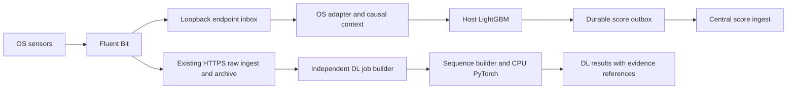

# Preparing model services before the models are ready

Status: 2026-10-30. The **model-free runtime foundation is now implemented**;
see [installation and operations](OPERATIONS.md). The sections below distinguish
the intended complete serving contract from the current bounded inbox/staging
implementation. Model-specific adapters, context/features, inference and score
transport remain activation work. No model weights or predictions are installed.

You do not need incremental learning to deploy a frozen supervised model.
Prepare the services now, then release a **versioned model bundle** later.
Adding weights alone is insufficient: preprocessing, input semantics, vocabulary,
model configuration and decision threshold must match training exactly.

## Placement and tools

| Component | Placement | Selected tools | Installation stage |
|---|---|---|---|
| Sensors and raw forwarding | All endhosts | Existing Sysmon/Security/PowerShell or auditd/journal + Fluent Bit | Already reported working |
| Local normalization/context | All endhosts | Python, bounded SQLite state, OS-specific adapters | Implement before model activation |
| Host ML scoring | Each supported endhost | LightGBM + NumPy/SciPy; FastAPI/Uvicorn loopback ingress | Prepare code/runtime now, model later |
| Process supervision | Ubuntu / Windows | systemd / WinSW wrapping Python | Separate OS installation recipes |
| Raw archive | Physical host | Existing Caddy/FastAPI/NATS/PostgreSQL | Already reported working |
| Sequence preparation + DL | Physical host Docker | Python + CPU PyTorch worker, PostgreSQL job cursor/outbox | Prepare code/runtime now, model later |
| Model distribution | Controller → services | Versioned directories + SHA256 manifest + Ansible | No registry server needed for this pilot |

Python inference code can be shared across Windows and Ubuntu. Sensors, raw-log
adapters, paths, service wrappers and dependency wheels differ. Do not install
Docker/PyTorch on every endpoint. Use one DL container initially, CPU only;
reserve GPU setup until measured latency shows a need. Do not add Kubernetes,
Triton, Kafka or MLflow merely to run three endhosts.

Start with one LightGBM worker/thread per host (proposed budget 512 MiB;
measure actual vocabulary/model memory), and one DL worker, two CPU threads,
batch size 8, container memory limit 2 GiB. These are starting limits, not tested
capacity. Reduce batch size if memory exceeds the limit. Preserve resources for
Kolla and the three VMs; benchmark events/s, queue age, RSS and p95 latency before
raising concurrency. Avoid multiple Uvicorn workers duplicating model memory.

## Runtime path



Keep raw forwarding active during preparation and initial shadow inference.
Add a second Fluent Bit HTTP output to loopback only after the endpoint inbox
exists. A failing ML service must not stop the raw archive path. Give each output
its own bounded buffer and expose drops/backlog; raw forwarding success does not
prove the local branch received everything.

Do **not** attach DL as a competing subscriber to the existing
`KLTN_EVENTS` work-queue stream: archive and DL could split messages, and ACKed
messages disappear. For this pilot, create independent durable DL jobs from
archived events. Use an anti-join against a `dl_seen(event_id, pipeline_version)`
ledger and insert jobs + seen entries in one transaction. Do not use only
`received_at > last_timestamp`: equal timestamps and concurrent commits can skip
records. A dedicated fan-out stream with independent consumers is a later option.

## Service interfaces to implement

The endpoint inbox, health and readiness interfaces are now implemented in
preparation mode. Score ingestion and model inference below remain a specification.
Existing central ingest accepts raw sources only; add a separate authenticated
score endpoint and table during activation.
Do not overload the raw `smoke` source or send fabricated scores.

| Interface | Required behavior |
|---|---|
| Endpoint `POST /v1/raw/{source}` on `127.0.0.1:18081` | Host identity from local config; bounded batch/body; acknowledge only after SQLite inbox commit; full disk returns retryable error |
| Endpoint `GET /healthz` | Process alive, version, inbox/backlog status; no secrets |
| Endpoint `GET /readyz` | Ready only when bundle, adapter and parity checks pass; otherwise HTTP503 and explicit reason |
| Central `POST /v1/scores` | Per-host credentials, server-enforced host ownership, idempotent score identity, ACK only after durable storage |
| DL worker | Consume only its own durable jobs; CPU `eval()`/`inference_mode()`; persist score and job completion atomically |

States: `waiting_for_model`, `incompatible_schema`, `unsupported_domain`,
`warming_context`, `ready_shadow`, `error`. A missing score is **null/unavailable**,
never probability 0 or a benign result. Missing ML/DL branches must remain visible
to any future fusion service through source masks.

Suggested score record:

```json
{
  "schema_version": "score.v1",
  "host_id": "openstack-instance-uuid",
  "branch": "host_ml",
  "bundle_id": "optc-lgbm-release-001",
  "event_refs": ["raw-event-id"],
  "window": null,
  "status": "ready_shadow",
  "score": 0.82,
  "threshold": 0.75,
  "prediction": 1,
  "domain": "windows-sysmon",
  "domain_validation": "pending",
  "processed_at": "2026-10-30T00:00:00Z"
}
```

Numbers above illustrate the contract, not model results. Define prediction as
`score >= threshold`; preserve full threshold precision and class-1 meaning.
For DL, include window start/end, host/session key, chunk index, event references
and late/partial-window status. Scores are model outputs, not calibrated confidence
unless calibration has actually been performed. Do not automatically isolate VMs
from shadow predictions.

## Normalization is required before plugging in models

Common event schema: source record ID, host UUID, boot/session identity, event time
in UTC, ingest time, source, schema version, action, object type, process/parent
identity, image, command line, principal, object path and missingness/provenance.
Retain raw evidence references. Missing information remains missing.

Windows adapter: parse Sysmon XML including provider/channel/EventRecordID and
ProcessGuid/ParentProcessGuid. Security4688 and Sysmon1 may describe the same
process start: define whether to correlate or keep source-specific events before
training the adapter contract. PowerShell4104 may be fragmented; retain fragment
identity and reconstruct with bounded time/size limits. Never execute script text.

Linux adapter: group audit records by host + boot + audit serial before deriving
an event. Combine SYSCALL/EXECVE/CWD/PATH/PROCTITLE, decode quoted/hex fields safely,
handle incomplete records/timeouts and record missingness. PID alone is not a
stable process identity: maintain lifetime/start information, avoid PID reuse,
and track only parents already observed. Do not invent a Windows ProcessGuid or
parent context from future events. Journald is supplemental, not automatically
an eCAR-equivalent event.

Use separate adapters into a shared semantic schema. Matching column names is
not evidence that auditd/Sysmon and OpTC have matching distributions. An OpTC-only
model is initially an offline baseline or explicitly labelled shadow experiment.
Ubuntu may collect logs while scoring remains `unsupported_domain`; do not claim
Linux detection coverage until its feature semantics and validation are ready.
Incremental learning can improve coverage later, but is neither a requirement
for baseline inference nor a substitute for correct adapters.

## Model bundle: what to save after training

Each immutable release directory must contain:

```text
manifest.json
model/                  # model.txt for LGBM; weights.pt for DL
preprocess/             # exact fitted vocabulary/maps/specs, no refitting
policy/threshold.json   # validation-selected threshold and class semantics
runtime/requirements.lock
fixtures/               # sanitized input, expected features and scores
```

The manifest must identify bundle/schema versions, branch, algorithm, training
corpus/split, supported source domains, adapter/tokenizer versions, feature order,
model configuration, framework versions, SHA256 of every artifact and the parity
fixture tolerance. Record domain validation separately from training domain.
Do not publish a template filled with invented hashes/metrics as a valid release.
Dependencies are locked per platform; obtain compatible Windows wheels, Ubuntu
packages and CPU PyTorch image during staging. Pin the tested image by digest.
Do not put passwords, training rows with sensitive content, optimizer state or
full datasets into deployed bundles.

### LightGBM export and loading

Use the final selected run, not an arbitrary older notebook. Export native text:

```python
# At the end of the trusted training run:
booster = estimator.booster_  # or the existing lightgbm.Booster
booster.save_model("model.txt", num_iteration=booster.best_iteration or -1)

# In the endpoint engine, after bundle verification:
import lightgbm as lgb
model = lgb.Booster(model_file="model.txt")
assert X_csr.shape[1] == model.num_feature()
scores = model.predict(X_csr, num_threads=1)
```

This example assumes a binary classifier and its probability output; validate
objective/class semantics in the release checker. Feature count alone is not a
compatibility check. Package the exact `vocab.json`, feature order, tokenizer
policy/code identity and binary-presence vs counts/TF-IDF specification. Unknown
tokens must use the training policy; never rebuild vocabulary online.

If the selected ML run uses parent context, a cascade, veto policy or multiple
boosters, export the entire inference policy and every dependent model. A lone
`model.txt` cannot reproduce that pipeline. Use golden raw→feature→score fixtures
to establish parity with the selected notebook. Preserve approved seed02 artifacts.

### BiLSTM export and loading

The inspected `DL/04_notebooks/06d_BiLSTM_Kaggle_v2_final.ipynb` saves a dictionary
containing `model_state_dict`, `config`, `best_epoch`, `best_val_pr_auc`; it writes
`threshold.json` separately. Export both, plus the exact model-class implementation
and fitted preprocessing files (`network_preprocess_spec.json`, category maps,
layout and `feature_subset.json`). Prefer an inference-only state_dict:

```python
# From the already-loaded, trusted training model:
torch.save(model.cpu().state_dict(), "weights.pt")
# Save architecture/config as JSON separately.

# In the worker, construct the SAME model class/config first:
state = torch.load("weights.pt", map_location="cpu", weights_only=True)
model.load_state_dict(state, strict=True)
model.eval()
torch.set_num_threads(2)
with torch.inference_mode():
    logits = model(**batch)
    scores = torch.sigmoid(logits)
```

Do not loosen `strict=True` to hide incompatible weights. The current forward
signature expects `x_cat`, `x_num`, `x_num_missing`, `x_bin`, `delta_t_log1p`,
`lengths`; package shapes, dtypes, vocabulary cardinalities, PAD/UNK IDs and
padding conventions. Zero-width numerical tensors and a zero binary channel
must match the trained implementation, not be guessed by the service.

The current notebook still retains categorical `app_family`, **`proto`**,
**`resp_port_class`**, `image_dir_class` and time delta. Removing numerical Zeek
features did not remove all network semantics. For the intended host-only system,
produce/confirm a host-only training contract before activation. Do not fabricate
protocol/port values or feed process events into a flow-trained sequence model
without explicitly changing and validating the event population.

Sequence construction is part of the model: freeze grouping key, ordering,
event-time unit, window alignment/duration, chunk length/stride, truncation,
padding, delta transform, empty-window behavior and late-event policy. BiLSTM
uses both directions within a completed chunk; it cannot make the same claim as
an immediate per-event classifier. Report detection delay including window closure.

## Installation and activation sequence

1. **Now: finish adapters and serving code without weights.** Add the loopback
   inbox, causal context tracker, engine interface, outbox, central score schema,
   DL job builder and sequence tests. Test bounded buffers, crash recovery and
   unavailable-model states. Keep current raw pipeline intact.
2. **Ubuntu packaging:** Ansible creates `/opt/kltn-agent`, a dedicated venv,
   unprivileged service user, `/var/lib/kltn-agent` for SQLite/outbox, and a systemd
   unit with automatic restart. Only Fluent Bit needs raw sensor access; the agent
   can consume loopback HTTP. Restrict model/config ownership and bind loopback.
3. **Windows packaging:** Ansible installs a pinned Python distribution and venv
   under `C:\KLTN\agent`, verifies a pinned WinSW binary, and registers Python as
   a real Windows service with restart behavior and rotating logs. Grant the
   service account access only to its state/config/model directories; Sysmon and
   Fluent Bit keep their existing privileges. Python/Uvicorn alone is not a native
   SCM service executable. Do not replace the working Fluent Bit native service.
4. **Central packaging:** add an opt-in `inference` Compose profile with a CPU
   PyTorch image, one non-root worker, read-only release mount, restart policy,
   bounded logs and 2GiB/2CPU initial limits. Use a separate DB role for DL jobs
   and scores; do not give it OpenStack admin credentials. No public inference
   port is needed for the worker.
5. **Stage trained bundle:** verify checksums/provenance, dependency versions,
   supported domain and schema; run model load and golden parity tests before
   pointing the service at the candidate directory. Never import arbitrary code
   uploaded through the telemetry API.
6. **Activate in shadow mode:** restart with a versioned release path, check
   readiness and process fixtures through the real input path. Persist bundle ID
   on every score. Roll out one endpoint first, then remaining compatible hosts.
7. **Rollback:** retain previous immutable release; stop inference worker, switch
   release config and restart. Keep raw archive and evidence; version context and
   job state so incompatible state is not reused or scores silently overwritten.

No new Terraform VM is needed. Terraform remains responsible for networking/VMs;
Ansible installs services; Compose manages the central worker. The endpoint runtime and central preparation container are installed by the
[operations runbook](OPERATIONS.md); adapter, inference and score transport steps
remain pending. The preparation worker only stages event references.

## Acceptance before declaring “just add the model” complete

- Model absent: services stay observable, no fake benign scores, raw archive works.
- Bad hash/schema/unsupported OS: activation refused with an explicit reason.
- Golden fixtures: offline and service feature vectors, probabilities and decisions
  match with documented float tolerance; threshold boundary tested.
- Real Windows/Linux samples: adapter semantics, PID reuse, missing parents,
  PowerShell fragments and audit record assembly tested independently.
- Crash/retry: inbox/outbox/job transactions survive restarts; duplicate IDs do not
  create duplicate scores; disk-full/backpressure behavior is measured.
- DL ordering/late events: no cross-host mixing, no future context leakage beyond
  the declared completed window, no silent dropped records on restart.
- Load test: RSS, CPU, queue age, dropped events and p95 end-to-end delay recorded.
- OpTC-only model: shadow outputs clearly labelled; live detection accuracy is
  unproven until representative labelled testbed evaluation is completed.

Fusion, SOC UI, isolation, GraphSAGE and incremental learning are separate later
milestones. Their absence does not prevent testing a frozen ML/DL service, but
means the complete architecture is not finished.

## References

- Local deployment evidence: [status report](../../../Temp/task/2.md).
- [LightGBM Booster API](https://lightgbm.readthedocs.io/en/latest/pythonapi/lightgbm.Booster.html).
- [PyTorch saving/loading](https://docs.pytorch.org/tutorials/beginner/saving_loading_models.html).
- [Fluent Bit HTTP output](https://docs.fluentbit.io/manual/pipeline/outputs/http).
