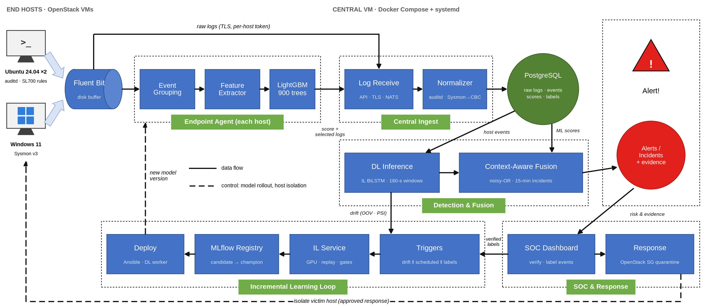
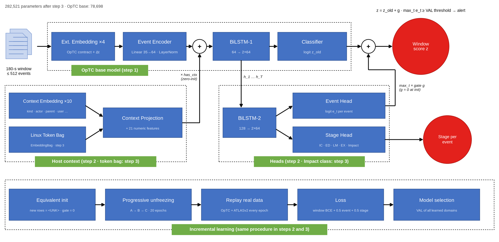
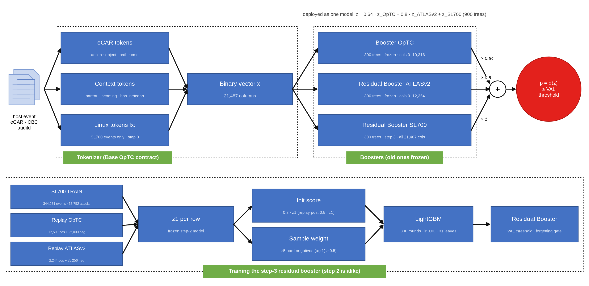

# Khung phát hiện APT đa nguồn, nhận thức ngữ cảnh, học tăng dần (Incremental Learning)

Khóa luận tốt nghiệp (KLTN): **Xây dựng khung phát hiện tấn công có chủ đích (APT) đa nguồn kết hợp nhận thức ngữ cảnh**, khởi đầu trên DARPA OpTC và học tăng dần sang ATLASv2 và AInception SL700.

Cập nhật 14/11/2026. README này mô tả **trạng thái hiện tại**:
- hai model IL cuối cùng (DL và ML) đã học qua ba miền;
- hạ tầng OpenStack chạy hai model đó đã được kiểm thử đầu-cuối.

Model OpTC ban đầu nay là **bước 1** của chuỗi IL (mục 5).

---

## Mục lục

- [1. Tổng quan](#1-tổng-quan)
- [2. Kết quả chính](#2-kết-quả-chính)
- [3. Hai mô hình](#3-hai-mô-hình)
- [4. Hạ tầng OpenStack (triển khai IL3)](#4-hạ-tầng-openstack-triển-khai-il3)
- [5. Bước 1: model gốc trên DARPA OpTC](#5-bước-1-model-gốc-trên-darpa-optc)
- [6. Giới hạn](#6-giới-hạn)
- [7. Cấu trúc thư mục](#7-cấu-trúc-thư-mục)
- [8. Tài liệu chi tiết](#8-tài-liệu-chi-tiết)

---

## 1. Tổng quan



- **Bài toán:** phát hiện APT trên telemetry host. Model phải học được miền mới khi môi trường thay đổi mà không quên miền cũ.
- **Chuỗi IL, ba miền:**

  ```mermaid
  flowchart LR
    S1["Bước 1 · DARPA OpTC<br/>Windows · eCAR"] --> S2["Bước 2 · ATLASv2<br/>Windows · Carbon Black EDR"] --> S3["Bước 3 · AInception SL700<br/>Linux · auditd"]
  ```

- **Hai nhánh phát hiện:**
  - **DL:** BiLSTM chấm theo cửa sổ 180 s, kèm stage tấn công theo từng sự kiện. Chạy ở central.
  - **ML:** LightGBM chấm từng sự kiện, học tiếp bằng boosting phần dư. Chạy ngay trên end host.
- **Fusion và vòng IL:**
  - điểm của hai nhánh được hợp nhất theo ngữ cảnh thành incident trên trang SOC;
  - nhãn SOC đã xác minh, drift hoặc lịch định kỳ sinh yêu cầu IL;
  - model mới phải qua gate chống quên rồi mới được deploy.

## 2. Kết quả chính

F1 trên TEST. Mỗi ô là F1 của miền đó sau bước tương ứng; "—" là miền chưa học tới.

| Nhánh | Sau bước | OpTC | ATLASv2 | SL700 |
|---|---|---:|---:|---:|
| DL (cửa sổ, 3 seed) | 1 | 0,988 | — | — |
| | 2 | 0,994 | 0,990 ± 0,014 | — |
| | 3 | 0,994 | 0,970 ± 0,012 | **0,978 ± 0,004** |
| ML (sự kiện) | 1 | 0,996 | — | — |
| | 2 | 0,991 | 0,959 | — |
| | 3 | 0,994 | 0,953 | **0,995** (theo cửa sổ 0,883) |

- **Chống quên:** sau cả ba bước, không miền cũ nào mất quá 0,02 F1. Cơ chế chống quên chính là replay: bỏ replay thì ATLASv2 của nhánh ML tụt từ 0,959 xuống 0,741.
- **Không có chuyển giao xuôi:** train từ đầu trên miền mới đạt F1 ngang IL. Giá trị của IL là **một model duy nhất giữ được cả ba miền**.
- **Stage (DL):** chỉ số stage presence trên miền mới đạt 0,837 (ATLASv2) và 0,758 (SL700).
- **Số SL700 không dùng địa chỉ IP.** Thêm phạm vi địa chỉ thì DL đạt 0,999, ML theo cửa sổ đạt 0,966. Nhóm này được báo cáo riêng vì gần với luật gán nhãn.

Confusion matrix trên TEST: [`IL/figures/`](IL/figures/). So sánh với các nghiên cứu khác (chi phí phần cứng, nhóm phương pháp): [`IL/profile_20261114/related_work_comparison_v1.md`](IL/profile_20261114/related_work_comparison_v1.md).

## 3. Hai mô hình

Chi tiết tiền xử lý, kiến trúc và cơ chế IL: [`IL/README.md`](IL/README.md) mục 4–6.

### 3.1 DL: BiLSTM-IL (282.521 tham số sau bước 3)



- **Phần gốc OpTC (78.698 tham số):** 4 trường contract `app_family`, `proto`, `resp_port_class`, `image_dir_class` + Δt → encoder → BiLSTM-1 → classifier, cho ra `z_old`.
  - Bốn trường này **vẫn dùng ở mọi miền**, với cùng quy tắc tạo token.
  - Với sự kiện không phải kết nối mạng, `proto` và `resp_port_class` là `<MISSING>`.
- **Nhánh ngữ cảnh host:**
  - bước 2 thêm 10 trường ngữ cảnh (loại sự kiện, actor, cha, đích, user, publisher…) và 21 đặc trưng số;
  - bước 3 thêm túi token Linux (EmbeddingBag 1.939 × 32).
  - Nhánh này được chiếu về 64 chiều và **cộng** vào đầu ra encoder; nhân `has_ctx` nên tắt hẳn với OpTC.
- **Phần mới ở bước 2:** BiLSTM-2 → event head (logit từng sự kiện) và stage head (IC · ED · LM · EX · Impact).
  - Điểm cửa sổ: `z = z_old + gate · max_t(logit sự kiện)`.
- **Cơ chế IL:**
  - mọi khối mới khởi tạo 0, nên ngay sau khi mở rộng model chấm điểm như cũ;
  - mở băng dần A → B → C;
  - replay dữ liệu thật của miền cũ;
  - ngưỡng chọn trên VAL riêng của từng miền.
- Ảnh chi tiết từng lớp: [`IL/DL_IL_architecture.png`](IL/DL_IL_architecture.png).

### 3.2 ML: LightGBM boosting phần dư (21.487 cột, 3 × 300 cây)



- **Đặc trưng:** mỗi sự kiện host thành một vector nhị phân token theo hợp đồng Base OpTC:
  - token eCAR;
  - ngữ cảnh cha, incoming và `has_netconn`;
  - token Linux `lx:` cho SL700.
- **Từ vựng mở rộng đơn điệu:** 10.317 cột OpTC → 12.365 (bước 2) → 21.487 (bước 3).
- **Cộng dồn margin:** `z1 = 0,8·z_OpTC + z_ATLASv2`, rồi `z2 = 0,8·z1 + z_SL700`.
  - Booster cũ đóng băng và chỉ đọc phần cột của mình.
  - Booster mới học phần dư, với replay, init score và trọng số hard negative.
- **Ngưỡng:** miền cũ giữ ngưỡng đóng băng (OpTC 0,87427; ATLASv2 0,94073); miền mới chọn trên VAL.
- **Khi triển khai:** ba booster được ghép thành một booster 900 cây và chạy trong agent trên end host.
- Ảnh chi tiết: [`IL/ML_IL_architecture.png`](IL/ML_IL_architecture.png).

## 4. Hạ tầng OpenStack (triển khai IL3)

Tài liệu đầy đủ: [`Openstack/KLTN/README.md`](Openstack/KLTN/README.md).

- **End host (3 VM do Terraform tạo):**
  - 2 Ubuntu 24.04 chạy auditd với đúng bộ rule đã sinh dữ liệu SL700;
  - 1 Windows 11 chạy Sysmon v3, Security và PowerShell 4104.
  - Fluent Bit gửi log thô về central. `kltn-agent` chấm điểm bằng model ML ngay trên máy.
- **Central (Docker compose `kltn-il3`):**
  - Caddy (TLS) → FastAPI → NATS JetStream → archiver → PostgreSQL;
  - normalizer dựng `host_events`; DL worker chấm từng cửa sổ;
  - framework: fusion theo bucket 5 phút, gộp incident, drift, trigger IL;
  - trang `/soc` để review alert, gán nhãn từng event, yêu cầu response và quản lý vòng đời model.
- **Phản ứng:** `response_controller` (systemd) cô lập VM bằng security group `kltn-quarantine`. Chỉ chạy trên alert đã Confirmed và đã được duyệt. Lab dùng chính sách `single_operator` (người yêu cầu tự duyệt); môi trường dùng chung thì đổi sang `two_person`.
- **IL service** (systemd, GPU):
  1. export dataset đã xác minh từ SOC, chia theo incident;
  2. gate dữ liệu: ≥ 3 incident, ≥ 20 event tấn công, ≥ 2.000 benign;
  3. mở rộng vocab → bước IL có replay;
  4. gate quên: F1 VAL mỗi miền cũ giảm ≤ 0,02;
  5. ghi vào MLflow với alias `candidate`.
  - Việc activate và deploy luôn do người vận hành làm.
- **Parity train/serve trên log thô:**
  - ML: 105.606/105.606 dòng TEST SL700 trùng cột đặc trưng, |Δz| = 2,3e-14;
  - DL: 1.681/1.681 cửa sổ khớp input.
- **Kiểm thử đầu-cuối 14/11:**
  - sửa vòng lặp tự giám sát của sensor;
  - SOC hiển thị đúng lệnh gốc;
  - sửa logic drift và trigger;
  - cả hai service systemd chạy đúng (`collect_evidence` xuất xong; request IL bị từ chối đúng vì chưa có tấn công được xác nhận).
- **Trạng thái miền:**
  - Ubuntu (`linux-audit`) đã validated offline;
  - Windows (`windows-sysmon`) chạy ở chế độ `shadow_unvalidated`, vì model chưa từng thấy Sysmon có nhãn.
- **Bước tiếp theo:** hunting bằng APT thật để có incident gán nhãn cho IL. Phương pháp và ràng buộc của hạ tầng: [`Openstack/KLTN/docs/hunting_reading_list.md`](Openstack/KLTN/docs/hunting_reading_list.md). Repo không chứa code tấn công; `red-team/` cố ý để trống.

## 5. Bước 1: model gốc trên DARPA OpTC

Hai model này là điểm khởi đầu của chuỗi IL. Chúng không được train lại; từ vựng OpTC được giữ nguyên ở mọi bước sau. Số liệu dưới đây là của riêng bước 1, chấm trên TEST OpTC.

**ML: LightGBM + ngữ cảnh cha và incoming** (`ML/code/output/host_ml_parent_incoming_seed02/`)
- Mỗi sự kiện eCAR (benign 16–22/09/2019, tấn công 23–25/09/2019) thành 10.317 cột nhị phân:
  - token cú pháp và ngữ nghĩa;
  - dòng dõi cha;
  - `PROCESS OPEN` / `THREAD REMOTE_CREATE` đi tới tiến trình (chỉ dùng bằng chứng trước thời điểm sự kiện).
- Split ngẫu nhiên phân tầng theo sự kiện, 75/10/15. TEST có 1.249.689 sự kiện.

| Model (cùng TEST) | Precision | Recall | F1 | FP | FN |
|---|---:|---:|---:|---:|---:|
| Random Forest baseline | 0,9587 | 0,8677 | 0,9109 | 1.505 | 5.334 |
| XGBoost baseline | 0,9793 | 0,9209 | 0,9492 | 786 | 3.189 |
| LightGBM baseline | 0,9881 | 0,9209 | 0,9533 | 446 | 3.189 |
| **LightGBM + cha & incoming** (ngưỡng VAL 0,87427) | **0,9973** | **0,9954** | **0,9963** | **109** | **187** |

**DL: BiLSTM subsetB** (`DL/05_models/v2_subsetB`)
- Đầu vào: cửa sổ 15 phút theo máy, tối đa 512 flow mạng (Bro conn nối eCAR FLOW).
- Chỉ dùng 4 trường `app_family`, `proto`, `resp_port_class`, `image_dir_class` + Δt. Các metric L3/L4 của Bro được bỏ hẳn, để đặc trưng nào cũng lấy được từ log hệ điều hành.
- Split ngẫu nhiên theo cửa sổ. TEST có 34.413 mẫu, 82 dương.
- Kết quả: BiLSTM đạt **F1 0,988** (80 TP / 0 FP / 2 FN). Mixed-Type Self-Attention đạt 0,994 nhưng không được dùng tiếp cho IL.

**Lưu ý khi diễn giải bước 1:**
- Trên OpTC, một luật đơn "cửa sổ có `powershell.exe`" đã đạt F1 0,994.
- Split ngẫu nhiên không tách theo máy: 80/81 cửa sổ dương của TEST nằm trên máy đã có cửa sổ dương trong TRAIN.

Vì vậy kết quả OpTC chủ yếu chứng minh model gốc hoạt động. Khả năng tổng quát được đo ở các bước 2–3, nơi split theo kịch bản hoặc run để TEST là tấn công chưa thấy.

Tài liệu bước 1: [`ML/code/README.md`](ML/code/README.md), [`DL/01_code/README.md`](DL/01_code/README.md), [`DL/02_artifacts/22_v2_pipeline/S7_results/STEP_S7_RESULTS.md`](DL/02_artifacts/22_v2_pipeline/S7_results/STEP_S7_RESULTS.md).

## 6. Giới hạn

1. **Không có chuyển giao xuôi:** train từ đầu trên miền mới đạt F1 ngang IL.
2. **Biến thể chưa thấy:** giữ run e_a (persistence bằng cron) làm TEST thì DL chỉ đạt 0,74–0,83.
3. **SL700:** TEST chỉ là một run, nhãn là heuristic theo cây tiến trình.
4. **Windows/Sysmon chưa có số đo**, và fusion chưa được calibrate trên lab.
5. **Replay cần giữ dữ liệu thật** của các miền cũ.
6. **FP trên lab:** workload benign và thao tác quản trị (ssh+sudo, WinRM) vẫn sinh FP. Chúng chỉ giảm được khi IL có incident tấn công được xác nhận.

## 7. Cấu trúc thư mục

```text
/mnt/SSD_Data/optc/
├── README.md                 # tài liệu này
├── AGENTS.md, MENU.md        # quy tắc thực nghiệm và bản đồ vai trò file
├── DATASET/                  # dữ liệu gốc (OpTC, ATLASv2, AInception, …), chỉ đọc
├── IL/                       # chuỗi Incremental Learning (DL + ML), kết quả cuối
│   ├── README.md             # tổng quan IL: tiền xử lý, kiến trúc, cơ chế IL, kết quả
│   ├── dataset_1-ATLASv2/    # bước 2
│   ├── dataset_2-AInception/ # bước 3
│   ├── figures/              # sơ đồ khối 2 model, confusion matrix TEST
│   ├── profile_20261114/     # đo thời gian/GPU, so sánh related work
│   └── HANDOFF_20261113.md   # nhật ký bàn giao
├── ML/                       # bước 1: Host ML trên OpTC (LightGBM + ngữ cảnh)
├── DL/                       # bước 1: Network DL trên OpTC (BiLSTM subsetB)
├── Openstack/KLTN/           # hạ tầng: Terraform, Ansible, central, serving, IL service, SOC
│   ├── README.md             # kiến trúc, vận hành, kiểm thử e2e
│   ├── docs/                 # tài liệu hunting
│   └── images/               # sơ đồ kiến trúc + script vẽ
├── docs/                     # đề cương, chọn framework, ghi chú IL
├── paper-general/, paper-token/, paper-il/   # tài liệu tham khảo
└── Temp/                     # nháp (không track)
```

## 8. Tài liệu chi tiết

| Chủ đề | Tài liệu |
|---|---|
| Chuỗi IL, hai model, kết quả | [`IL/README.md`](IL/README.md) |
| Báo cáo từng bước IL | [`IL/README.md`](IL/README.md) mục 9 |
| Hạ tầng, fusion, drift, vận hành, kiểm thử e2e | [`Openstack/KLTN/README.md`](Openstack/KLTN/README.md) |
| Sơ đồ kiến trúc | [`Openstack/KLTN/images/README.md`](Openstack/KLTN/images/README.md) |
| Hunting và soạn kịch bản | [`Openstack/KLTN/docs/hunting_reading_list.md`](Openstack/KLTN/docs/hunting_reading_list.md) |
| So sánh related work, chi phí | [`IL/profile_20261114/related_work_comparison_v1.md`](IL/profile_20261114/related_work_comparison_v1.md) |
| Model gốc OpTC (bước 1) | [`ML/code/README.md`](ML/code/README.md), [`DL/01_code/README.md`](DL/01_code/README.md) |
