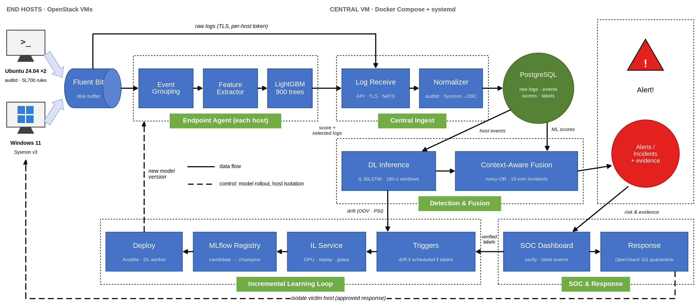

# Khung phát hiện APT đa nguồn, nhận thức ngữ cảnh, học tăng dần (Incremental Learning)

Khóa luận tốt nghiệp (KLTN): **Xây dựng khung phát hiện tấn công có chủ đích (APT) đa nguồn kết hợp nhận thức ngữ cảnh**, phát triển trên các tập dữ liệu **DARPA OpTC** (Domain 0), **ATLASv2** (Domain 1), **AInception SL700** (Domain 2 — nhánh cửa sổ) và **DARPA TC E3 THEIA** (Domain 2 — nhánh đồ thị nhân quả $L=3$ đa nhiệm).

Cập nhật **26/11/2026**. Tài liệu này tổng hợp trạng thái hiện tại của toàn bộ kho mã nguồn, bao gồm:
- **Nhánh kiến trúc mới nhất (`23–26/11/2026`)**: **Causal Provenance Triplet ($L=3$) + `MixHeadSelfAttentionCausalHost` & `ExpandableMixHeadCausalIL`** (đa nhiệm 3 đầu ra Binary / Scenario / Stage, mở rộng tầng Transformer + residual gates + Progressive Unfreezing `A→B→C` + Experience Replay + LwF Logit Distillation) qua **OpTC → ATLASv2 / THEIA** kèm đo kiểm **Backward Transfer (BWT) trên toàn bộ 1,249,689 mẫu OpTC Test**.
- **Nhánh 3 miền tiền nhiệm & Hạ tầng OpenStack (`14/11/2026`)**: **Host ML (`LightGBM` boosting phần dư)** + **BiLSTM cửa sổ 180s** qua **OpTC → ATLASv2 → AInception SL700** và hạ tầng triển khai thực nghiệm **OpenStack IL3**.

---

## Mục lục

- [1. Tổng quan](#1-tổng-quan)
- [2. Kết quả chính](#2-kết-quả-chính)
- [3. Kiến trúc mô hình](#3-kiến-trúc-mô-hình)
- [4. Tiền xử lý đa miền & Kiểm soát rò rỉ dữ liệu](#4-tiền-xử-lý-đa-miền--kiểm-soát-rò-rỉ-dữ-liệu)
- [5. Hạ tầng OpenStack (triển khai IL3)](#5-hạ-tầng-openstack-triển-khai-il3)
- [6. Giới hạn hiện tại](#6-giới-hạn-hiện-tại)
- [7. Cấu trúc thư mục](#7-cấu-trúc-thư-mục)
- [8. Tài liệu chi tiết](#8-tài-liệu-chi-tiết)

---

## 1. Tổng quan



- **Bài toán:** phát hiện tấn công APT trên telemetry host (Windows eCAR / Carbon Black EDR và Linux auditd / DARPA TC e3 THEIA) với 3 bài toán đồng thời: **Binary Detection**, **Campaign Scenario Attribution** và **MITRE ATT&CK Stage Classification** — học được miền mới mà không quên miền cũ (không cần Task-ID khi suy luận).
- **Lộ trình học tăng dần đang phát triển song song:**

  ```mermaid
  flowchart LR
    OpTC["Domain 0 · DARPA OpTC<br/>Windows · eCAR"] --> ATLAS["Domain 1 · ATLASv2<br/>Windows · Carbon Black EDR"]
    ATLAS --> SL700["Domain 2a · AInception SL700<br/>Linux · auditd (Window BiLSTM + LightGBM)"]
    OpTC --> THEIA["Domain 2b · DARPA TC E3 THEIA<br/>Linux · Provenance L=3 (Expandable MixHead + Replay)"]
  ```

---

## 2. Kết quả chính

### 2.1 Nhánh Host DL `MixHeadSelfAttentionCausalHost` ($L=3$ Causal Triplet) & `ExpandableMixHeadCausalIL`

Kết quả đo trực tiếp trên các tập **TEST** (`mixhead_attention_t4x2_full.pt`, `atlasv2_traceback_results`, `theia_traceback_results (2)`):

| Giai đoạn / Miền kiểm thử | Số mẫu TEST | Binary F1 | Precision | Recall | FPR | PR-AUC | Scenario Macro-F1 | Stage Macro-F1 | Ghi chú IL / BWT |
|---|---:|---:|---:|---:|---:|---:|---:|---:|---|
| **Domain 0 · OpTC Base** (`BEFORE IL`) | `1,249,689` (`pos=40,310`) | `0.9968` | `0.9986` | `0.9950` | `0.0047%` | `0.9994` | `0.9974` | `0.9584` | Mô hình gốc [`mixhead_attention_t4x2_full.pt`](DL/code/output/results/mixhead_attention_t4x2_full.pt) |
| **Domain 1 · ATLASv2 IL** (bản adapter cũ, chưa Replay) | `427,065` (`pos=762`) | `0.8902` | `0.9984` | `0.8031` | `0.0002%` | `0.8637` | — | `0.3962` | Stage hiếm (`IC/ED/LM`) còn ít mẫu |
| **THEIA IL cũ** *(không Replay / không mở rộng layer)* | `114,577` (`pos=13,018`) | `0.9973` | `0.9993` | `0.9954` | `0.0089%` | `0.9988` | `0.9107` | `0.9388` | Khi test ngược lại **OpTC 1.25M**: `FP` tăng `57 → 11,929` (`F1=0.8707`) |
| **Domain 2 · THEIA IL mới** (`Expandable + A→B→C + Replay + LwF`) | `114,577` (`pos=13,018`) | **`0.9973`** | **`0.9995`** | **`0.9952`** | **`0.0069%`** | `0.9987` | **`0.9127`** | **`0.9249`** | Chỉ `7 FP` (`Drakon F1=0.7387`, `MicroAPT F1=0.9996`) |
| **OpTC Test (`AFTER THEIA IL` — BWT 1 lần chạy)** | `1,249,689` (`pos=40,310`) | **`0.9968`** | **`0.9981`** | **`0.9954`** | **`0.0063%`** | **`0.9994`** | **`0.9972`** | `0.8761` *(W-F1 `0.9997`)* | **`76 FP`** (`BWT Binary=-0.00004`, `Scenario=-0.00017`) |

- **Hiệu quả chống quên đã chứng minh thực nghiệm trên 1,249,689 mẫu OpTC Test:** Bổ sung tầng Transformer riêng (`domain_blocks`) + residual gates khởi tạo `0` + Progressive Unfreezing (`A → B → C`) + **25% Experience Replay OpTC** (`100,000` mẫu phân tầng) + **LwF Logit Distillation** giảm **99.4% số báo động giả OpTC** (`11,929 FP → 76 FP`), khôi phục hoàn toàn Binary F1 (`0.9968`) và Scenario Macro-F1 (`0.9974 → 0.9972`).
- **Điểm cần tối ưu tiếp ở OpTC Stage Macro-F1 (`0.9584 → 0.8761`):** 7/8 lớp OpTC chính giữ nguyên hoặc tăng nhẹ F1 (`Credential Access 1.0000`, `Exfiltration 0.9982`, `Lateral Movement 0.9975`, `Discovery 0.9904`); duy nhất lớp cực hiếm `OpTC_Defense_Evasion_AMSI` (`6` mẫu test) chuyển sang `OpTC_Defense_Evasion_Injection` (không rơi về Benign) do `l_op_st` chưa gắn class-weight cho `AMSI`.

### 2.2 Nhánh Host ML (`LightGBM`) & BiLSTM cửa sổ 180s (3 miền OpTC → ATLASv2 → AInception SL700, 14/11/2026)

| Nhánh | Sau bước | OpTC | ATLASv2 | SL700 |
|---|---|---:|---:|---:|
| DL (cửa sổ, 3 seed) | 1 | `0.988` | — | — |
| | 2 | `0.994` | `0.990 ± 0.014` | — |
| | 3 | `0.994` | `0.970 ± 0.012` | **`0.978 ± 0.004`** |
| ML (sự kiện · `LightGBM + cha & incoming`) | 1 | `0.9963` (`109 FP / 187 FN`) | — | — |
| | 2 | `0.991` | `0.959` | — |
| | 3 | `0.994` | `0.953` | **`0.995`** (theo cửa sổ `0.883`) |

- So sánh baseline Host ML trên **1,249,689** sự kiện TEST OpTC (`ML/code/output/host_ml_parent_incoming_seed02/`): Random Forest (`0.9109`), XGBoost (`0.9492`), LightGBM baseline (`0.9533`), **LightGBM + ngữ cảnh cha & incoming (`0.9963`, ngưỡng VAL `0.87427`)**.
- Bỏ Replay ở bước 2 làm ATLASv2 trên nhánh ML tụt từ `0.959` xuống `0.741`. Số SL700 trên bảng không dùng địa chỉ IP; nếu thêm phạm vi IP, DL đạt `0.999` và ML theo cửa sổ đạt `0.966`.

---

## 3. Kiến trúc mô hình

### 3.1 `MixHeadSelfAttentionCausalHost` & `ExpandableMixHeadCausalIL` (`DL/` + `IL/dataset_4-THEIA/`)

Chi tiết mã nguồn: [`DL/code/preprocess/model_mixhead_attention.py`](DL/code/preprocess/model_mixhead_attention.py), [`DL/code/README.md`](DL/code/README.md), [`IL/dataset_4-THEIA/code/kaggle/generate_kaggle_notebook_theia.py`](IL/dataset_4-THEIA/code/kaggle/generate_kaggle_notebook_theia.py).

- **Biểu diễn chuỗi nhân quả $L=3$ Lines:** Mỗi sự kiện được mã hóa thành bộ ba chỉ sử dụng bằng chứng quá khứ $[E_{\text{incoming}},\, E_{\text{parent}},\, E_{\text{current}}]$ nhúng qua `EmbeddingBag(128)` cộng `line_embedding(3, 128)`, loại bỏ hoàn toàn nhiễu xen kẽ của cửa sổ thời gian phẳng.
- **Backbone (`MixHeadOpTCBase`, 50 tensors OpTC Base):** 2 khối `TransformerCausalBlock` (`MultiHeadSelfAttention` 4 heads, `ff_dim=256`, `LayerNorm`), `il_adapter` (32-dim residual), `line_pooling_attn`, và 3 đầu ra (`binary_head`, `scenario_head`, `stage_head`).
- **Mở rộng khi sang miền mới (`ExpandableMixHeadCausalIL`):**
  1. **Mở rộng từ vựng đơn điệu:** giữ nguyên 10,499 dòng embedding OpTC (`dl_vocab.json`); nối thêm token mới chỉ fit từ `train` miền mới (`13,204` token cho ATLASv2; `20,937` token cho THEIA).
  2. **Thêm tầng cho miền mới (`domain_blocks`):** gắn thêm 1 khối `TransformerCausalBlock` xử lý toàn bộ 3 lines sau backbone gốc, tổng hợp `[pooled_dom, line_0, line_1, line_2]` (`512` chiều) qua 3 residual heads (`delta_binary_head`, `delta_scenario_head` 6 lớp Unified, `delta_stage_head` 14 lớp Unified) nhân với residual gates **`gate_bin, gate_sc, gate_st` khởi tạo `0.0`** $\rightarrow$ đảm bảo **Epoch-0 Equivalence (`max|Δ| == 0.00e+00`)** trên miền gốc OpTC.
  3. **Huấn luyện Progressive Unfreezing (`A → B → C`) + Replay + LwF:** Phase A (tầng mới + token mới) $\rightarrow$ Phase B (mở `blocks.1`, `il_adapter`, base heads `@1e-4`) $\rightarrow$ Phase C (mở `blocks.0`, `token_norm`, `line_embedding` `@2e-5` và cập nhật OpTC embeddings với bước `0.02×`).

### 3.2 Nhánh BiLSTM-IL (282,521 tham số) & LightGBM Boosting phần dư (21,487 cột, 3 × 300 cây)

Chi tiết: [`IL/README.md`](IL/README.md) và [`ML/code/README.md`](ML/code/README.md).
- **BiLSTM-IL:** Đầu vào 4 trường contract OpTC (`app_family`, `proto`, `resp_port_class`, `image_dir_class`) + $\Delta t$, bổ sung nhánh ngữ cảnh host + túi token Linux (`EmbeddingBag 1,939 × 32`), `BiLSTM-2` + `stage head`, `z = z_old + gate · max_t(logit sự kiện)`, mở băng dần `A → B → C` và replay miền cũ.
- **ML (`LightGBM`):** Mở rộng vector nhị phân (`10,317 → 12,365 → 21,487` cột) và cộng dồn margin đóng băng (`z1 = 0.8·z_OpTC + z_ATLASv2`, `z2 = 0.8·z1 + z_SL700`) với ngưỡng đóng băng theo miền (`OpTC 0.87427`, `ATLASv2 0.94073`).

---

## 4. Tiền xử lý đa miền & Kiểm soát rò rỉ dữ liệu

| Tập dữ liệu | Vai trò | Số mẫu sạch ($L=3$ / Shards) | Chiến dịch & Giai đoạn | Chính sách làm sạch & chống rò rỉ |
|---|---|---:|---|---|
| **DARPA OpTC** | Domain 0 | `~8.33M` (`1,249,689` Test) | `3` Scenarios · `10` MITRE Stages | Từ vựng gốc `10,499` (`dl_vocab.json`), ngữ cảnh cha + incoming chỉ dùng quá khứ trước sự kiện |
| **ATLASv2** (`IL/dataset_1-ATLASv2`) | Domain 1 | `1,830,633` (`184` shards) | `5` Stages (chuyển từ CBC EDR + REAPr) | Loại DLL/loader Windows chuẩn (`ntdll.dll`, `kernel32.dll`), nối ngữ cảnh nhân quả past-only |
| **DARPA TC E3 THEIA** (`IL/dataset_4-THEIA`) | Domain 2 | `580,048` (`59` shards) | `2` Success Scenarios · `4` Active Stages | Sort T3 `Parquet`, xử lý `EDGE_REVERSED_OPS`, **loại 4 chuỗi REAPr `fail` + 2 cạnh `contaminated` + 17 cạnh 4.6 phishing + 1,050,433 OS `.so`** (giữ `/tmp/memtrace.so`), chia cửa sổ 5s/60s không giao nhau (`0` overlap) |

---

## 5. Hạ tầng OpenStack (triển khai IL3)

Tài liệu đầy đủ: [`Openstack/KLTN/README.md`](Openstack/KLTN/README.md).

- **End host (3 VM Terraform):** 2 Ubuntu 24.04 (`auditd` chuẩn SL700) + 1 Windows 11 (`Sysmon v3`, Security, PowerShell 4104); `kltn-agent` chấm điểm ML trực tiếp trên end host và đẩy log về central qua Fluent Bit.
- **Central (`docker-compose kltn-il3`):** Caddy (TLS) $\rightarrow$ FastAPI $\rightarrow$ NATS JetStream $\rightarrow$ archiver $\rightarrow$ PostgreSQL; normalizer dựng `host_events`, DL worker chấm điểm, trang `/soc` review cảnh báo/gán nhãn/kích hoạt phản ứng (`response_controller` cô lập bằng security group `kltn-quarantine`).
- **IL service:** Tự động xuất incident đã xác minh từ SOC, qua data gate và gate chống quên trên VAL (`F1` miền cũ giảm $\le 0.02$) trước khi lưu vào MLflow dưới alias `candidate`.
- **Parity train/serve trên log thô (14/11/2026):** ML khớp `105,606/105,606` dòng TEST SL700 ($|\Delta z| = 2.3 \times 10^{-14}$); DL khớp `1,681/1,681` cửa sổ.

---

## 6. Giới hạn hiện tại

1. **Một số sự kiện HTTP 1-hop trên THEIA (`NationState_Firefox_Drakon`) bị trùng phổ token với Benign:** `54/62` FN và `6/7` FP trên THEIA rơi vào mẫu hình `firefox ← EVENT_RECVFROM ← external_public:http_web` khi IP cụ thể bị ẩn vì chống rò rỉ.
2. **Lớp cực hiếm trên replay đa miền:** Khi chuyển sang miền mới (`OpTC_Defense_Evasion_AMSI` chỉ có `6` mẫu test trên OpTC hay các stage hiếm `IC/ED/LM` trên ATLASv2), cần gắn class-weight cho cả luồng replay miền cũ và oversample hợp lý.
3. **Biến thể hoàn toàn chưa thấy & FP môi trường thực:** Trên SL700 khi giữ `e_a` (cron persistence) làm test chỉ đạt `0.74–0.83`; trên hạ tầng lab OpenStack, các tác vụ quản trị (`ssh+sudo`, WinRM) vẫn sinh FP cho tới khi được vòng IL từ dữ liệu xác nhận cập nhật lại.
4. **Windows/Sysmon trên OpenStack (`shadow_unvalidated`):** Cần hoàn tất hunting kịch bản ([`Openstack/KLTN/red-team/`](Openstack/KLTN/red-team/README.md)) để có dữ liệu gán nhãn chuẩn.

---

## 7. Cấu trúc thư mục

```text
/mnt/SSD_Data/optc/
├── README.md                           # Tài liệu tổng quan (tệp này)
├── AGENTS.md, MENU.md                  # Quy tắc thực nghiệm và bản đồ vai trò mã nguồn
├── DATASET/                            # Dữ liệu gốc (OpTC, ATLASv2, AInception, THEIA, REAPr), chỉ đọc
├── DL/                                 # Kiến trúc Mix-Head Self-Attention & Causal BiLSTM trên OpTC (L=3)
│   ├── code/preprocess/                # model_mixhead_attention.py, model_causal_bilstm.py, build_dl_vocab.py
│   ├── code/kaggle/                    # Mix-Head.ipynb, BiLSTM.ipynb, scripts đóng gói Kaggle
│   ├── code/test/                      # Unit/integration tests DL trên OpTC
│   ├── code/output/results/            # mixhead_attention_t4x2_full.pt (OpTC Base Domain-0)
│   └── analyst/, docs/                 # Báo cáo kiến trúc và trạng thái DL
├── IL/                                 # Học tăng dần đa miền
│   ├── README.md                       # Tài liệu tổng quan nhánh Window BiLSTM + LightGBM (OpTC→ATLASv2→SL700)
│   ├── dataset_1-ATLASv2/              # Domain 1: L=3 shards (1.83M), adapter IL, LightGBM & BiLSTM IL
│   ├── dataset_2-AInception/           # Domain 2a: Linux auditd SL700 (relabel_v3, BiLSTM & LightGBM step 3)
│   ├── dataset_3-KLTN/                 # Kết quả runs hạ tầng KLTN
│   └── dataset_4-THEIA/                # Domain 2b: THEIA T3 sạch (580k shards), ExpandableMixHeadCausalIL + OpTC BWT 1.25M
│       ├── code/preprocess/            # theia_schema.py, theia_stage_mapper.py, build_theia_causal_shards.py, build_optc_replay_bundle.py
│       ├── code/kaggle/                # THEIA-MixHead-IL.ipynb, pack_kaggle_theia_il.py
│       ├── code/test/                  # test_theia_labeling.py, test_theia_il_model.py
│       └── docs/, output/              # THEIA_GROUND_TRUTH_ANALYSIS.md, optc_il_eval/, kaggle/theia_traceback_results (2)/
├── ML/                                 # Host ML gốc trên OpTC (LightGBM + ngữ cảnh cha/incoming)
├── Openstack/KLTN/                     # Hạ tầng Terraform, Ansible, central, serving, IL service, SOC, red-team
├── docs/                               # Đề cương KLTN, chọn framework, đối chiếu paper
├── paper-general/, paper-token/, paper-il/  # Tài liệu tham khảo khoa học
└── Temp/                               # Thư mục tạm cục bộ (không commit)
```

---

## 8. Tài liệu chi tiết

| Chủ đề | Tài liệu |
|---|---|
| Deep Learning Causal Provenance $L=3$ & Mix-Head (OpTC) | [`DL/code/README.md`](DL/code/README.md), [`DL/analyst/CAUSAL_BILSTM_ARCHITECTURE.md`](DL/analyst/CAUSAL_BILSTM_ARCHITECTURE.md) |
| Domain-IL THEIA T3 Sạch, `ExpandableMixHeadCausalIL` & OpTC BWT | [`IL/dataset_4-THEIA/README.md`](IL/dataset_4-THEIA/README.md), [`IL/dataset_4-THEIA/docs/THEIA_GROUND_TRUTH_ANALYSIS.md`](IL/dataset_4-THEIA/docs/THEIA_GROUND_TRUTH_ANALYSIS.md) |
| Domain-IL ATLASv2 | [`IL/dataset_1-ATLASv2/README.md`](IL/dataset_1-ATLASv2/README.md) |
| Chuỗi IL tiền nhiệm (Window BiLSTM + LightGBM 3 miền) | [`IL/README.md`](IL/README.md), [`IL/dataset_2-AInception/README.md`](IL/dataset_2-AInception/README.md) |
| Model ML gốc trên OpTC | [`ML/code/README.md`](ML/code/README.md) |
| Hạ tầng OpenStack IL3, SOC & Red-Team Hunting | [`Openstack/KLTN/README.md`](Openstack/KLTN/README.md), [`Openstack/KLTN/docs/hunting_reading_list.md`](Openstack/KLTN/docs/hunting_reading_list.md) |
| Bản đồ vai trò toàn bộ mã nguồn | [`MENU.md`](MENU.md) |
