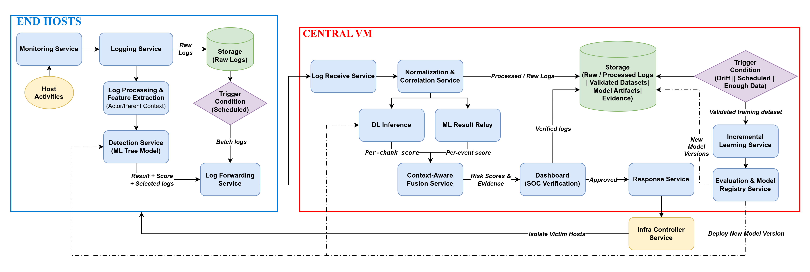
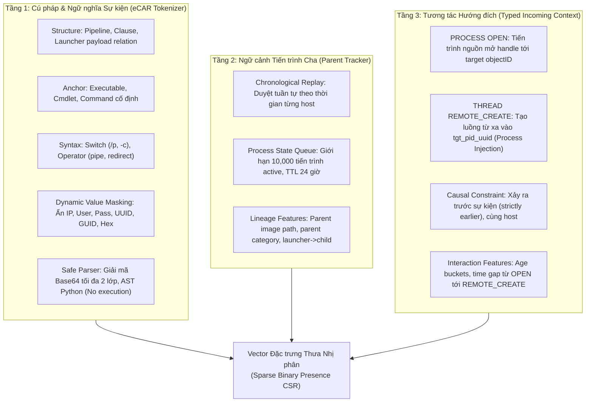
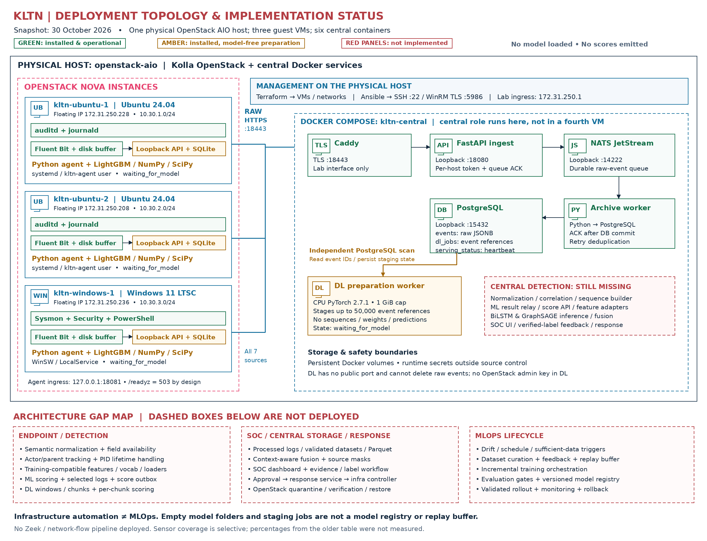

# Multi-Source Context-Aware Framework for APT Detection trên DARPA OpTC

Khóa luận tốt nghiệp (KLTN): **Xây dựng khung phát hiện tấn công có chủ đích (APT) đa nguồn kết hợp nhận thức ngữ cảnh trên tập dữ liệu DARPA OpTC**.

---

## Mục lục

- [1. Tổng quan Kiến trúc Hệ thống](#1-tổng-quan-kiến-trúc-hệ-thống)
- [2. Nhánh Host ML: Mô hình LightGBM Mở rộng Ngữ cảnh (Parent &amp; Incoming Context)](#2-nhánh-host-ml-mô-hình-lightgbm-mở-rộng-ngữ-cảnh-parent--incoming-context)
  - [2.1. Tập dữ liệu &amp; Phạm vi thí nghiệm](#21-tập-dữ-liệu--phạm-vi-thí-nghiệm)
  - [2.2. Quy trình tiền xử lý chi tiết (Tokenization &amp; Mở rộng Ngữ cảnh Đa tầng)](#22-quy-trình-tiền-xử-lý-chi-tiết-tokenization--mở-rộng-ngữ-cảnh-đa-tầng)
  - [2.3. Thiết lập phân chia tập dữ liệu (Frozen Contextual Split Seed 02)](#23-thiết-lập-phân-chia-tập-dữ-liệu-frozen-contextual-split-seed-02)
  - [2.4. Kết quả thực nghiệm của mô hình LightGBM Mở rộng Ngữ cảnh](#24-kết-quả-thực-nghiệm-của-mô-hình-lightgbm-mở-rộng-ngữ-cảnh)
  - [2.5. So sánh đối chiếu tiến hóa hiệu năng các mô hình Host ML](#25-so-sánh-đối-chiếu-tiến-hóa-hiệu-năng-các-mô-hình-host-ml)
- [3. Nhánh Network DL: Mô hình BiLSTM, Mixed-Type Self-Attention &amp; Rút gọn Đặc trưng Tầng Mạng](#3-nhánh-network-dl-mô-hình-bilstm-mixed-type-self-attention--rút-gọn-đặc-trưng-tầng-mạng)
  - [3.1. Thiết kế rút gọn đặc trưng (Phương án B — Loại bỏ metric L3/L4 của Bro)](#31-thiết-kế-rút-gọn-đặc-trưng-phương-án-b--loại-bỏ-metric-l3l4-của-bro)
  - [3.2. Khả năng thu thập thông tin L4 (`proto`, `resp_port_class`) từ OS Log](#32-khả-năng-thu-thập-thông-tin-l4-proto-resp_port_class-từ-os-log)
  - [3.3. Quy trình tiền xử lý chi tiết (Pipeline v2 &amp; Cơ chế nạp Shards)](#33-quy-trình-tiền-xử-lý-chi-tiết-pipeline-v2--cơ-chế-nạp-shards)
  - [3.4. Kết quả thực nghiệm của BiLSTM và Mixed-Type Self-Attention](#34-kết-quả-thực-nghiệm-của-bilstm-và-mixed-type-self-attention)
  - [3.5. Phân tích ngữ cảnh, trọng số chú ý và giới hạn dữ liệu](#35-phân-tích-ngữ-cảnh-trọng-số-chú-ý-và-giới-hạn-dữ-liệu)
- [4. Hạ tầng Thực nghiệm OpenStack Testbed &amp; Central Docker](#4-hạ-tầng-thực-nghiệm-openstack-testbed--central-docker)
  - [4.1. Tổng quan kiến trúc phân tán đã triển khai](#41-tổng-quan-kiến-trúc-phân-tán-đã-triển-khai)
  - [4.2. Khung runtime phục vụ mô hình (Model Serving)](#42-khung-runtime-phục-vụ-mô-hình-model-serving)
  - [4.3. Các thành phần còn thiếu và lộ trình hoàn thiện](#43-các-thành-phần-còn-thiếu-và-lộ-trình-hoàn-thiện)
- [5. Cấu trúc Thư mục Dự án](#5-cấu-trúc-thư-mục-dự-án)
- [6. Liên kết Tài liệu Chi tiết](#6-liên-kết-tài-liệu-chi-tiết)

---

## 1. Tổng quan Kiến trúc Hệ thống

Hệ thống được thiết kế theo mô hình hai nhánh phát hiện kết hợp hợp nhất ngữ cảnh (Context-Aware Fusion):



- **Nhánh Host ML**: Tập trung vào vết thực thi cục bộ trên hệ điều hành (tiến trình, dòng lệnh, registry, file) từ dữ liệu eCAR. Được mở rộng thêm ngữ cảnh tiến trình cha (Parent Process Lineage) và tương tác hướng đích (Typed Incoming: `PROCESS OPEN`, `THREAD REMOTE_CREATE`), mô hình **LightGBM** đạt hiệu năng vượt trội **F1 = 0.9963** và **PR-AUC = 0.9993** trên tập Test hơn 1.2 triệu sự kiện.
- **Nhánh Network DL**: Mô hình hóa chuỗi hành vi kết nối mạng theo thời gian của tiến trình (tiến trình, thư mục chạy, giao thức, cổng đích và khoảng thời gian) theo các cửa sổ trượt 15 phút. Đã loại bỏ hoàn toàn các trường đo lường lưu lượng L3/L4 chuyên sâu của Bro/Zeek để đảm bảo toàn bộ đặc trưng có thể thu thập đồng nhất ngay từ nhật ký hệ điều hành (OS log). Sử dụng mạng nơ-ron học sâu (BiLSTM và Mixed-Type Self-Attention).
- **Nhánh Hạ tầng OpenStack (`Openstack/KLTN`)**: Xây dựng testbed thực tế mô phỏng môi trường doanh nghiệp (2 Ubuntu, 1 Windows), pipeline thu thập log tập trung và nền tảng runtime sẵn sàng cho việc phục vụ mô hình (Serving).

---

## 2. Nhánh Host ML: Mô hình LightGBM Mở rộng Ngữ cảnh (Parent & Incoming Context)

Tài liệu chi tiết tại [ML/code/README.md](file:///mnt/SSD_Data/optc/ML/code/README.md), sổ tay [PARENT_CONTEXT_RUNBOOK.md](file:///mnt/SSD_Data/optc/ML/code/kaggle/docs/PARENT_CONTEXT_RUNBOOK.md) và phân tích quy tắc [ML/analyst/xu_li_host_data.md](file:///mnt/SSD_Data/optc/ML/analyst/xu_li_host_data.md).

### 2.1. Tập dữ liệu & Phạm vi thí nghiệm

- **Nguồn dữ liệu:** Dữ liệu sự kiện eCAR đã được hiệu chỉnh từ DARPA OpTC:
  - Dữ liệu lành tính (Benign): Ngày 16–22/09/2019.
  - Dữ liệu tấn công (Malicious/Attack): Ngày 23–25/09/2019.
- **Thí nghiệm hiện hành đạt hiệu năng cao nhất (Active SOTA Run):** Toàn bộ phân hệ Host ML hiện tại đã được nâng cấp lên không gian thí nghiệm **`host_ml_parent_incoming_seed02`** (kế thừa phân vùng đóng băng `split` seed 02 gốc, tích hợp thêm **Parent Process Lineage** và **Typed Incoming Interaction Context**).
- **Quy tắc bảo vệ dữ liệu:** Các thư mục dữ liệu gốc (`host-begnin/`, `host-malicious/`, `ecar-bro/`, `bro/`) là vùng **Read-Only tuyệt đối**. Mọi artifact sinh ra đều lưu trữ độc lập tại `ML/code/output/host_ml_parent_incoming_seed02/`.

### 2.2. Quy trình tiền xử lý chi tiết (Tokenization & Mở rộng Ngữ cảnh Đa tầng)

Quy trình tiền xử lý của nhánh Host ML được kết hợp chặt chẽ qua 3 tầng phân tích:



1. **Tầng 1: Phân rã Cú pháp và Ngữ nghĩa Sự kiện (Structure, Anchor, Syntax):**
   - **Structure**: Ghi nhận quan hệ pipeline (`command_line::relation::pipeline=get-process->select-object`), liên kết tải trọng (`launcher_payload=powershell->inline_command`), quan hệ cha → con.
   - **Anchor**: Trích xuất tên công cụ thực thi cố định (`powershell.exe`, `schtasks.exe`, `get-process`).
   - **Syntax**: Ghi nhận switch (`-Command`, `/p`, `/u`), toán tử thực thi (pipe `|`, redirect, dấu chấm phẩy `;`).
   - **Dynamic Value Masking**: Che phủ toàn bộ các giá trị động có độ tản mạn cao (username, mật khẩu, IP, UUID, PID, địa chỉ bộ nhớ) thành các token phân loại ngữ nghĩa (`password_value`, `user_profile_path`).
   - **Safe Non-executing Parsing**: Giải mã tối đa 2 tầng Base64 UTF-16LE/UTF-8 của PowerShell và duyệt AST Python inline (`-c`) mà **tuyệt đối không thực thi lệnh**.
   - **Allowlist theo eCAR Object**: Giữ thuộc tính an toàn của `PROCESS`, `FILE`, `MODULE`, `REGISTRY`, `TASK`, `SHELL`; loại bỏ ID thực thi khỏi ma trận đặc trưng.
2. **Tầng 2: Theo dõi Ngữ cảnh Tiến trình Cha (Parent Process Context Tracker):**
   - Triển khai qua `process_context_tracker.py` duyệt tuần tự các sự kiện theo thời gian thực (chronological replay).
   - Duy trì hàng đợi trạng thái tiến trình với cơ chế dọn dẹp theo thời gian sống (TTL = 24 giờ / 86,400 giây) và giới hạn tối đa 10,000 tiến trình active đồng thời.
   - Bổ sung các đặc trưng về tiến trình cha (`parent_image_path`, lineage quan hệ cha-con) để phát hiện hành vi bất thường khi tiến trình hệ thống bị lợi dụng để sinh mã độc (ví dụ: `explorer.exe` hoặc `svchost.exe` đẻ ra `powershell.exe`).
3. **Tầng 3: Thu nạp Tương tác Hướng đích (Typed Incoming Context — Checkpoint Schema 4):**
   - Thu nhận các tương tác nguy hiểm có hướng tới tiến trình mục tiêu xảy ra **ngay trước thời điểm sự kiện** (strictly earlier than query timestamp):
     - **PROCESS OPEN (với target `objectID`):** Tiến trình bên ngoài mở handle can thiệp vào tiến trình mục tiêu (ghi nhận snapshot ảnh và quyền của tiến trình can thiệp).
     - **THREAD REMOTE_CREATE (với target `tgt_pid_uuid`):** Tạo luồng từ xa vào không gian bộ nhớ của tiến trình mục tiêu — dấu hiệu kinh điển của kỹ thuật **Process Injection / Shellcode Execution** trong các chiến dịch APT.
   - **Ràng buộc an toàn nhân quả (Causal Safety):**
     - Cả hai đầu mút (source và target) phải là UUID hợp lệ trên cùng một máy; không dùng PID tái sử dụng; không dùng nhãn tương lai hay nhãn của tổ tiên.
     - Mỗi tiến trình lưu tối đa 8 bản ghi mỗi loại tương tác (16 tổng cộng), phân nhóm độ trễ (age buckets) và tính toán khoảng cách thời gian giữa lần OPEN trước đó và thời điểm tạo luồng từ xa.

### 2.3. Thiết lập phân chia tập dữ liệu (Frozen Contextual Split Seed 02)

Mô hình tái sử dụng chính xác phân vùng đóng băng **Stratified Random Split Seed 02** (tỷ lệ 75/10/15 phân tầng theo cặp `file_nguồn × nhãn`):

| Phân vùng (Partition) | Tỷ lệ |  Số lượng Benign | Số lượng Malicious | Tổng số sự kiện |
| ----------------------- | ------: | ------------------: | --------------------: | ------------------: |
| **TRAIN**         |     75% |           6,046,892 |               201,551 |           6,248,110 |
| **VALIDATION**    |     10% |             806,252 |                26,873 |             833,125 |
| **TEST**          |     15% |           1,209,379 |                40,310 |           1,249,689 |
| **Tổng cộng**   |    100% | **8,062,523** |     **268,734** | **8,330,924** |

- **Chống rò rỉ dữ liệu (No Evaluation Leakage):** Toàn bộ từ điển đặc trưng mở rộng `vocab.json` được fit **DUY NHẤT trên tập TRAIN** ($TF \ge 2$, gồm cả Benign TRAIN và Malicious TRAIN).
- **Lấy mẫu huấn luyện:** Random negative undersampling trên tập Train (tổng 6,248,110 dòng, 201,551 positive), tham số `scale_pos_weight = 30.00`.
- **Lưu trữ Shards nhị phân nén:** Toàn bộ dữ liệu được trích xuất thành các file shard `.npz` nén, chỉ lưu `row_nnz`, `column_delta` (uint32), `label` (uint8) và `source_line_delta` (uint64) phục vụ khôi phục CSR nhị phân thưa tối ưu.

### 2.4. Kết quả thực nghiệm của mô hình LightGBM Mở rộng Ngữ cảnh

Mô hình LightGBM 4.6.0 được huấn luyện trên Kaggle với tham số chuẩn hóa: `objective='binary'`, `num_leaves=31`, `learning_rate=0.05`, `n_estimators=300`, `scale_pos_weight=30.00`, `force_col_wise=True`. Ngưỡng phân loại tối ưu chọn trên tập Validation ($T = 0.87427$), sau đó áp dụng cố định trên tập Test:

**Bảng chỉ số đánh giá của LightGBM (`host_ml_parent_incoming_seed02`):**

| Tập dữ liệu                      | Ngưỡng (Threshold) |        Precision |           Recall |         F1-Score |                FPR |  PR-AUC (binned) |  ROC-AUC (binned) |
| ----------------------------------- | -------------------: | ---------------: | ---------------: | ---------------: | -----------------: | ---------------: | ----------------: |
| **Validation** (833,125 mẫu) |              0.87427 |           0.9978 |           0.9956 |           0.9967 |           0.000074 |           0.9996 |           0.99997 |
| **Test** (1,249,689 mẫu)     |              0.87427 | **0.9973** | **0.9954** | **0.9963** | **0.000090** | **0.9993** | **0.99997** |

**Ma trận nhầm lẫn (Confusion Matrix) trên tập TEST (1,249,689 sự kiện):**

```text
                     Dự đoán Lành tính (0)    Dự đoán Tấn công (1)
Thực tế Lành tính (0)        1,209,270 (TN)                 109 (FP)
Thực tế Tấn công  (1)              187 (FN)              40,123 (TP)
```

- **F1-Score đột phá:** Đạt mức **0.9963 (99.63%)**, đưa hiệu năng phát hiện APT lên mức gần như hoàn hảo.
- **Khả năng bắt mẫu tấn công (Recall):** Đạt **99.54%** — bắt được **40,123 / 40,310** sự kiện độc hại; số lượng bỏ sót (FN) giảm mạnh từ 3,189 ở bản baseline cũ xuống chỉ còn **187 sự kiện**.
- **Độ chính xác cảnh báo (Precision):** Đạt **99.73%** với tỷ lệ dương tính giả FPR cực thấp **0.0090%** (chỉ có 109 cảnh báo sai trên hơn 1.2 triệu sự kiện lành tính), loại bỏ gần như triệt để tình trạng mỏi mệt vì cảnh báo giả (alert fatigue) trong các trung tâm SOC.

### 2.5. So sánh đối chiếu tiến hóa hiệu năng các mô hình Host ML

Bảng đối chiếu quá trình tiến hóa từ các mô hình baseline đơn lẻ đến mô hình tích hợp ngữ cảnh cha-con và tương tác luồng trên cùng tập TEST (1,249,689 sự kiện):

| Phiên bản mô hình                          |  Ngưỡng ($T$) |        Precision |           Recall |         F1-Score |                FPR |           PR-AUC | FN (Bỏ sót) | FP (Báo nhầm) |
| ---------------------------------------------- | ----------------: | ---------------: | ---------------: | ---------------: | -----------------: | ---------------: | ------------: | --------------: |
| **Random Forest (Baseline seed02)**      |           0.56634 |           0.9587 |           0.8677 |           0.9109 |           0.001244 |           0.9237 |         5,334 |           1,505 |
| **XGBoost (Baseline seed02)**            |           0.87878 |           0.9793 |           0.9209 |           0.9492 |           0.000650 |           0.9523 |         3,189 |             786 |
| **LightGBM (Baseline seed02)**           |           0.94016 |           0.9881 |           0.9209 |           0.9533 |           0.000369 |           0.9578 |         3,189 |             446 |
| **LightGBM + Parent & Incoming Context** | **0.87427** | **0.9973** | **0.9954** | **0.9963** | **0.000090** | **0.9993** | **187** |   **109** |

> [!TIP]
> **Nhận xét chuyên môn:**
>
> - Việc bổ sung ngữ cảnh tiến trình cha và lịch sử tạo luồng từ xa (`THREAD REMOTE_CREATE` / `PROCESS OPEN`) đã giải quyết triệt để điểm mù lớn nhất của việc phân tích log đơn sự kiện: các tiến trình độc hại ngụy trang dưới vỏ bọc tiến trình hệ thống hoặc thực thi mã độc qua kỹ thuật tiêm luồng (Process Injection).
> - So với phiên bản LightGBM baseline cũ, mô hình mở rộng ngữ cảnh đã:
>   - Giảm hơn **94%** số sự kiện tấn công bị bỏ sót (từ 3,189 xuống còn 187 FN).
>   - Giảm hơn **75%** số lượng cảnh báo sai (từ 446 xuống còn 109 FP).
>   - Đưa chỉ số $PR\text{-}AUC$ từ 0.9578 lên **0.9993**, chứng minh khả năng tách biệt hoàn hảo giữa hành vi tấn công APT và các tác vụ quản trị thông thường.

---

## 3. Nhánh Network DL: Mô hình BiLSTM, Mixed-Type Self-Attention & Rút gọn Đặc trưng Tầng Mạng

Tài liệu chi tiết tại [DL/README.md](file:///mnt/SSD_Data/optc/DL/README.md), [STEP_S7_RESULTS.md](file:///mnt/SSD_Data/optc/DL/02_artifacts/22_v2_pipeline/S7_results/STEP_S7_RESULTS.md) và các notebook huấn luyện [06d_BiLSTM_Kaggle_v2_final.ipynb](file:///mnt/SSD_Data/optc/DL/04_notebooks/06d_BiLSTM_Kaggle_v2_final.ipynb), [07d_Mixed_Type_Kaggle_v2_final.ipynb](file:///mnt/SSD_Data/optc/DL/04_notebooks/07d_Mixed_Type_Kaggle_v2_final.ipynb).

### 3.1. Thiết kế rút gọn đặc trưng (Phương án B — Loại bỏ metric L3/L4 của Bro)

Trong thiết kế ban đầu của nhánh Network DL, mô hình khai thác cả các trường phân tích sâu luồng mạng từ Bro/Zeek (như thống kê byte, gói tin, thời lượng, trạng thái kết nối TCP). Tuy nhiên, theo cập nhật mới nhất ở **STEP 23 (Phương án B)** được hiện thực trực tiếp trong các notebook huấn luyện cuối cùng (`06d` và `07d`):

1. **Đã loại bỏ hoàn toàn các trường đo lường mạng tầng 3 và tầng 4 độc quyền của Bro/Zeek:**
   - **Bỏ toàn bộ 7 đặc trưng số (numeric flow metrics):** `duration`, `orig_bytes`, `resp_bytes`, `orig_pkts`, `orig_ip_bytes`, `resp_pkts`, `resp_ip_bytes` (`active_numerical_features = []`).
   - **Bỏ cờ nhị phân tầng giao vận:** `has_missed_bytes` (`zero_binary = True`).
   - **Bỏ các trường trạng thái và dịch vụ ứng dụng chuyên sâu của Bro:** `conn_state` (như S0, SF, REJ...) và `service` (http, ssl, dns...).
   - **Bỏ trường tài khoản phía host:** `principal_class` (loại bỏ shortcut testbed liên quan đến tài khoản Administrator của Red Team).
2. **Tập đặc trưng đầu vào tinh gọn của mô hình hiện tại chỉ gồm 5 trường:**
   - **2 đặc trưng định danh tiến trình phía Host:**
     - `app_family`: Tên tiến trình khởi tạo kết nối (ví dụ: `powershell.exe`, `firefox.exe`, `cmd.exe`).
     - `image_dir_class`: Phân loại thư mục thực thi của tiến trình (`SYSTEM`, `PROGRAM_FILES`, `TEMP_OR_APPDATA`, `OTHER`).
   - **2 đặc trưng giao tiếp mạng cơ bản:**
     - `proto`: Giao thức mạng tầng 4 (`tcp`, `udp`, `icmp`).
     - `resp_port_class`: Nhóm cổng dịch vụ đích (`HTTP_80`, `HTTPS_443`, `DNS_53`, `DYNAMIC`, `OTHER`...).
   - **1 đặc trưng thời gian tương đối:**
     - `delta_t_log1p`: Khoảng thời gian $\ln(1 + \Delta t)$ giữa hai kết nối liên tiếp trong cùng một cửa sổ 15 phút.

### 3.2. Khả năng thu thập thông tin L4 (`proto`, `resp_port_class`) từ OS Log

> [!NOTE]
> **Nhận định cốt lõi về tính khả thi triển khai:**
> Mặc dù `proto` (Giao thức mạng: TCP/UDP) và `resp_port_class` (Cổng dịch vụ đích: 80, 443, 53,...) là các thông tin thuộc tầng giao vận (Layer 4 transport), **nhưng hai thông tin này hoàn toàn có thể trích xuất trực tiếp ngay từ nhật ký hệ điều hành (OS log / Host Telemetry)** mà không cần thiết bị bắt gói tin mạng, port mirroring hay cảm biến Zeek/Bro:
>
> - **Trên môi trường Windows:** Sự kiện **Sysmon Event ID 3 (Network Connection)** ghi nhận rõ ràng `Protocol` (tcp/udp), `DestinationPort`, `DestinationPortName` đi kèm với thông tin tiến trình `Image` và PID.
> - **Trên môi trường Linux:** Cấu hình **auditd** (theo dõi các syscalls mạng `connect`, `sendto`, `bind`) hoặc cơ chế **eBPF socket tracing** đều ghi nhận chính xác địa chỉ socket, protocol và port đích (`sin_port`).
> - **Trong hạ tầng thử nghiệm OpenStack (`Openstack/KLTN`):** Fluent Bit trên 3 máy ảo (Ubuntu và Windows) có thể trực tiếp chuyển tiếp các sự kiện socket/Sysmon này về central một cách nhẹ nhàng.
>
> **Mục đích của việc tinh giản này:**
>
> - Chuyển nhánh DL từ một mô hình phụ thuộc hạ tầng mạng vật lý nặng nề thành một mô hình **Sequence-based Process-Network Behavioral Model** (Mô hình hóa chuỗi hành vi kết nối mạng của tiến trình).
> - Giúp mô hình có khả năng tổng quát hóa cao và có thể chuyển giao, đánh giá trực tiếp trên các bộ dữ liệu khác ngoài DARPA OpTC (như SAGA, skrghosh, Windows-APT) — nơi chỉ có telemetry mức host/socket mà không có sẵn cảm biến Bro/Zeek.

### 3.3. Quy trình tiền xử lý chi tiết (Pipeline v2 & Cơ chế nạp Shards)

Pipeline tiền xử lý dữ liệu được thiết kế modular qua các bước tự động:

| Bước                           | Mã thực thi                             | Đầu vào → Đầu ra                                                           | Mô tả kỹ thuật                                                                                                                                                                                                                                                                                           |
| -------------------------------- | ----------------------------------------- | -------------------------------------------------------------------------------- | ------------------------------------------------------------------------------------------------------------------------------------------------------------------------------------------------------------------------------------------------------------------------------------------------------------ |
| **S1: Join**               | `s1_join.py`                            | Bro `conn.*.log.gz` + eCAR-Bro `ecarbro.json.gz` → `flows_joined.parquet` | Inner-join theo `bro_uid = uid`. Thu được **92,045,755 flow**, trong đó có **24,721 flow tấn công** từ **743 máy**. Bổ sung ngữ cảnh tiến trình (`app_family`, `image_dir_class`).                                                                                    |
| **S2: Cửa sổ & Split**   | `s2_windows_split.py`                   | flow → `windows.csv`                                                          | Gom flow thành các cửa sổ trượt **15 phút** (tổng 110,402 cửa sổ trên 620 máy). Chia tập 70% Train / 15% Validation / 15% Test cấp cửa sổ, phân tầng theo Scenario (SC1, SC2, SC3).                                                                                                  |
| **S3: Preprocess Spec**    | `s3_preprocess.py`                      | Cửa sổ TRAIN → `preprocess_spec.json` + `vocab.csv`                       | Khớp từ điển phân loại và tính thống kê **chỉ từ tập TRAIN**.                                                                                                                                                                                                                             |
| **S4: Shards Sequence**    | `s4_shards.py`                          | Flow + Spec → `.npz` chunks + `samples.csv`                                 | Chia cửa sổ thành chuỗi tuần tự tối đa 512 flow (chunk). Train: 160,210 mẫu; Val: 34,361 mẫu; Test: 34,413 mẫu (82 dương).                                                                                                                                                                      |
| **S5: Validate**           | `s5_validate.py`                        | Shards → Check report                                                           | Giải mã ngược kiểm tra chéo ngẫu nhiên 400 mẫu về lại dữ liệu thô (đạt 0 sai lệch).                                                                                                                                                                                                         |
| **S6: Packaging & Filter** | `06d_...`, `07d_...`                  | Shards + `feature_subset.json` → Input tensors                                | Tại DataLoader của notebook, áp dụng cơ chế lọc `feature_subset`: triệt tiêu toàn bộ cột số (`x_num = x[:, :0]`), xóa cột nhị phân (`x_bin = 0`), chỉ đưa vào 4 trường phân loại (`app_family`, `proto`, `resp_port_class`, `image_dir_class`) và `delta_t_log1p`. |
| **S7: Analyze**            | `s7_analyze.py`, `s7b_diagnostics.py` | Checkpoint weights → Metrics & Diagnostics                                      | Đánh giá chỉ số, phân tích attention và các trường hợp bỏ sót.                                                                                                                                                                                                                                 |

### 3.4. Kết quả thực nghiệm của BiLSTM và Mixed-Type Self-Attention

Huấn luyện trên môi trường Kaggle GPU (seed 42). Ngưỡng phân loại tối ưu chọn trên tập Validation ($T = 1.0$ do phân phối xác suất dự đoán bão hòa phân cực rõ rệt), sau đó đánh giá một lần duy nhất trên tập TEST (34,413 mẫu, trong đó có 82 mẫu dương):

| Mô hình                           | Ngưỡng (Val) | Precision |         Recall |         F1-Score | PR-AUC | ROC-AUC | TP / FP / FN |
| ----------------------------------- | -------------: | --------: | -------------: | ---------------: | -----: | ------: | ------------ |
| **BiLSTM**                    |          1.000 |     1.000 | 0.9756 (97.6%) | **0.9877** | 0.9890 |  0.9996 | 80 / 0 / 2   |
| **Mixed-Type Self-Attention** |          1.000 |     1.000 | 0.9878 (98.8%) | **0.9939** | 1.0000 |  1.0000 | 81 / 0 / 1   |

**Kết quả phát hiện theo từng kịch bản tấn công (Scenario):**

| Kịch bản tấn công (Scenario) | Số mẫu dương trong TEST | BiLSTM phát hiện (Recall) | Mixed-Type phát hiện (Recall) |
| -------------------------------- | --------------------------: | --------------------------: | ------------------------------: |
| **Scenario 1 (SC1)**       |                           9 |                9 / 9 (100%) |                    9 / 9 (100%) |
| **Scenario 2 (SC2)**       |                          72 |             70 / 72 (97.2%) |                  72 / 72 (100%) |
| **Scenario 3 (SC3)**       |                           1 |                1 / 1 (100%) |                      0 / 1 (0%) |

### 3.5. Phân tích ngữ cảnh, trọng số chú ý và giới hạn dữ liệu

> [!WARNING]
> **Nhận định khoa học trung thực về kết quả mô hình Network DL:**
>
> 1. **Tại sao mô hình vẫn đạt F1 rất cao (0.988 – 0.994) dù đã bỏ toàn bộ 7 metric lưu lượng của Bro?**
>    - Các đặc trưng còn lại (`app_family`, `image_dir_class`, `proto`, `resp_port_class`) vẫn mang đầy đủ dấu hiệu nhận diện cốt lõi của hành vi tấn công trong testbed: tiến trình `powershell.exe` chạy từ thư mục hệ thống/Temp mở socket kết nối ra ngoài qua TCP cổng 80/443.
>    - Thậm chí, một luật đơn dòng: *"Cửa sổ có chứa tiến trình `powershell.exe`"* đã đạt $F1 = 0.9939$ (81/82 mẫu) trên cùng tập Test. Nếu kết hợp thêm *"hoặc chạy từ `TEMP_OR_APPDATA`"* sẽ đạt 82/82 mẫu ($F1 = 1.000$, 0 FP). Do đó, việc loại bỏ các trường đo lường mạng chi tiết không làm giảm độ chính xác trên OpTC, đồng thời giúp loại bỏ nhiễu thống kê mạng.
> 2. **Chênh lệch giữa 2 mô hình chỉ là 1 mẫu dương:** Mixed-Type bắt được 81/82 mẫu, trong khi BiLSTM bắt được 80/82 mẫu. Với số lượng mẫu dương trong Test set nhỏ (82 mẫu), 1 mẫu tương đương 1.2% Recall; do đó chưa đủ bằng chứng thống kê để khẳng định Mixed-Type ưu việt hơn BiLSTM.
> 3. **Giới hạn của phân vùng cấp cửa sổ (Không Host-Disjoint):** 80/81 cửa sổ dương của Test có máy ảo đã từng xuất hiện cửa sổ dương trong tập Train. Do đó kết quả này phản ánh khả năng nhận diện dấu hiệu tấn công trên các máy đã quan sát, chưa chứng minh khả năng tổng quát hóa sang máy chủ hoàn toàn mới.
> 4. **Các mẫu bị bỏ sót (False Negatives):**
>    - **BiLSTM** bỏ sót 2 chunk của `sysclient0851` (SC2): cửa sổ này có 1,800 flow nền của `firefox.exe` làm lu mờ 8 flow beacon của `powershell.exe`.
>    - **Mixed-Type** bỏ sót mẫu SC3 duy nhất (`sysclient0351`, 18 flow): tiến trình `cKfGW.exe` chạy từ Temp bị kết nối từ chối (`REJ`), trong khi BiLSTM vẫn nhận diện được.

---

## 4. Hạ tầng Thực nghiệm OpenStack Testbed & Central Docker

Tài liệu chi tiết tại [Openstack/KLTN/README.md](file:///mnt/SSD_Data/optc/Openstack/KLTN/README.md).

### 4.1. Tổng quan kiến trúc phân tán đã triển khai

Hạ tầng thực nghiệm được triển khai thực tế trên cụm máy chủ **OpenStack All-in-One (AIO)** kết hợp Docker Compose tại host vật lý:



1. **Các máy ảo Endhosts (3 VM do Terraform khởi tạo):**
   - 2 máy **Ubuntu 24.04 LTS** (`kltn-ubuntu-1: 172.31.250.228`, `kltn-ubuntu-2: 172.31.250.208`).
   - 1 máy **Windows 11 Enterprise LTSC** (`kltn-windows-1: 172.31.250.236`): 4 vCPU, 6 GiB RAM, 80 GiB đĩa, UEFI/TPM.
2. **7 Nguồn Telemetry được thu thập qua Fluent Bit:**
   - Trên Windows: **Sysmon**, **Security Audit**, **PowerShell Script Block Logging**.
   - Trên Ubuntu: **auditd** (syscall execution/persistence), **journald**.
3. **Central Ingestion & Queue (Docker trên Host vật lý):**
   - **Caddy**: Reverse proxy quản lý mTLS/HTTPS tại cổng `172.31.250.1:18443`.
   - **FastAPI Ingestion**: Tiếp nhận payload JSON raw, kiểm tra định dạng và xác thực token.
   - **NATS JetStream**: Hàng đợi tin nhắn bền vững (dưới hạn 1 GiB), cam kết lưu trữ trước khi xác nhận ACK.
   - **Python Archive Worker & PostgreSQL**: Lưu trữ raw JSONB vào bảng `events`, cơ chế primary key chống trùng lặp dữ liệu.
4. **An toàn & Quản trị:**
   - Cổng API nội bộ, NATS và PostgreSQL chỉ bind loopback host (`127.0.0.1`).
   - SSH/WinRM chỉ cho phép từ IP quản trị `172.31.250.1/32`. Windows được cấu hình chứng thư WinRM IP SAN và tắt chế độ ngủ đông (`powercfg /hibernate off`).

### 4.2. Khung runtime phục vụ mô hình (Model Serving)

- **Tại Endhosts (Host ML):** Đã cài đặt dịch vụ agent Python nội bộ (`kltn-agent` trên Linux, WinSW service trên Windows) với thư viện **LightGBM 4.6.0**, **NumPy**, **SciPy** và **SQLite WAL Inbox** (giới hạn 128 MiB/50,000 sự kiện) để nhận log cục bộ từ Fluent Bit qua `127.0.0.1:18081`.
- **Tại Central (Network DL):** Container Docker chạy **PyTorch 2.7.1 CPU**, worker stage tham chiếu sự kiện từ bảng `events` vào bảng hàng đợi `dl_jobs` (giới hạn 50,000 jobs) và phát nhịp tim (heartbeat) vào `serving_status`.

### 4.3. Các thành phần còn thiếu và lộ trình hoàn thiện

> [!IMPORTANT]
> **Hiện trạng thực tế:** Hệ thống hiện tại đã hoàn thiện khâu **thu thập telemetry phân tán** và **khung runtime môi trường phục vụ mô hình**. Tuy nhiên, **chưa có luồng phát hiện APT hoặc vòng lặp MLOps tự động hóa trực tiếp**.

Bảng tóm tắt các thành phần còn thiếu cần phát triển tiếp:

| Thành phần còn thiếu                                           | Hiện trạng đã có                                                                                                             | Công việc cần thực hiện tiếp theo                                                                                                                                                |
| ------------------------------------------------------------------ | --------------------------------------------------------------------------------------------------------------------------------- | -------------------------------------------------------------------------------------------------------------------------------------------------------------------------------------- |
| **Bộ chuẩn hóa ngữ nghĩa (Semantic Normalizer)**        | Mới lưu trữ raw log dạng JSON/XML thô trong PostgreSQL và SQLite inbox                                                      | Xây dựng adapter phân tích XML Windows và Linux audit syscall để chuẩn hóa về schema chung (eCAR/CDM).                                                                       |
| **Logic nạp mô hình & Suy luận thực (Model Inference)** | Runtime Python/LightGBM/PyTorch đã cài đặt; API hiện trả `disabled_schema_pending`; DL worker báo `waiting_for_model` | Đóng gói model bundle (weights + vocabulary + scaler), nạp vào agent/worker và kích hoạt hàm tính điểm (scoring).                                                          |
| **Hợp nhất ngữ cảnh (Context-Aware Fusion)**             | Thiết kế kiến trúc dạng nháp tại `STEP_20_FUSION_DESIGN.md`                                                              | Xây dựng module kết hợp điểm số Host ML và Network DL theo cửa sổ thời gian, áp dụng cơ chế gating/source-masking.                                                      |
| **Vòng lặp MLOps khép kín**                              | `dl_jobs` (hàng đợi tham chiếu), `serving_status` (heartbeat), phiên bản thư viện cố định                          | Xây dựng pipeline phát hiện trôi dữ liệu (Drift Detection), bộ đệm phát lại (Replay Buffer), tự động retrain gia tăng và Model Registry kiểm soát rollout/rollback. |
| **Bộ phản ứng tự động (Automated Response)**           | Terraform dựng và hủy máy ảo thủ công                                                                                      | Phát triển controller tự động gửi lệnh cô lập mạng (OpenStack Network Quarantine) cho máy ảo bị xâm nhập qua Neutron API.                                               |

---

## 5. Cấu trúc Thư mục Dự án

```text
/mnt/SSD_Data/optc/
├── README.md                          # Tài liệu tổng quan toàn bộ đề tài KLTN (Tệp này)
├── AGENTS.md                          # Hướng dẫn và quy tắc thực nghiệm dành cho AI Agents
├── ML/                                # Phân hệ Host ML (Nguyễn Nhật Nguyễn)
│   ├── code/                          # Mã nguồn tiền xử lý, huấn luyện và kiểm thử
│   │   ├── preprocess/                # Trích xuất index, split 75/10/15, vocab và shards
│   │   ├── kaggle/                    # Notebook và scripts huấn luyện Kaggle (LGBM, XGB, RF)
│   │   └── output/host_ml_seed02/     # Artifact được phê duyệt: 358 shards, vocab, metrics
│   ├── analyst/                       # Báo cáo phân tích chuyên sâu về tokenization và dữ liệu
│   └── MENU.md                        # Sơ đồ vai trò các tệp mã nguồn của phân hệ ML
├── DL/                                # Phân hệ Network DL (Võ Ngọc Hoàng Lâm)
│   ├── 01_code/pipeline_v2/           # Pipeline v2 từ S1 (Join) đến S7 (Analyze)
│   ├── 02_artifacts/22_v2_pipeline/   # Kết quả, schema và kiểm định từng bước của pipeline v2
│   ├── 04_notebooks/                  # Notebook huấn luyện Kaggle (BiLSTM, Mixed-Type)
│   ├── README.md                      # Hướng dẫn chi tiết phân hệ Network DL
│   └── CLAUDE.md                      # Quy tắc và quyết định thiết kế của phân hệ DL
├── Openstack/KLTN/                    # Hạ tầng thử nghiệm thực tế & Central Serving
│   ├── README.md                      # Tài liệu hợp nhất chi tiết về hạ tầng, topology và gap analysis
│   ├── terraform/                     # Mã Terraform khởi tạo 3 VM, router, subnet, security group
│   ├── ansible/                       # Playbooks cấu hình máy ảo, sensor và kltn-agent
│   ├── central/                       # Docker Compose cho Caddy, FastAPI, NATS, Postgres
│   ├── scripts/                       # Scripts chuẩn bị inventory, TLS, kiểm thử ingest
│   ├── serving/                       # Đặc tả serving, validation và tài liệu vận hành
│   └── images/                        # Sơ đồ kiến trúc triển khai (PNG/SVG) và render script
├── docs/                              # Tài liệu phân tích lựa chọn framework và thiết kế chung
├── paper-general/                     # Tài liệu tham khảo về kiến trúc APT và detection
└── paper-token/                       # Tài liệu tham khảo về phương pháp tokenization
```

---

## 6. Liên kết Tài liệu Chi tiết

- **Nhánh Host ML:**
  - Hướng dẫn thí nghiệm mở rộng ngữ cảnh: [ML/code/README.md](file:///mnt/SSD_Data/optc/ML/code/README.md)
  - Sổ tay vận hành Parent Context: [ML/code/kaggle/docs/PARENT_CONTEXT_RUNBOOK.md](file:///mnt/SSD_Data/optc/ML/code/kaggle/docs/PARENT_CONTEXT_RUNBOOK.md)
  - Đặc tả Tokenization & Allowlist: [ML/analyst/xu_li_host_data.md](file:///mnt/SSD_Data/optc/ML/analyst/xu_li_host_data.md)
  - Báo cáo kết quả LightGBM SOTA (F1 0.9963): [ML/code/output/host_ml_parent_incoming_seed02/kaggle_output/lgbm_kaggle_results/results/lgbm_metrics.json](file:///mnt/SSD_Data/optc/ML/code/output/host_ml_parent_incoming_seed02/kaggle_output/lgbm_kaggle_results/results/lgbm_metrics.json)
- **Nhánh Network DL:**
  - Tài liệu chi tiết Pipeline v2: [DL/README.md](file:///mnt/SSD_Data/optc/DL/README.md)
  - Báo cáo kết quả BiLSTM & Mixed-Type: [DL/02_artifacts/22_v2_pipeline/S7_results/STEP_S7_RESULTS.md](file:///mnt/SSD_Data/optc/DL/02_artifacts/22_v2_pipeline/S7_results/STEP_S7_RESULTS.md)
  - Handoff & Lịch sử quyết định: [DL/00_docs/ai_agent/HANDOFF_V2_PIPELINE.md](file:///mnt/SSD_Data/optc/DL/00_docs/ai_agent/HANDOFF_V2_PIPELINE.md)
- **Hạ tầng OpenStack & Serving:**
  - Hướng dẫn triển khai chi tiết: [Openstack/KLTN/README.md](file:///mnt/SSD_Data/optc/Openstack/KLTN/README.md)
  - Chuẩn bị phục vụ mô hình: [Openstack/KLTN/serving/README.md](file:///mnt/SSD_Data/optc/Openstack/KLTN/serving/README.md)
  - Vận hành runtime: [Openstack/KLTN/serving/OPERATIONS.md](file:///mnt/SSD_Data/optc/Openstack/KLTN/serving/OPERATIONS.md)
