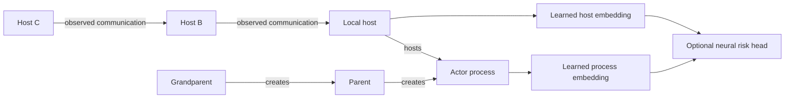

# Learned two-hop Host/Process provenance model

## Why context is needed

[A New Hope for DARPA OpTC, PDF p. 7, §§4.1–4.3](../../../a_new_hope_for_darpa_optc/A%20New%20Hope%20for%20DARPA%20OpTC.pdf)
labels malicious process activity and propagates labels to child processes. It
also discusses ambiguity in normal-looking session descendants and executions
that merely print help. This supports the teacher's ancestry hypothesis; it does
not establish that every FP/FN is caused by inherited labeling.

[Analyzing the Usefulness…, PDF p. 4, §3.3.3](../../../a_new_hope_for_darpa_optc/Analyzing%20the%20Usefulness%20of%20the%20DARPA%20OpTC%20Dataset%20in%20Cyber%20Threat%20Detection%20Research.pdf)
describes process fields and volatile host-specific PIDs. The index therefore
joins corrected UUIDs within the **event hostname**, never PID alone or filename
host. PROCESS/CREATE image/command fields describe the child; parent_image_path
refers to its actor/parent. The event being scored still belongs to actorID.

## Research choice

[FLASH, IEEE S&P 2024](https://ieeexplore.ieee.org/document/10646725/) uses semantic
encoding, a GraphSAGE-inspired contextual encoder, constrained traversal and
embedding reuse. It subsequently uses a lightweight classifier, choosing XGBoost
in its experiments. Our task is the learned graph component, not another tree
classifier. The implementation borrows bounded neighborhood message passing but
uses finite local node attributes rather than Word2Vec and an optional neural
risk head rather than XGBoost. It is **FLASH-inspired, not a FLASH reproduction**.

The local threaTrace paper likewise supports learned node-level provenance
representations. TAPAS motivates a process backbone but its recurrent/task
segmentation machinery is unnecessary for this small baseline. TraceCluster
still requires learned subgraph attention; ORTHRUS emphasizes attribution quality.
These ideas are not limited to OpTC papers. No published accuracy or resource claim
is transferred to this implementation.

## Explicit graph ontology

Process nodes use `(hostname, UUID)` keys. Host nodes use normalized event hostnames.
Host→Host edges require eCAR FLOW with explicit direction and a uniquely resolved
prior host-IP binding. Unresolved or conflicting IP mappings remain unknown; a
communication is not automatically lateral movement. Bro/eCAR-Bro are not ingested.
No cross-host process-creation edge is guessed from a network session.

The graph extractor returns an explicit node matrix, typed edge list, actor and
host root indices, and source/line evidence. It does not flatten parent/grandparent
features into input columns for RF/XGB/LGBM. Raw IDs are only for lookup and audit.
Host attributes summarize its own previously observed local process facts; they
contain no hostname/IP identity or malicious-label rate.

## Learned model

Each of the two layers computes a learned self projection plus a separate learned
projection of the mean incoming neighbor representation for each relation, followed
by ReLU. Relation types are `creates`, `communicates`, `communicates_reverse`, and
`hosts`. Reverse communication edges are message-passing conveniences; original
flow direction remains distinguishable in the evidence.

With two layers, a grandparent can influence the actor through two CREATE edges.
The local Host root separately aggregates a two-hop host neighborhood. Concatenating
its embedding with the actor embedding supplies both ontologies to a small neural
risk head. Widths 40 input → 32 hidden → 16 embedding produce 9,041 parameters.
Node order does not affect the score. No node-ID embedding or tree estimator exists
in the model. NumPy implements forward/backward passes and Adam; finite differences
and a two-hop-only synthetic learning problem test the actual learned behavior.

Limits are 64 nodes, eight host peers per direction per expansion, two process and
two host hops, 2,048 cached ego graphs and 4,096 cached node-attribute sets. Dense
adjacency is restricted to each small ego graph, never the full corpus. Weight size
alone is not total memory: cached graphs, SQLite pages, optimizer state and sampled
row identities add overhead. Full-corpus scalability has not been measured.

## Temporal and label boundaries

Graph evidence must precede `floor(event_time / 1 second) * 1 second`. Same-time
and future events are excluded even though the offline index contains later data.
The rule adds up to one second of conservative latency. Grandparent creation
cannot postdate its child's creation. Multiple prior parents and cycles are
explicit unresolved states. IP reassignment remains ambiguous without stronger
inventory evidence. Missing actor/time returns a marked minimal graph rather than
silently removing that event from evaluation.

Ground-truth labels are read only at the neural loss/output-evaluation boundary.
There is no `parent_is_malicious` attribute, label propagation, or TEST-derived
feature fitting. The index uses unlabelled past events from all partitions, which
matches a transductive streaming-context interpretation, not strict entity isolation.
A benign-looking injected ancestor can remain indistinguishable; two-hop context
cannot guarantee recovery of all label-inherited positives or the true attack root.

## Split and evaluation

Reuse exact seed02 75/10/15 candidate masks for the first graph experiment. Audit
host and `(hostname, UUID)` overlap using `ontology_audit.json`; graph nodes may
have events in several partitions. The existing contextual cohort used attack-
window knowledge and must not be presented as a deployment-neutral sample.
Changing representation and split simultaneously would obscure the comparison.

A later process-tree-grouped split should keep verified trees whole within hosts,
accept approximate ratios and report giant/unresolved groups. Host-held-out or
campaign/time-held-out evaluation answers further generalization questions. Those
alternative splitters are planned, not implemented.

Fit graph weights on TRAIN only; select thresholds on validation; keep test out
of training decisions. Report precision/recall/F1/FPR, confusion counts and average
precision, sampled/full scope, node/edge coverage, missing context, and newly
introduced FP/FN as well as corrected errors. The default capped training runner
is an initial graph experiment, not a claim of matched full-baseline training budgets.

At inference export process/host embeddings, risk and evidence edges. CREATE-edge
ablation measures dependence of the model's score on an ancestry path. It does
not prove that the parent/grandparent is malicious. If a later ensemble uses graph
risk scores as a feature, generate out-of-fold TRAIN scores; do not fit downstream
models on optimistic in-sample graph predictions.
