# Lựa chọn framework cho testbed ML/DL — 2026-10-29

Trạng thái: đề xuất thiết kế, chưa cài dịch vụ, chưa sửa Terraform, chưa bật VM.
Phạm vi: thu thập → chuẩn hóa → inference → tương quan điểm → SOC → phản ứng có phê duyệt.
Không thiết kế incremental learning, fine-tuning hay replay buffer cho huấn luyện.
“Central VM” trong sơ đồ được triển khai thành nhóm service trên máy vật lý hiện tại.

## Quyết định đề xuất

| Khối | Lựa chọn |
|---|---|
| Sensor Windows | Sysmon + Windows Security Audit + PowerShell Operational; TaskScheduler/System khi cần |
| Sensor Ubuntu | auditd với rule có chọn lọc + journald; auparse ghép các record của một audit event |
| Collector/forwarder cả hai OS | Fluent Bit: winevtlog trên Windows, tail/systemd trên Linux; checkpoint và filesystem buffer |
| Endpoint processing + LightGBM | Một service Python dùng Pydantic, SciPy sparse, LightGBM native; adapter theo OS; SQLite WAL cho inbox/outbox và trạng thái bounded |
| Quản lý service endpoint | systemd trên Ubuntu; WinSW stable trên Windows; không cần Docker Desktop |
| Central receive API | FastAPI/Uvicorn, HTTPS qua Caddy; xác thực từng endpoint |
| Hàng đợi trung tâm | NATS JetStream một node, file storage, durable pull consumers, explicit ACK |
| Normalization/correlation | Python + Pydantic; chuẩn hóa host event, actor/parent context, thứ tự theo host |
| BiLSTM | Worker PyTorch CPU riêng, model.eval()/inference_mode(), batch nhỏ; đóng gói cùng preprocess spec |
| ML result relay + fusion | Module Python trong worker trung tâm; nối theo event/chunk IDs, schema/version và source availability |
| Storage | Raw JSONL nén + Parquet trên filesystem; PostgreSQL riêng cho detection, evidence index, SOC decisions, action audit; DuckDB cho truy vấn Parquet theo yêu cầu |
| SOC UI | FastAPI + Jinja2/HTMX; xem evidence và phê duyệt thao tác qua API |
| Infra response | openstacksdk trong service riêng có quyền hạn giới hạn; Terraform giữ vai trò provisioning |
| Packaging | Docker Compose project riêng trên host; Ansible qua SSH/WinRM để cài endpoint |

Đây là các khối logic, không phải yêu cầu mỗi ô có một container. Bản đầu có thể gộp
normalization, ML relay, fusion và storage writer vào một worker. Tách PyTorch để
lỗi/tải inference không chặn ingest. Không dùng chung RabbitMQ/MariaDB của Kolla.
Chưa cần Kafka, Kubernetes, Spark, ELK/OpenSearch, Wazuh full stack, MLflow server
hay graph database cho ba endpoint. Đây là lựa chọn giảm số thành phần vận hành,
không phải khẳng định các hệ thống đó không thể chạy trên máy này.

## Đầu vào model hiện có và log cần thu

Đã đọc `ML/MENU.md`, tokenizer/context tracker và trực tiếp cả hai notebook DL mới.
README/config/S4 cũ chỉ dùng để xác định sự khác biệt với pipeline trước.
Không suy luận feature từ riêng tên LightGBM/BiLSTM.

**LightGBM:** tokenizer hiện nhận action, object, principal và các property được
allowlist. Nó loại FLOW và các field mạng khỏi feature Host ML. Binary sparse
vector phải dùng đúng vocabulary và thứ tự cột đi kèm checkpoint. Mã hiện có
actor/parent context và typed incoming PROCESS OPEN / THREAD REMOTE_CREATE;
phải đối chiếu đúng bundle model định triển khai, không tự thêm context vào model
cũ. UUID/PID là khóa tương quan, không phải feature số thứ tự.

| Dữ liệu semantic | Windows | Ubuntu và giới hạn |
|---|---|---|
| Process image, command line, parent | Sysmon 1; Security 4688 khi bật command-line auditing | audit SYSCALL+EXECVE+PROCTITLE+CWD/PATH; exe, argv, pid, ppid; exec không đồng nghĩa tạo process, cần theo dõi fork/clone/exit nếu model cần lifecycle |
| Actor/parent identity | ProcessGuid/ParentProcessGuid, kết hợp host/boot | host+boot+PID+start time hoặc generation từ lifecycle; khi không quan sát được thì đánh dấu unknown, không nối PID trần |
| File path, create/delete/rename/access | Sysmon 11/23/26; Security 4663 cần audit policy và SACL; không phải mọi read/write đều có trong Sysmon | audit open/openat, rename/unlink và rule đường dẫn chọn lọc; ghép nhiều PATH record, giữ result/success; audit mọi syscall sẽ rất tốn tải |
| Module/image load | Sysmon 7, bật và lọc có chủ đích | audit init_module/finit_module/delete_module cho kernel module; không tương đương shared-library/dlopen. Muốn user-space load cần sensor bổ sung và kiểm chứng |
| Persistence | Sysmon 12–14 registry; Security 4698/4702 task, 4697 hoặc System 7045 service | audit thay đổi cron/systemd unit/authorized_keys và nhật ký dịch vụ; không giả lập registry Windows |
| Session/principal | Security 4624/4634/4672 và process user/SID | audit USER_AUTH/USER_LOGIN/CRED*, uid/euid/auid/ses + SSH/sudo journal; root không tự động tương đương token Administrator đã train |
| Shell payload | PowerShell 4103/4104, tùy policy; 4104 không cùng ngữ nghĩa payload của mọi eCAR SHELL | exec argv + audit/journal; bash built-in và toàn bộ script body không mặc nhiên có log. Không dùng shell history làm telemetry đầy đủ |
| Incoming process/thread | Sysmon 10 ProcessAccess và 8 CreateRemoteThread là nguồn ứng viên | ptrace/process_vm_writev là loại sự kiện Linux riêng; không ép thành Windows RemoteThread |
| Process ↔ socket (tùy chọn evidence, ngoài feature đích) | Sysmon 3: process, IP/port, protocol, direction | audit connect/accept và SOCKADDR với rule phù hợp; còn thiếu case UDP/lifecycle, cân nhắc sensor eBPF sau đo coverage |

Các ánh xạ trên là ứng viên adapter, không phải khẳng định tương đương eCAR 1:1.
Đặc biệt giữ rõ chủ thể và đối tượng: người tạo process khác process vừa được tạo;
Sysmon ProcessAccess phải giữ SourceProcessGuid và TargetProcessGuid đúng chiều.
Thiếu sự kiện OPEN/REMOTE_CREATE không được diễn giải là “không xảy ra”.

**Kiểm tra lại notebook mới (2026-10-29):** đã đọc trực tiếp cell chọn feature
và embedded `PackedNetworkDataset` trong cả `06d_BiLSTM_Kaggle_v2_final.ipynb`
và `07d_Mixed_Type_Kaggle_v2_final.ipynb`, không chỉ dựa vào README/config cũ.

```python
KEEP_CAT = ['app_family', 'proto', 'resp_port_class', 'image_dir_class']
spec['active_numerical_features'] = []
# feature_subset.json: drop_numeric=True, zero_binary=True
```

Loader thực sự slice x_cat, tạo numeric/missing arrays 0 cột, đặt binary thành
hằng 0 và giữ delta_t_log1p. Đã bỏ service, conn_state, principal_class và bảy
numeric Bro. Tuy nhiên proto và resp_port_class vẫn mang thông tin giao thức/port;
“không field chỉ có ở Zeek” chưa đồng nghĩa “không dùng L3/L4”. Notebook vẫn đọc
shards/sample manifest cũ; thay feature subset chưa chứng minh đã đổi đơn vị mẫu
flow thành mọi host event. README DL và config/checkpoint đã xuất trước đó còn
mô tả pipeline cũ, không dùng chúng làm hợp đồng cho model mới.

**Thiết kế đích theo yêu cầu người dùng:** cả LightGBM và BiLSTM dùng host
telemetry, không dùng L3/L4. Loại Zeek, packet capture, OVS mirror, conn.log và
process–flow correlator khỏi stack bắt buộc. IP/port phục vụ truyền log và quản trị
hạ tầng không phải feature model. Không sửa notebook/checkpoint trong task này.

| Field DL | Hiện trạng notebook | Hướng thu cho thiết kế đích |
|---|---|---|
| app_family | Giữ | Process image/executable basename từ Sysmon 1 hoặc audit exec, theo taxonomy của model |
| image_dir_class | Giữ | Dẫn xuất từ process image path; adapter Linux riêng, không áp taxonomy Windows một cách máy móc |
| delta_t_log1p | Giữ | Tính từ timestamp của đúng loại event được định nghĩa trong model contract; không tự đổi flow timestamp thành process-create timestamp |
| proto, resp_port_class | Vẫn giữ | Ngoài phạm vi feature đích; model bundle dùng để deploy phải giải quyết điểm lệch này |
| Numeric Bro, service, conn_state | Bỏ | Không thu cho inference |
| has_missed_bytes | Hằng 0 | Không cần sensor mạng; đây là placeholder tensor, không phải quan sát thực |
| principal_class | Bỏ khỏi DL | Có thể vẫn cần cho LightGBM/evidence; không tự thêm lại vào DL |

Process, file, registry, command line, user/session và parent context vẫn cần thu
cho ML/evidence; không mặc nhiên cho rằng tất cả đều là feature DL mới. Cần chốt
model contract về loại event, thứ tự, cửa sổ, chunk, padding và nguồn timestamp.
Code S4 cũ là 900 giây/512 flow, không tự áp nguyên quy tắc đó cho mọi host event.
Nếu bundle chưa đáp ứng schema không-L3/L4, vẫn chạy collection + ML và đánh dấu
DL unsupported; không điền 0/UNK vào hai cột mạng để giả vờ checkpoint tương thích.

Sơ đồ Monitoring_Logging_Architecture phù hợp với nguồn host telemetry đích.
Bỏ GraphSAGE service khỏi milestone LightGBM/BiLSTM; central dùng ML Result Relay
như Architecture.png. Process socket monitoring không bắt buộc cho hai model;
nếu sau này giữ cho evidence thì là nguồn tùy chọn, không đưa field L3/L4 vào feature.

## Một đường xử lý có thể triển khai

```mermaid
flowchart LR
    W[Windows: Sysmon + Security + PowerShell] --> F[Fluent Bit collector]
    L[Ubuntu: auditd + journald] --> F
    F --> E[Local Python agent: durable inbox + OS adapter + context + LightGBM]
    E --> O[Durable outbox: raw refs + normalized events + ML scores]
    O --> T[Fluent Bit forwarder: HTTPS]
    T --> A[Central FastAPI receiver]
    A --> Q[NATS JetStream]
    Q --> C[Host normalization + process context + sequence builder]
    C --> D[PyTorch BiLSTM worker]
    C --> M[ML result relay]
    D --> U[Fusion: event/chunk evidence + availability]
    M --> U
    Q --> S[Raw archive + Parquet]
    U --> P[PostgreSQL]
    P --> UI[SOC UI]
    UI --> R[Approved response → openstacksdk]
```



Local agent có thể nhận HTTP loopback từ Fluent Bit; ACK sau khi inbox đã ghi bền.
ML chạy từ inbox, tạo outbox có ID ổn định; xử lý crash/retry theo transaction.
Forwarder tail các segment outbox JSONL đã publish và có offset DB. Tách tag/input
collector và forwarder để tránh tự đọc lại đầu ra thành vòng lặp. Raw archive là
artifact riêng; buffer nội bộ Fluent Bit không thay thế raw archive để nghiên cứu.

Receiver chỉ trả thành công sau JetStream publish ACK; NATS lỗi/đầy thì trả lỗi
retryable. Batch có retry một phần phải dedup theo event_id, giới hạn kích thước
message/batch. Consumer ACK sau commit side effect. Đây là at-least-once với
idempotency, không tuyên bố exactly-once. Giới hạn retention/bytes rõ ràng;
consumer lag, disk-full và drop phải thành cảnh báo. Không xóa raw chưa archive
chỉ vì lịch retention hết hạn mà không ghi nhận mất dữ liệu.

Cả ba endpoint gửi luồng sự kiện đã chọn bằng sensor policy, gồm benign, cùng
process lifecycle/parent context và ML scores. Không chỉ gửi event LightGBM
đánh malicious: như vậy DL mất context và không thể tìm ML false negative.
Batch scheduled dành cho archive/backfill; luồng inference nên flush ngắn khoảng
1–5 giây. Đây là transport buffer, không phải replay buffer cho huấn luyện.

Fusion nối score theo host/process/event/chunk và khoảng thời gian. Giữ riêng
per-event ML và per-chunk DL; không chép score chunk thành xác suất của mọi event,
không trung bình hai xác suất khi chưa có calibration/policy được kiểm chứng.
Bản đầu hiển thị cả hai score, source masks và evidence với policy có version;
chưa gọi đó là learned context-aware fusion. Nhánh thiếu/unsupported hiển thị rõ.

Response chỉ chạy sau SOC approval. Một service dùng openstacksdk đổi cấu hình
port/nhóm cách ly theo policy có audit và rollback. Gắn thêm một security group
“deny” không chặn rule allow của nhóm khác; phải kiểm tra toàn bộ group đang gắn,
stateful connections và đường quản trị. Không trao admin-openrc cho receiver hay
service chạy trong endhost. Không triển khai thay đổi mạng trong task thiết kế này.

## Khác OS và hai dataset mới

Dùng chung được transport, envelope schema, agent core, LightGBM runtime, API,
queue, storage và dashboard. Sensor, adapter, semantic taxonomy, service wrapper
và bundle model đủ điều kiện inference phải theo OS/nguồn.

- ATLASv2 README tại workspace mô tả hai Windows 7 32-bit VMs; có Security Audit,
  Sysmon, Firefox, DNS từ Wireshark và Carbon Black. Không phải nguồn Linux.
  Không giả định Carbon Black fields có sẵn từ Sysmon, hoặc Firefox log cũ được
  browser mới sinh tương tự. Chọn feature từ nguồn có thể thu trên testbed hoặc
  đánh dấu nguồn EDR bổ sung phải được cung cấp.
- THEIA CSV cục bộ có event(src,dst,operation,event_uuid,timestamp_rec), process
  (path,cmd), file(path), netflow(src/dst address/port). Đây là kiểm tra header và
  vài dòng, chưa audit toàn corpus hay raw CDM. Các bảng này không chứng minh có
  tương thích với schema/đơn vị mẫu của BiLSTM mới; cần đối chiếu adapter host-event.
- Tokenizer Windows hiện có quy tắc path/principal/command family riêng; không
  đưa /usr/bin/bash qua taxonomy Windows rồi cho rằng model hỗ trợ Linux.
- Hợp đồng model mới phải nói rõ DL vẫn là flow sequence hay chuyển sang host
  event sequence. Hạ tầng mới chỉ chuẩn bị host telemetry; không ép THEIA event
  vào đơn vị mẫu cũ hoặc tự thêm/bớt cột của checkpoint có shape cố định.

Sysmon for Linux có tồn tại và giúp gần format Windows, nhưng không phải bảo đảm
coverage ngang Windows/eCAR/THEIA. Đề xuất auditd+journald làm baseline Linux;
đánh giá Sysmon Linux hoặc một sensor eBPF ở bước đo khoảng trống, không cài cả
nhiều sensor trùng lặp ngay. osquery phù hợp inventory, không lấy polling process
list làm nguồn duy nhất cho short-lived process hay ancestry.

Envelope nên có event_time, ingest_time, host_id (Nova UUID ổn định trong đời VM),
boot_id, os, source/provider, source_event_id, source_record_ref, event_id,
action, object_type, actor/target/parent process IDs, schema_version,
field_availability và raw hash/reference. Normalized fields giữ null/unknown
khác giá trị 0; native fields giữ trong extension namespace. UID/GID/SID khác
nhau vẫn giữ raw và semantic class có version. Timestamps dùng UTC và ghi đơn vị.
Parent context chỉ từ evidence có thời gian trước target, không lookup tương lai.

Gói giao diện cần chốt với người làm model: input_schema.json, preprocess/vocab,
model checksum, feature order, supported OS/sources, missing-value behavior,
event-selection + window/chunk policy, threshold policy, và vài fixture raw→normalized→vector→score.
Chưa cần quyết định cách fine-tune hay lựa chọn replay samples.

## Ngân sách tài nguyên: đo hiện trạng, chưa benchmark workload

Host: i5-11400H, 6 physical cores/12 threads, 31 GiB RAM. Snapshot `free -h` lúc
không có endhost VM: ~15 GiB used, ~15 GiB available, 187 MiB swap used. Không coi
12 threads là 12 physical cores. NVIDIA-SMI hiện lỗi driver: baseline CPU, chưa
kết luận máy không có GPU. Free disk lúc đọc: SSD data ~316 GiB, root ~324 GiB,
HDD ~248 GiB; đây là dung lượng chia sẻ, không tự cấp toàn bộ cho logging.

Flavor hiện tại: Windows 4 vCPU/8 GiB/80 GiB; mỗi Ubuntu 1 vCPU/2 GiB/12 GiB.
Tổng guest 12 GiB; với snapshot nền 15 GiB chỉ còn khoảng 4 GiB trước overhead,
central services và headroom. Vì thế chưa khẳng định cấu hình mặc định đủ tải.

Đề xuất pilot: Windows 6 GiB/4 vCPU, mỗi Ubuntu 1.5 GiB/1 vCPU (workload nhẹ),
central services mục tiêu tổng 2–2.5 GiB, giữ khoảng 3–4 GiB headroom. Đó là đề xuất
flavor khác, chưa áp dụng và chưa xác nhận Windows/app workload chạy tốt ở mức
này. Nếu cần giữ 8+2+2 GiB guest, phải đo/giảm workload nền hoặc tăng RAM; không
coi swap là giải pháp throughput. Không tự tắt Kolla services đang được dùng.

| Nhóm central | Budget RAM khởi điểm |
|---|---:|
| API/TLS + correlation/fusion/storage worker | 0.5–0.8 GiB |
| PyTorch BiLSTM CPU worker | 0.5–0.8 GiB |
| NATS JetStream | 0.15–0.25 GiB |
| PostgreSQL + UI | 0.4–0.6 GiB |

Tổng 1.55–2.45 GiB là mục tiêu sizing, không phải cam kết hay giới hạn an toàn
đã đo. Raw event rate, số process đang theo dõi, context cache và Python runtime quyết định RSS.
Config BiLSTM đã xuất cũ có 80,657 tham số; không dùng số này làm kích thước
model mới. Model file nhỏ cũng không đại diện toàn bộ RAM runtime. Endpoint agent+collector mục tiêu 150–400 MiB/VM, nằm trong RAM guest;
phải đo riêng audit/Sysmon overhead. LightGBM 1 inference thread mỗi endpoint;
PyTorch khởi đầu 1–2 threads, một worker; tránh mỗi process dùng toàn bộ CPU.

Dữ liệu nóng: đề xuất quota tổng ~20 GiB central (queue + raw/Parquet), 1 GiB
spool mỗi endpoint và retention ngắn theo thí nghiệm. Không triển khai PCAP capture trong phạm vi hiện tại. Ví dụ 300 event/s tổng, 1 KiB/event →
~24.7 GiB/ngày trước nén/index/replication: quota 20 GiB không đủ một ngày ở rate
đó. Retention phải tính theo EPS và kích thước thực, không chỉ ghi “7 ngày”.
Không ghi bất kỳ artifact vào DATASET; vị trí runtime sẽ là thư mục riêng khi
triển khai, có quota, còn dataset chỉ đọc.

## Điều kiện nghiệm thu trước khi chạy kịch bản nghiên cứu

1. Sinh fixture benign trên mỗi OS: create process/child, file create/rename/delete,
   login và persistence test; đối chiếu raw, actor/target và availability.
2. Kiểm tra ProcessGuid/PID lifetime, actor/target, parent-child, timestamp và
   late arrivals; không dùng bằng chứng tương lai để bổ sung context quá khứ.
3. Replay fixture qua đúng package model; cùng vector và score với offline runtime.
4. Ngắt kết nối central rồi reconnect; restart agent/receiver/worker; xác nhận
   retry không mất event trong capacity đã cấp và duplicate không nhân đôi score.
5. Đo idle rồi workload bình thường/burst: EPS, RSS, CPU, disk/day, sensor loss,
   queue age, inference latency, parent-context coverage, unknown-token/missing-field rate.
   Có thể dùng psutil, Fluent Bit metrics, NATS monitoring và auditctl -s;
   chưa cần một Prometheus/Grafana stack riêng cho pilot này.
6. Giữ ít nhất 3 GiB MemAvailable và không swap kéo dài dưới workload pilot;
   nếu không đạt thì điều chỉnh budget hoặc thêm RAM trước mở rộng test.

## Nguồn đã đối chiếu

Local: `ML/code/preprocess/ecar_tokenizer.py`, `process_context_tracker.py`,
hai notebook `DL/04_notebooks/06d_BiLSTM_Kaggle_v2_final.ipynb` và
`07d_Mixed_Type_Kaggle_v2_final.ipynb`; README/config DL cũ chỉ để đối chiếu,
`DL/01_code/s4_shards.py`, `v2_common.py`, các schema S1/S3/S4;
`DATASET/ATLASv2/atlasv2/README.md`; header CSV THEIA; hai hình trong docs.

- [Sysmon events và các giới hạn event theo loại](https://learn.microsoft.com/en-us/sysinternals/downloads/sysmon)
- [Linux audit và auparse](https://github.com/linux-audit/audit-userspace)
- [Sysmon Linux](https://github.com/microsoft/Sysmon-Linux)
- [Fluent Bit winevtlog và checkpoint](https://docs.fluentbit.io/manual/data-pipeline/inputs/windows-event-log-winevtlog)
- [Fluent Bit HTTP output](https://docs.fluentbit.io/manual/data-pipeline/outputs/http)
- [Fluent Bit buffering](https://docs.fluentbit.io/manual/administration/buffering-and-storage)
- [NATS JetStream ACK và redelivery](https://docs.nats.io/concepts/jetstream)
- [WinSW service wrapper](https://github.com/winsw/winsw)
